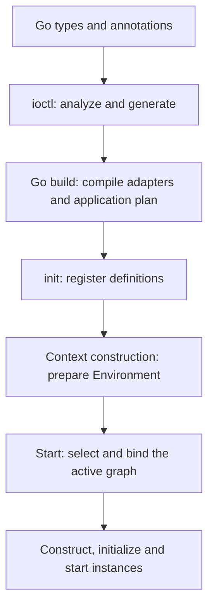

# ioc

[English](README.md) | [简体中文](README.zh_CN.md)

ioc generates dependency injection and lifecycle calls from annotations in Go
comments. The `ioctl` compiler analyzes Go types and generates construction,
private field injection and typed lookup code. Runtime wiring uses neither
reflection nor unsafe. Shared contracts are defined by
[gosr](https://github.com/longxi-go/gosr).



Use **Go 1.27.0 or later**. See [go.mod](go.mod) for pinned dependencies.
Build the CLI and run the complete examples from a checkout:

```sh
make build
make generate
go run ./examples/hello
go run ./examples/events
make check-generated
```

The hello program prints `hello from static IoC (request-1)`; the event program
prints `audit order-42`, then `notify order-42`. They demonstrate startup and
cleanup, private injected interfaces, caller-scoped providers and typed events.

```go
// +ioc:component
// +ioc:expose=contracts.Greeter
type Greeting struct {
    // +ioc:inject
    repository contracts.Repository
    // +ioc:inject
    request gs.Provider[*Request]
}
```

Imports and complete declarations are in [examples/hello](examples/hello).
Generated `init` functions register definitions and application plans without
creating instances. Each application context manages its own instances; call
`Start` and close the context on every exit path. Constructors, Init and Start
receive the current operation's Context. Stop and Destroy use the container's
cleanup Context. Do not retain callback contexts; Context fields cannot be injected.

The [quick start](docs/design/docs/quick-start.md) builds a complete application.
The [annotation reference](docs/design/docs/annotations.md) covers all markers,
including targets, defaults, repeatability and invalid combinations.

| Capability | Supported behavior |
| --- | --- |
| Selection | Explicit contracts, names/aliases, qualifiers, unique primary; Bean conditions and selection reports |
| Dependency access | T, Optional[T], []T, and Provider wrapping each; other operator nesting is rejected |
| Scope | Per-application singleton, explicit request/custom scopes, prototype leases |
| Lifecycle | Typed Init/Start/Stop/Destroy hooks, startup rollback and repeatable close |
| Initialization prerequisites | Named/alias depends-on targets finish Init before dependent construction, including lazy targets |
| Events | Typed synchronous listeners, instance ordering and lifecycle barriers |
| Configuration | Built-in Nemo Environment, Gosr interface injection, startup snapshot conditions and profiles |
| Composition | Library-owned adapters/metadata, application-owned entry plan and query dispatch |

Conditional registrations use explicit attributes:

```go
// +ioc:bean
// +ioc:conditional:on-missing-bean:type=ordercontracts.Repository
func DefaultRepository() ordercontracts.Repository {
    return &MemoryRepository{}
}
```

`on-missing-bean` keeps this definition only when no accepted definition
exposes `ordercontracts.Repository`; with no `type` or `name`, the declared
result type is inferred. `on-bean` requires each specified type or name to exist.
`on-property` evaluates structured property predicates on the startup
Environment snapshot. `profile` selects definitions using bootstrap-selected
profiles. Nemo prepares the default Environment before ordinary Bean creation.
Property sources, precedence, injection and refresh rules are described in the
[Environment guide](docs/design/docs/environment.md). These conditions select definitions before construction;
they do not test instance readiness. `app.ConditionReport()` inspects selection
without constructing Beans. The [condition reference](docs/design/docs/annotations.md)
defines marker effects, value matching, ordering and diagnostics.

Use `+ioc:depends-on=databaseMigration` when another Bean must finish construction
and Init before this factory runs, without injecting that Bean. Targets use
names or aliases; repeat the marker for multiple targets. See the runnable
[prerequisites example](examples/prerequisites) and
[scope and lifecycle rules](docs/design/docs/annotations.md#initialization-prerequisites).
`Primary` resolves single-valued dependency ambiguity; it does not arbitrate
condition cycles. `BeanDefinition.Order` sorts collections. Event ordering uses
listener instances and method-level `+ioc:order`; neither controls conditional registration.

Libraries run `ioctl generate --library` and publish their generated adapters,
`ioc/module.json` and importable index with module source. Applications compose
them without a handwritten runtime module list:

```sh
.tmp/bin/ioctl generate --entry ./cmd/server --roots ./app/...
.tmp/bin/ioctl check --entry ./cmd/server --roots ./app/...
.tmp/bin/ioctl explain --entry ./cmd/server --roots ./app/...
.tmp/bin/ioctl graph --entry ./cmd/server --roots ./app/...
```

These paths assume your application contains `cmd/server` and `app`.
`check`, `explain` and `graph` do not write source. Dependency caches, vendor and
foreign replacement modules remain read-only. Consumer source/type compatibility
is checked; compatible portable libraries may be reused across build environments.
Each library publication is checked against the consumer's build environment;
incompatible variants require regeneration. See
[architecture](docs/design/docs/architecture.md) for generation, concurrency,
ownership and compatibility rules, and [events](docs/design/docs/events.md) for
delivery and ordering.

Dynamic graph refresh, automatic configuration rebinding, Web integration,
early-exposed circular objects and arbitrary method interception are outside the
current container. Public APIs use the module version. Generated Bean registrations
use a separately checked schema/ABI. Upgrade the CLI and runtime together and
regenerate application/library output when that ABI changes. Version 0.x may introduce API
changes between minor versions; pin versions and review changes when upgrading.
The [roadmap](docs/roadmap.md) separates current capabilities from future work.

For contributors:

```sh
make setup
make format
make check-format
make check
make docs-build
```

`make check` includes module consistency, source/license/format gates, vet,
coverage tests, shuffled race tests, golangci-lint and generated-output freshness.
Formatting delegates to pinned [golayout](https://github.com/longxi-go/golayout);
generators use its `pkg/format` API. Install the linter version configured in
[Quality](.github/workflows/quality.yml). See the
[development guide](docs/design/docs/development.md) for prerequisites and checks.

The [bilingual manual](docs/design/README.md) supports local preview with
`make docs-serve`. The hosted manual is
[ioc Guide](https://longxi-go.github.io/ioc/).
