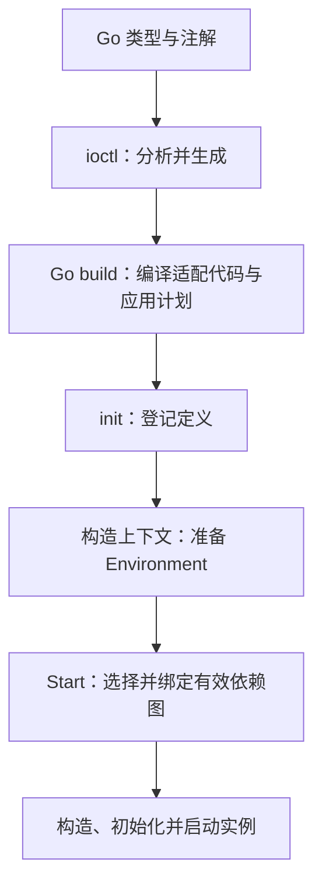

# ioc

[English](README.md) | [简体中文](README.zh_CN.md) | [在线手册](https://longxi-go.github.io/ioc/zh/)

ioc 根据 Go 注释中的注解生成依赖注入与生命周期调用代码。`ioctl` 编译器分析
Go 类型，生成构造、私有字段注入和类型化查询代码。运行时装配不依赖反射或 unsafe。
共享契约由 [gosr](https://github.com/longxi-go/gosr) 定义。



需要 **Go 1.27.0 或更高版本**。固定依赖见 [go.mod](go.mod)。在仓库中构建 CLI
并运行完整示例：

```sh
make build
make generate
go run ./examples/hello
go run ./examples/events
make check-generated
```

hello 程序输出 `hello from static IoC (request-1)`；事件程序依次输出
`audit order-42` 和 `notify order-42`。示例涵盖启动与清理、私有接口字段注入、
使用调用方作用域的 Provider 和类型化事件。

```go
// +ioc:component
// +ioc:expose=contracts.Greeter
type Greeting struct {
    // +ioc:inject
    repository contracts.Repository
    // +ioc:inject
    request gs.Provider[*Request]
}
```

导入和完整声明见 [examples/hello](examples/hello)。生成的 `init` 登记定义和
应用计划，不创建实例。每个应用上下文管理自己的实例；调用 `Start` 后，应在每条
退出路径上关闭上下文。构造函数、Init 和 Start 接收当前操作的 Context，Stop 和
Destroy 使用容器的清理 Context。不得保存回调 Context，也不能向字段注入 Context。

## 应用示例

| 示例 | 内容 | 使用指南 |
| --- | --- | --- |
| [Gin 集成](examples/gin/) | 注解路由注册、请求 Provider、作用域关闭 | [Gin 请求作用域](examples/gin/README.zh_CN.md) |
| [Coffee MVC](examples/coffee/) | Nemo 配置绑定、SQLite、HTML/REST、条件 Bean 和事件 | [Coffee 应用集成](examples/coffee/docs/integration.zh_CN.md) |

两者均为独立模块，在各自目录执行 `make run` 和 `make check`。完整示例列表见
[示例索引](docs/design/docs/examples/index.zh.md)。

## 容器能力

[快速开始](docs/design/docs/quick-start.zh.md) 展示完整应用的构建过程。
[注解参考](docs/design/docs/annotations.zh.md) 覆盖全部 Marker 的位置、
默认值、重复性和非法组合。

| 能力 | 已支持的行为 |
| --- | --- |
| 选择 | 显式契约、名称/别名、限定符、唯一主候选；Bean 条件与选择报告 |
| 依赖访问 | T、Optional[T]、[]T 及 Provider 包装这三种形态；拒绝其他操作符嵌套 |
| 作用域 | 每应用单例、显式请求/自定义作用域、原型 Lease |
| 生命周期 | 类型化 Init/Start/Stop/Destroy 方法、启动回滚和可重复关闭 |
| 初始化前置依赖 | depends-on 通过名称/别名指定目标，包括 lazy 目标；目标在依赖方构造前完成 Init |
| 事件 | 类型化同步监听器、实例排序和生命周期屏障 |
| 配置 | 内置 Nemo Environment、Gosr 接口注入、启动快照条件与 Profile |
| HTTP | Controller 与路由注解、类型化 Gin 桥接、独立适配模块中的请求作用域集成 |
| 组合 | 库发布适配代码和元数据，应用生成入口计划和查询分派 |

条件注册采用显式属性：

```go
// +ioc:bean
// +ioc:conditional:on-missing-bean:type=ordercontracts.Repository
func DefaultRepository() ordercontracts.Repository {
    return &MemoryRepository{}
}
```

若没有已接受定义暴露
`ordercontracts.Repository`，`on-missing-bean` 才保留该定义；省略 `type` 和 `name`
时使用声明结果类型。`on-bean` 要求指定的类型或名称分别存在。`on-property` 在启动 Environment 快照上判断结构化属性条件，`profile` 按启动时
选定的 Profile 筛选定义。默认 Environment 由 Nemo 在普通 Bean 构造前准备。
来源优先级、注入与刷新规则见 [Environment](docs/design/docs/environment.zh.md)。条件在构造实例前选择定义，不检查实例是否就绪。
`app.ConditionReport()` 可查询选择结果而不构造 Bean。Marker 的作用、值匹配、排序和
诊断规则见[条件参考](docs/design/docs/annotations.zh.md)。

另一个 Bean 必须在当前工厂执行前完成构造和 Init、但无需注入该对象时，使用
`+ioc:depends-on=databaseMigration`。目标通过名称或别名引用，多项目标重复声明。
完整代码见 [prerequisites 示例](examples/prerequisites)，约束见
[作用域与生命周期规则](docs/design/docs/annotations.zh.md#initialization-prerequisites)。
`Primary` 消除单值依赖歧义，不裁决条件环。`BeanDefinition.Order` 用于集合排序；
事件顺序由监听器实例和方法级 `+ioc:order` 决定，均不控制条件注册。

库执行 `ioctl generate --library`，将适配代码、`ioc/module.json` 和可导入索引
随模块源码发布。应用组合这些库，无需手工维护运行时模块列表：

```sh
.tmp/bin/ioctl generate --entry ./cmd/server --roots ./app/...
.tmp/bin/ioctl check --entry ./cmd/server --roots ./app/...
.tmp/bin/ioctl explain --entry ./cmd/server --roots ./app/...
.tmp/bin/ioctl graph --entry ./cmd/server --roots ./app/...
```

这些命令使用 `cmd/server` 作为入口，`app/...` 作为生成根。
`check`、`explain`、`graph` 不写源码。
依赖缓存、vendor 和外部 replace 模块保持只读。编译器检查消费方源码/类型兼容性，
语义兼容的可移植库可在不同构建环境中复用；不兼容变体需要重新生成。
生成、并发、所有权和兼容规则见[架构](docs/design/docs/architecture.zh.md)，
事件投递和排序见[事件](docs/design/docs/events.zh.md)。

动态图刷新、自动配置重绑定、提前暴露循环对象和任意方法拦截不属于
当前容器。公开 API 使用模块版本；生成装配描述使用独立且受检查的 schema/ABI。
升级时应配套使用 CLI 与运行时；ABI 变化时重新生成应用和库产物。0.x 版本可能在
次版本升级时调整 API；请固定版本并审阅升级变化。
[路线图](docs/roadmap.md) 区分当前能力和后续方向。

## HTTP 与 Gin

Controller 与 HTTP 路由通过注释注解声明，由独立模块中的 `ginctl` 生成类型化注册代码：

```go
// +ioc:controller:name=healthController
// +ioc:http:route=/api/v1/
type HealthController struct{}

// +ioc:http:get=/healthz
func (*HealthController) health(ctx *gin.Context) {
    ctx.Status(http.StatusOK)
}
```

该声明映射 `GET /api/v1/healthz`，需要导入 `net/http` 和 Gin。
Gin 适配器位于独立模块 `github.com/longxi-go/ioc/adaptors/gin`；
根模块不引入 Gin。参见 [HTTP 与 Gin 指南](docs/design/docs/http.zh.md)，
以及采用生成式路由的 [Gin](examples/gin/README.zh_CN.md) 和
[Coffee MVC](examples/coffee/docs/integration.zh_CN.md) 示例。

## 开发与验证

```sh
make setup
make format
make check-format
make check
make check-adapters
make docs-build
```

`make check` 包含模块一致性、源码/许可头/格式门禁、vet、覆盖率测试、随机顺序
race 测试、golangci-lint 和生成产物一致性检查。格式化委托给固定版本的
[golayout](https://github.com/longxi-go/golayout)，生成器使用其 `pkg/format` API。
请安装 [Quality](.github/workflows/quality.yml) 配置的 linter 版本。
前提条件与检查说明见[开发指南](docs/design/docs/development.zh.md)。

[双语手册](docs/design/README.md) 支持通过 `make docs-serve` 本地预览。
在线手册：[ioc 使用手册](https://longxi-go.github.io/ioc/zh/)。
