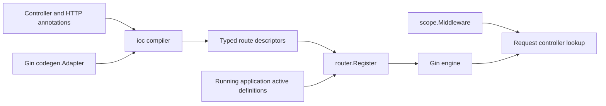

# ioc Gin adapter

Native Gin routing for statically generated ioc controllers. This independently
versioned module requires Go 1.27, Gin 1.12 and ioc v0.2.0. Root ioc remains
independent of Gin. [简体中文](README.zh_CN.md).



Install the generator and add the runtime dependency:

```sh
go install github.com/longxi-go/ioc/adaptors/gin/cmd/ginctl@v0.2.0
go get github.com/longxi-go/ioc/adaptors/gin/pkg/router@v0.2.0
ginctl generate --entry ./cmd/app --roots ./internal/...
ginctl check --entry ./cmd/app --roots ./internal/...
```

Run `go get` from the consumer module to declare the generated runtime dependency;
installing the command alone does not modify consumer dependencies.

`generate`, `check`, `explain` and `graph` share root `pkg/cli` parsing and flags:
`--dir`, `--entry`, `--library`, `--tags` and `--roots`. HTTP library metadata is
unsupported and `--library` with routes returns an error. Core `ioctl` rejects
HTTP endpoints unless an HTTP backend is explicitly composed.

```go
// +ioc:controller:name=health
// +ioc:http:route=/api/
type healthController struct{}

// +ioc:http:get=/healthz
func (*healthController) health(c *gin.Context) {
    c.Status(http.StatusNoContent)
}
```

Handlers must accept exactly `*gin.Context`, return nothing and be nonvariadic.
Private methods and standalone annotated functions work because generation occurs
inside the declaring package. Only annotated methods are exposed. Method paths
join the controller base at slash boundaries; trailing slashes remain significant.
Canonical `+ioc:http:route:method=GET,path=/healthz` equals the shortcut above.
Shortcuts cover GET, POST, PUT, PATCH, DELETE, HEAD and OPTIONS. Canonical routes
also accept native Gin uppercase alphabetic methods such as TRACE or PURGE.

The application entry package receives `IOCGinRoutes() []router.Route`; individual
packages expose `IOCGinPackageRoutes()`. These functions return declarations and
never create controllers. Start the IoC application, install any required scope
middleware with `scope.Middleware(scope.Options{Manager: application, OnError:
report})`, then call `router.Register(ctx, engine, application, IOCGinRoutes()...)`
before serving. Check both middleware configuration and registration errors.
`report` must have signature `func(error)`.

Registration filters controller routes by active definition ID, accepts singleton
and request lifetimes, and checks native wildcard/collision behavior against
existing routes. Incompatible active routes fail. Discard an engine after any
registration error because Gin registrations cannot be rolled back. Excluded
conditional/profile controllers do not contribute routes. Request controllers
require installed scope middleware; each request resolves the exact controller
name and concrete contract. Lookup/type failures attach a Gin error and abort 503.
A missing request scope therefore fails at request resolution.

The middleware opens one request scope and closes it during normal return or panic
unwinding. Opening failures report through `OnError` and abort 503. Cleanup uses
`context.WithoutCancel` with a timeout: zero chooses five seconds, negative values
are invalid. Manager and OnError are mandatory. Scope failures are reported only
through OnError; cleanup may happen after headers are committed. Applications own
middleware order, error presentation, server draining and IoC close.

Runtime packages `pkg/router` and `pkg/scope` have no dependency on the compiler.
For embedded tools, pass `codegen.Adapter{}` through root `codegen.Options.HTTP`
or `cli.Options.HTTP`. An optional declarations-only bootstrap enables production
startup code to call generated aggregators before first generation. These declarations
exist only in memory and retain strict type checks. The adapter emits source fragments and root ioc owns
formatting, overlay checks and atomic file persistence.

Run `make check` for formatting, source notices, module verification, vet, tests,
race detection and lint. Formatting uses the pinned golayout dependency. Tests
compile consumer modules and exercise HTTP responses through generated routes.

See the [HTTP guide](https://longxi-go.github.io/ioc/http/) and
[v0.2.0 release notes](docs/releases/v0.2.0.md).
