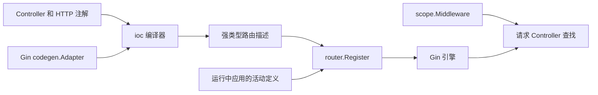

# ioc Gin 适配器

为静态生成的 ioc Controller 提供 Gin 原生路由。本模块独立版本化，要求
Go 1.27、Gin 1.12 和 ioc v0.2.0。根 ioc 模块不依赖 Gin。
[English](README.md)。



安装生成器并添加运行时依赖：

```sh
go install github.com/longxi-go/ioc/adaptors/gin/cmd/ginctl@v0.2.0
go get github.com/longxi-go/ioc/adaptors/gin/pkg/router@v0.2.0
ginctl generate --entry ./cmd/app --roots ./internal/...
ginctl check --entry ./cmd/app --roots ./internal/...
```

在消费者模块目录执行 `go get`，声明生成代码的运行时依赖；仅安装命令不会修改消费者依赖。

`generate`、`check`、`explain`、`graph` 复用根 `pkg/cli` 的解析与参数：
`--dir`、`--entry`、`--library`、`--tags`、`--roots`。当前不支持 HTTP 路由库元数据，
包含路由时使用 `--library` 会报错。核心 `ioctl` 未显式组合 HTTP 后端时拒绝 HTTP 端点。

```go
// +ioc:controller:name=health
// +ioc:http:route=/api/
type healthController struct{}

// +ioc:http:get=/healthz
func (*healthController) health(c *gin.Context) {
    c.Status(http.StatusNoContent)
}
```

处理器必须恰好接收 `*gin.Context`，没有返回值且不能使用可变参数。
生成代码位于声明包内，因此支持私有方法和带注解的独立函数，仅暴露带注解的方法。
方法路径与 Controller 基路径在斜杠边界连接，末尾斜杠有意义。
标准写法 `+ioc:http:route:method=GET,path=/healthz` 与上述快捷写法相同。
快捷写法支持 GET、POST、PUT、PATCH、DELETE、HEAD、OPTIONS。标准写法还支持
Gin 原生的大写字母方法名，如 TRACE、PURGE。

应用入口包生成 `IOCGinRoutes() []router.Route`，各包提供
`IOCGinPackageRoutes()`。这些函数仅返回描述，不创建 Controller。
启动 IoC 应用，使用 `scope.Middleware(scope.Options{Manager: application,
OnError: report})` 安装需要的作用域中间件，再在提供服务前调用
`router.Register(ctx, engine, application, IOCGinRoutes()...)`。
必须检查中间件配置和路由注册错误，`report` 签名为 `func(error)`。

注册根据活动定义 ID 过滤 Controller 路由，接受 singleton、request 生命周期，
并使用 Gin 原生路由树检查通配符和与现有路由的冲突。活动路由冲突会失败。
任何注册错误后都应丢弃该引擎，因为 Gin 注册无法回滚。
条件或 profile 排除的 Controller 不贡献路由。request Controller 必须安装作用域中间件；
每个请求按精确名称及具体类型契约查找 Controller。查找或类型失败会添加 Gin 错误并中止为 503。
缺少 request 作用域在请求查找时失败。

中间件为每个请求打开作用域，在正常返回和 panic 展开时关闭。
打开失败通过 `OnError` 报告并中止为 503。清理使用 `context.WithoutCancel`
及超时：零值选择五秒，负值无效。Manager、OnError 均必填。
作用域错误仅通过 OnError 报告；清理时响应头可能已经提交。
应用负责中间件顺序、错误呈现、HTTP 排空和 IoC 关闭。

运行时包 `pkg/router`、`pkg/scope` 不依赖编译器。嵌入工具通过根
`codegen.Options.HTTP` 或 `cli.Options.HTTP` 传入 `codegen.Adapter{}`。
可选的声明引导让生产启动代码在首次生成前即可引用生成的聚合函数；
这些声明仅存在于内存中，仍执行严格类型检查。适配器返回源码片段，
根 ioc 负责格式化、overlay 校验及原子写入。

执行 `make check` 检查格式、版权头、模块依赖、vet、测试、竞态和 lint。
格式化使用模块中固定的 golayout 依赖。测试编译消费者模块，并通过生成的路由验证
HTTP 响应。

参见 [HTTP 使用指南](https://longxi-go.github.io/ioc/zh/http/) 和
[v0.2.0 发布说明](docs/releases/v0.2.0.md)。
