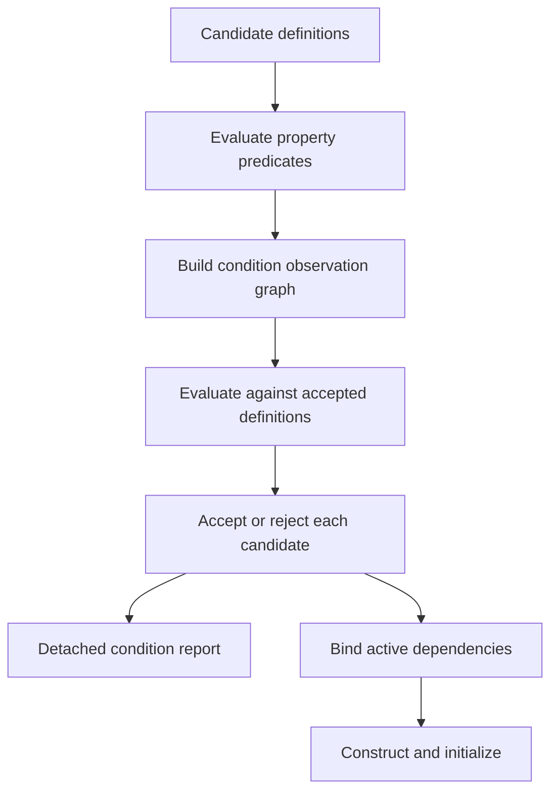
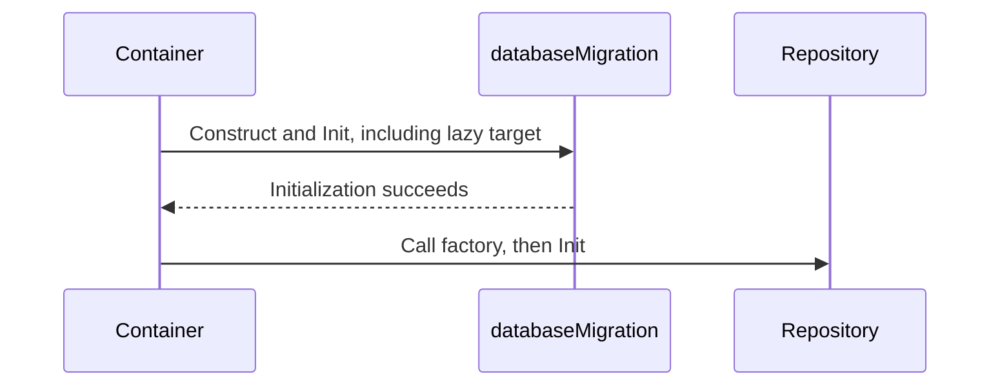

# Annotation reference

All annotations below are parsed with controller-tools marker syntax and
validated with Go AST/type information. Put each marker on its own `//` line in
the doc comment immediately above the declaration or field. Markers in package
comments, trailing comments or fields of unmanaged structs are rejected. Unknown
markers and unsupported targets also produce source diagnostics. Marker names
are case-sensitive.

In this reference **Bean declaration** means a `+ioc:bean` function or a
`+ioc:component` struct. A declaration supplement needs one of
those registration markers. A field supplement needs `+ioc:inject`. A
`+ioc:listen` method accepts only the `+ioc:order` supplement.

## Syntax, targets and defaults

The table lists every registered marker. “Repeat” means multiple marker lines on
one target; it does not permit duplicate values where uniqueness is required.
Names and identifiers cannot be blank. Quote values containing marker punctuation,
for example `+ioc:expose="map[string]int"`. Property conditions allow an explicit
empty `havingValue`, as specified below.

| Marker syntax | Target | Default when absent | Repeat | Meaning and constraints |
| --- | --- | --- | --- | --- |
| `+ioc:bean:name=readDB,aliases={reportsDB}` | Package-level function | No registration | No | Constructor returns `T` or `(T, error)`; not a method, variadic function or open generic. Bare marker is valid; name defaults to the function name. |
| `+ioc:component:name=repository,aliases={repo}` | Named non-generic struct | No registration | No | Generates `&T{}` and annotated field assignments; does not call a constructor. Bare marker is valid; name defaults to the type name. |
| `+ioc:listener` | Bean declaration | No subscription | No | Requires explicit bean/component registration and `OnEvent(context.Context, E) error`; subscribes the statically declared result type |
| `+ioc:listen` | Receiver method with a statically known managed concrete owner | No subscription | No | Requires `(context.Context, E) error`; free functions and orphan methods are errors |
| `+ioc:inject:name=readDB,qualifiers={sql}` | Named component field | Field is left untouched | No | Bare marker selects by field type; optional name/alias and qualifiers refine selection; private fields work, embedded and Context fields are rejected |
| `+ioc:param:parameter=read,name=readDB,qualifiers={sql,read}` | Bean constructor | Parameter type only | Yes, once per parameter | Existing named parameter; at least `name` or `qualifiers`; cannot target `_`, unknown parameters or Context |
| `+ioc:scope=request` | Bean declaration | `singleton` | No | Built-ins: `singleton`, `prototype`, `request`; custom nonblank IDs need `pkg/context.WithScope` at runtime |
| `+ioc:qualifier=sql` | Bean declaration | No qualifiers | Yes | Declares a candidate qualifier; duplicate qualifiers are errors; injection uses inject/param attributes |
| `+ioc:expose=contracts.Repository` | Bean declaration | Result type (`*T` for component) | Yes | Adds a contract without removing the result contract; result must be assignable to the type expression; duplicate contracts are errors |
| `+ioc:primary` | Bean declaration | `false` | No | Resolves single/optional ambiguity only when exactly one matching primary exists; collections keep all matches |
| `+ioc:lazy` | Bean declaration | Eager singleton | No | Defers singleton creation until lookup; does not change scope; incompatible with Start or lifecycle/event-wide listeners |
| `+ioc:conditional:on-property:prefix=storage,name={mode,driver},havingValue=memory,matchIfMissing=false` | Bean declaration | No property predicate | Yes | Names are required and combined with AND; optional prefix, exact expected scalar, and missing-key policy; see property rules below |
| `+ioc:conditional:on-bean:type=ordercontracts.Repository,name=repository` | Bean declaration | No existence predicate | Yes | Optional `type` and `name`; each specified requirement must exist among accepted definitions; with neither attribute, infer the declared result type |
| `+ioc:conditional:on-missing-bean:type=ordercontracts.Repository,name=repository` | Bean declaration | No absence predicate | Yes | Same attributes/default inference; every specified requirement must be absent |
| `+ioc:profile={dev,"!prod"}` | Bean declaration | No profile predicate | No | Validated Gosr profile predicates combined with OR; no expression syntax |
| `+ioc:order=100` | Bean declaration or listen method | Bean: `0`; method: owner event order | No | Integer; Bean order sorts injection collections; method order overrides only that method's numeric event order; no condition or construction priority |
| `+ioc:depends-on=databaseMigration` | Bean declaration | No additional prerequisite | Yes | Active Bean name or alias; target completes construction and Init before this factory runs; no type/ID lookup or implicit scope creation |

Flag markers take no value: `+ioc:primary=false` and `+ioc:listener:name=audit` are invalid.
Non-repeatable markers cannot be written twice, even with equal values. In the
structured `param` marker, `parameter` is required; `name` and `qualifiers` are
optional individually. Registration name/aliases and injection name/qualifiers are
optional. Blank names/identifiers, duplicate aliases/qualifiers and unknown
attributes are errors. `listener` accepts no attributes.

## Registration and contracts

```go
// +ioc:bean:name=readDB,aliases={reportsDB}
// +ioc:qualifier=sql
// +ioc:primary
func NewReadDB() (*sql.DB, error) {
    return sql.Open("postgres", "...")
}

// +ioc:component
// +ioc:expose=contracts.Repository
type Repository struct {
    // +ioc:inject:name=reportsDB,qualifiers={sql}
    db *sql.DB
}
```

This fragment omits imports, driver registration and Repository's implementation
of `contracts.Repository`. Database resources need a wrapper with a Destroy hook
for managed cleanup; `sql.DB.Close` alone is not a recognized lifecycle hook.
Constructors may be private. Interface contracts must be exposed explicitly;
implementing an interface does not register it for lookup.

All exposed contracts and aliases resolve to the same Bean definition. Instance
reuse follows its scope: one singleton per application context, one instance per
request/custom scope, or a new prototype instance per resolution. See
[scope ownership](architecture.md#scope-ownership) for cleanup rules.

The stable definition ID is `package/import/path.Function` or
`package/import/path.Type`; changing `name` does not change that ID.

A successful factory must produce a usable value. Generated concrete pointer
results are checked for nil before interface conversion, including `(T, error)`
results. Interface-held typed nils cannot be universally detected without runtime
reflection; interface factories must uphold the nonnil implementation contract.
Zero scalar values such as `0` and `false`, and nil maps/slices, are valid Beans.
A nonnil value returned with an error transfers cleanup responsibility to the
container; a constructor that returns nil remains responsible for its partial
resources.

## Parameters, access and cardinality

```go
type ReadWriteRepository struct {
    read  *sql.DB
    write *sql.DB
}

// +ioc:bean
// +ioc:param:parameter=read,name=readDB,qualifiers={sql,read}
// +ioc:param:parameter=write,name=writeDB
func NewRepository(read, write *sql.DB) *ReadWriteRepository {
    return &ReadWriteRepository{
        read:  read,
        write: write,
    }
}
```

The fragment requires a `readDB` Bean with both `sql` and `read` qualifiers and a
`writeDB` Bean. The factory assigns the resolved parameters itself; factory
results do not receive a separate field-injection pass. See the
[injection model](architecture.md#injection-model).

Parameter names identify selector bindings only; they do not implicitly select a
Bean. Selectors combine the Go contract, name/alias and every qualifier. An
optional dependency tolerates absence, never ambiguity or a failed constructor.

| Go dependency type | Access | Cardinality |
| --- | --- | --- |
| `T` or `*T` | Direct | Exactly one, or a unique primary among matches |
| `gs.Optional[T]` | Direct | Zero or one; `Present` distinguishes absence |
| `[]T` | Direct | All matches, sorted by BeanDefinition.Order then ID |
| `gs.Provider[T]` | Deferred | Same selection, resolved using each caller's Context |
| `gs.Provider[gs.Optional[T]]` | Deferred | Optional result per call |
| `gs.Provider[[]T]` | Deferred | Collection per call |

`gs` is `github.com/longxi-go/gosr/pkg/ioc`. Provider must be outermost;
only the six forms in the table are accepted. `Optional[[]T]`, `[]Optional[T]`,
`Optional[Optional[T]]`, `[][]T`, inner or repeated Provider, and Provider wrapping
any of those combinations fail during generation at the injection point. Type
aliases follow the same rules.
`context.Context` constructor parameters are operation inputs, not Bean dependencies.
Do not store them; pass the caller Context to a Provider when needed. Context
parameters cannot have selectors, and Context field injection is rejected.
A pointer dependency is required unless wrapped in Optional. In an injection
point, `[]T` requests all T Beans. `app.GetBeans[T](ctx)` makes the same collection
request, whereas `app.GetBean[[]T](ctx)` requests a single Bean whose own type is
`[]T`. Maps, fixed arrays and named slice types are ordinary Bean types, not
collection injection syntax; a type alias to `[]T` retains collection semantics.

Provider targets are selected and checked for absence/ambiguity at Start, even
when the provider is never called. Only instance resolution is deferred. For
cycle detection and invocation timing, see
[dependency cycles](architecture.md#dependency-cycles).

## Conditional defaults and ordering {#conditional-defaults-and-ordering}



```go
// +ioc:bean
// +ioc:conditional:on-missing-bean:type=ordercontracts.Repository
// +ioc:conditional:on-property:prefix=storage,name=mode,havingValue=memory
func NewDefaultRepository() ordercontracts.Repository {
    return &MemoryRepository{}
}
```

Supply properties when creating the application context (`app` denotes
`github.com/longxi-go/ioc/pkg/context`):

```go
application, err := app.NewApplicationContext(ctx,
    app.WithProperties(map[string]string{
        "storage.mode": "memory",
    }),
)
if err != nil {
    return err
}
```

The context copies this map. If `storage.mode` is missing or has another value, this
definition is excluded. If the property matches but a regular `Repository` Bean
has already been accepted, the `on-missing-bean` condition excludes the default.
Both conditions must pass for the factory to participate.

`type` and `name` are optional scalar attributes on both conditional markers.
Their combinations have these meanings:

| Attributes | on-bean | on-missing-bean |
| --- | --- | --- |
| `type=T` | An accepted definition exposes T | No accepted definition exposes T |
| `name=n` | An accepted definition has name or alias n | No accepted definition has name or alias n |
| `type=T,name=n` | T exists **and** n exists; different definitions may satisfy them | T is absent **and** n is absent |
| Neither | Use the factory's declared result type, or `*T` for a component/listener | Same inferred type |

A name-only condition does not add an inferred type requirement. Repeated marker
lines and other predicates on the same declaration combine with AND. Existence
checks do not require a unique primary, instantiate candidates or establish
successful activation. They inspect exposed contracts, not every assignable type.

Write type expressions using the imports of the declaration's source file, such
as `type=ordercontracts.Repository`. Distinct import aliases disambiguate packages
that have the same package name. The compiler resolves the Go type and stores its
full import-path identity; it never searches globally by package name. A comment
does not count as a Go import use: the import must also be used by Go declarations,
as in the factory's result above. Unknown types, value expressions, uninstantiated
generic types and blank attributes are errors. They never become Bean names.
Quote type expressions containing marker punctuation, for example
`type="map[string]int"`.

### Property and profile conditions {#property-and-profile-conditions}

| Attribute | Meaning | Default |
| --- | --- | --- |
| `prefix` | Prefix joined to each name with one dot; a trailing dot is optional | No prefix |
| `name` | One property name or a nonempty list; all keys must match | Required |
| `havingValue` | Exact scalar text to compare, including an explicitly empty string | Present scalar other than case-insensitive `false` |
| `matchIfMissing` | Result for an absent key | `false` |

Boolean and numeric properties use Gosr scalar text. Explicit comparisons are
case-sensitive and preserve whitespace. Unlike Spring's case-insensitive comparison and empty-value sentinel,
`havingValue=""` matches an actual empty scalar; it does not mean “attribute omitted”.
Nulls, lists and objects are invalid condition values and fail startup.
Resolution and lookup errors are errors, not missing properties.

Only `prefix`, `name` and `havingValue` may contain `${...}`. Each operand resolves once per evaluation
against the startup Environment snapshot. Nested keys such as
`${storage.${region}.mode}` and defaults follow Gosr/Nemo syntax. Lookup values
are already resolved and are never expanded again. Bean identities, aliases,
qualifiers, scopes, prerequisites and Bean-condition names remain static and
reject placeholders during generation. Generation performs no configuration I/O.

`+ioc:profile={dev,"!prod"}` matches when at least one Gosr profile predicate
matches. All entries are validated, even after an earlier match. Profiles are
chosen when the Environment is prepared. `!prod` means prod is not active.
Parentheses, `&`, `|` and placeholder expressions are unsupported. Separate
conditions on one declaration combine with AND.

`WithProperties` copies its map into the highest-priority Environment source.
All predicates read the same pinned startup snapshot. See
[Environment](environment.md) for defaults, custom implementations and refresh.

Property-ineligible definitions are removed
before observation edges are built. Each possible matching definition precedes
its observer; the observer does not observe itself. Predicates then inspect the
definitions accepted so far, without creating instances or computing a fixed
point. An ordinary matching implementation is evaluated before its absence
fallback. Positive, negative or mixed observation cycles return DependencyCycle
with a condition path. Two mutually missing defaults remain a condition conflict
even if one is Primary. Source order, module location, `order` and `depends-on`
cannot resolve that conflict. The selected graph is then checked for required
targets, ambiguity, ownership and creation cycles.

Multiple active implementations are permitted. A unique primary resolves a
single-valued lookup among matching active definitions; it does not exclude other
definitions. Collections retain all matches. `BeanDefinition.Order` sorts those
collections. It is independent of
`ordered.Ordered.Order()` and method `+ioc:order`, which sort event callbacks;
see [event ordering](events.md#event-ordering).

### Condition reports {#condition-reports}

```go
report, err := app.ConditionReport()
if err != nil {
    return err
}
for _, candidate := range report.Candidates {
    fmt.Println(candidate.Bean, candidate.Outcome)
}
```

`ConditionReport` uses the same selection evaluator as Start without constructing
Beans. It is safe before Start, after a failed Start and during lifecycle calls.
The application snapshot fixes its inputs. Each candidate includes its source,
`accepted`, `rejected` or `not-evaluated` outcome, observed predicates and matching
accepted Bean IDs. Property observations retain the declared prefix/name expression
and boolean result, without exposing dynamically expanded keys, expected values
or actual values. Returned slices are detached from the
application.

A property-rejected candidate has only property observations. If ordering fails,
the method returns the ordering error and a partial report; eligible candidates
remain `not-evaluated`. Acceptance describes condition selection only and does
not establish valid dependency binding, successful construction or readiness.

## Initialization prerequisites {#initialization-prerequisites}



```go
// +ioc:bean
// +ioc:depends-on=databaseMigration
// +ioc:depends-on=cachePreparation
func NewRepository() *Repository {
    return &Repository{}
}
```

Use constructor or field injection when the object needs another Bean's value.
`depends-on` declares an initialization prerequisite without injecting it. Each
line names one primary Bean name or alias; repeat lines for multiple targets.
It accepts no type expression, definition ID, qualifier or Primary preference.
Independent prerequisites have no declared relative order.

The active target must exist after condition selection. An excluded target is
MissingBean; an excluded dependent creates no requirement. Duplicate names,
aliases resolving to the same target and self-references are errors. Direct
injection and prerequisite edges share creation-cycle validation.

Lazy targets initialize when their dependent is created. A lazy dependent alone
does not activate prerequisites at startup. Construction or Init failure prevents
the dependent factory from running. The guarantee does not wait for target Start,
background tasks or business readiness. All eager initialization still precedes
the application Start phase; Start hooks respect prerequisite edges.

| Dependent scope | Prerequisite scope | Supported |
| --- | --- | --- |
| singleton | singleton | Yes |
| request/custom S | singleton or the same S | Yes; same S uses the dependent's exact scope owner |
| prototype | singleton | Yes; existing caller/lease ownership is retained |
| Any | prototype | No |
| singleton | request/custom | No |
| request/custom S | different request/custom kind | No |
| prototype | request/custom | No |

Unsupported combinations fail with ScopeViolation. No scope or lease is created
implicitly. Same-owner cleanup releases dependents before prerequisites; shared
targets remain owned by their application/scope. Cross-owner shutdown retains
the [application shutdown phases](architecture.md#application-lifecycle).
The [prerequisites example](https://github.com/longxi-go/ioc/tree/main/examples/prerequisites)
executes a lazy migration before the repository factory.

## Lifecycle and event restrictions

Methods named `Init`, `Start`, `Stop` and `Destroy`, when present on the result
type's method set, must each accept `context.Context` and return `error`.
No marker is required for these hooks. `Start` requires an eager singleton;
combining it with `lazy`, request/custom scope or prototype is an error.
[Architecture](architecture.md#application-lifecycle) describes cleanup on failure.

Event `E` must implement `event.Event`. `listener` registers `OnEvent`; `listen`
registers only the annotated method. An ordinary `OnEvent` method is not an
implicit subscription. Annotating the same `OnEvent` with `listen` does not cause
double delivery. All listeners require singleton ownership. A listener accepting
`ContextRefreshed`, `ContextClosing` or an event-wide interface must be eager;
a business-only singleton listener may be lazy. An interface-result factory
cannot identify annotations on its hidden concrete implementation.

## Diagnostic examples

| Invalid input | Why it fails |
| --- | --- |
| `+ioc:inject` on an ordinary unregistered struct field | No generated component owner |
| `+ioc:scope=request` above an unannotated function | Supplement without a Bean registration |
| `+ioc:param:parameter=read` | No name or qualifiers supplied |
| `+ioc:conditional:on-property:name=""` or `name={mode,mode}` | Blank or duplicate property name |
| Duplicate `+ioc:bean` or duplicate `+ioc:qualifier=sql` | Non-repeatable marker or duplicate qualifier |
| `+ioc:expose=contracts.Repository` when the result is not assignable | Invalid exposed contract |
| `+ioc:lazy` on a Bean with `Start(context.Context) error` | Activation requires eager singleton ownership |
| `+ioc:listen` plus `+ioc:scope=singleton` on a method | Listen accepts only an optional order supplement |
| Unknown `type` or a value expression in a Bean condition | Invalid Go type reference; no name fallback |
| `Optional[[]T]` or `[][]T` at an injection point | Unsupported dependency shape |
| Required T with two matching candidates and no unique primary | Ambiguous dependency |
| Singleton directly captures a request Bean, including through prototypes | Scope escape; use a caller-invoked Provider |

`ioctl check` verifies generated output; `ioctl explain` and `ioctl graph` report
potential candidates and edges without writing source. Start checks the active
graph after evaluating conditions, including missing/ambiguous dependencies,
scope violations and cycles.
