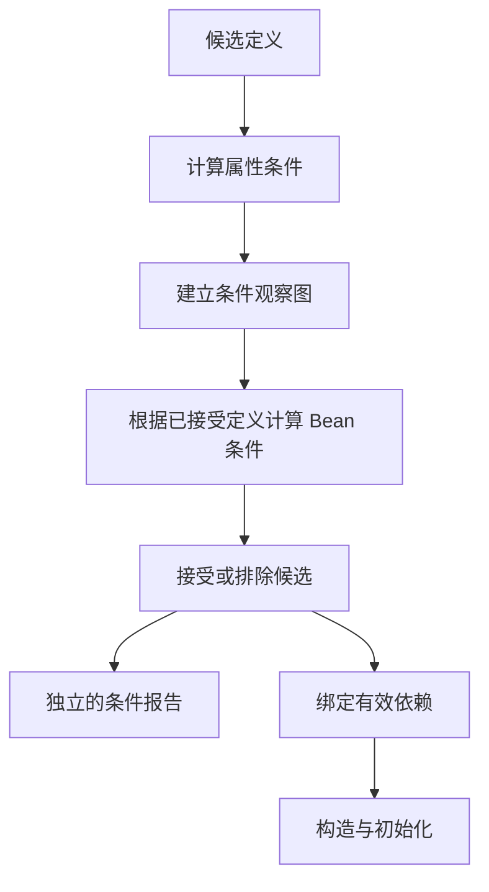
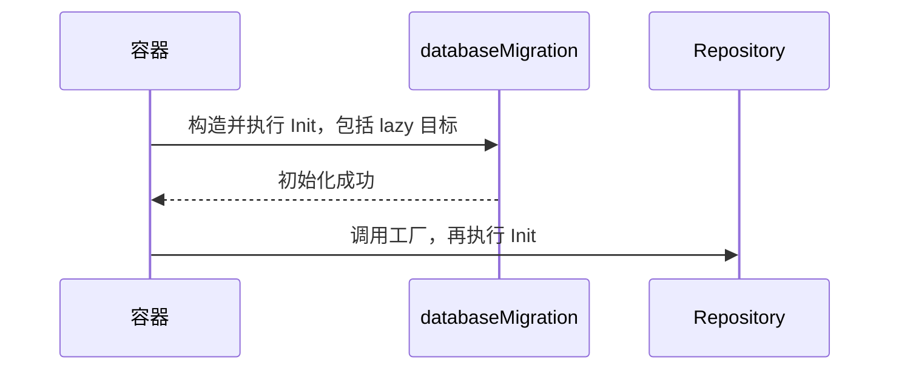

# 注解参考

以下注解采用 controller-tools Marker 语法解析，并通过 Go AST/类型信息
校验。每个 Marker 单独占一行 `//`，放在紧邻声明或字段上方的文档注释中。
将 Marker 放在包注释、行尾注释或未托管结构体字段上会报错。未知 Marker 和
不支持的注解位置也会产生源码诊断。Marker 名称区分大小写。

本文的 **Bean 声明**指带有 `+ioc:bean` 的函数，或带有 `+ioc:component` 的结构体。声明补充注解必须与这些注册注解之一一起使用；字段补充
注解需要 `+ioc:inject`。`+ioc:listen` 方法只允许 `+ioc:order` 作为补充。

## 语法、目标与默认值

下表列出全部已注册 Marker。“重复”表示同一目标可以使用多行该 Marker；要求唯一
的值仍不能重复。名称与标识符不能为空白。包含 Marker 标点的值应加引号，例如
`+ioc:expose="map[string]int"`。属性条件允许显式空字符串 `havingValue`，规则见下文。

| Marker 语法 | 目标 | 缺省值/行为 | 重复 | 含义与约束 |
| --- | --- | --- | --- | --- |
| `+ioc:bean:name=readDB,aliases={reportsDB}` | 包级函数 | 不注册 | 否 | 构造函数返回 `T` 或 `(T, error)`；不能是方法、可变参数函数或开放泛型。支持裸 Marker，名称默认为函数名。 |
| `+ioc:component:name=repository,aliases={repo}` | 具名非泛型结构体 | 不注册 | 否 | 生成 `&T{}` 和注解字段赋值，不调用构造函数。支持裸 Marker，名称默认为类型名。 |
| `+ioc:listener` | Bean 声明 | 不订阅 | 否 | 必须同时声明 bean/component，并具有 `OnEvent(context.Context, E) error`；按声明结果类型生成订阅 |
| `+ioc:listen` | 静态已知的受管具体类型上的方法 | 不订阅 | 否 | 需要 `(context.Context, E) error`；包级函数和无受管 Bean 对应的方法非法 |
| `+ioc:inject:name=readDB,qualifiers={sql}` | 组件具名字段 | 不修改字段 | 否 | 裸 Marker 按字段类型选择，可用名称/别名与限定符进一步筛选；支持私有字段，拒绝嵌入字段和 Context 字段 |
| `+ioc:param:parameter=read,name=readDB,qualifiers={sql,read}` | Bean 构造函数 | 只按参数类型选择 | 是，每个参数一次 | 必须是已存在的命名参数，至少有 `name` 或 `qualifiers`；不能指向 `_`、未知参数或 Context |
| `+ioc:scope=request` | Bean 声明 | `singleton` | 否 | 内置 `singleton`、`prototype`、`request`；非空白自定义 ID 需在运行时通过 `pkg/context.WithScope` 启用 |
| `+ioc:qualifier=sql` | Bean 声明 | 无限定符 | 是 | 声明候选限定符，重复值非法；注入筛选使用 inject/param 属性 |
| `+ioc:expose=contracts.Repository` | Bean 声明 | 结果类型，组件为 `*T` | 是 | 添加暴露类型，保留结果类型；结果必须可赋值给该类型；重复暴露非法 |
| `+ioc:primary` | Bean 声明 | `false` | 否 | 只有匹配候选中恰好一个主候选时才消除单值/可选歧义；集合保留全部匹配 |
| `+ioc:lazy` | Bean 声明 | 单例立即构造 | 否 | 将单例构造推迟到查询；不改变作用域；不能与 Start 或生命周期通知监听器或接收全部事件的监听器组合 |
| `+ioc:conditional:on-property:prefix=storage,name={mode,driver},havingValue=memory,matchIfMissing=false` | Bean 声明 | 无属性条件 | 是 | name 必填，多键按 AND 组合；支持前缀、精确标量期望值和缺失键策略，规则见下文 |
| `+ioc:conditional:on-bean:type=ordercontracts.Repository,name=repository` | Bean 声明 | 无存在条件 | 是 | `type`、`name` 均可选；每个指定要求都必须在已接受定义中存在；均省略时推断声明结果类型 |
| `+ioc:conditional:on-missing-bean:type=ordercontracts.Repository,name=repository` | Bean 声明 | 无缺失条件 | 是 | 属性和默认推断规则相同；每个指定要求都必须不存在 |
| `+ioc:profile={dev,"!prod"}` | Bean 声明 | 无 Profile 条件 | 否 | 采用 Gosr Profile 谓词，列表按 OR 组合；不支持表达式语法 |
| `+ioc:order=100` | Bean 声明或 listen 方法 | Bean 为 `0`；方法沿用所有者事件顺序 | 否 | 整数；Bean order 用于注入集合排序，方法 order 仅覆盖该方法的事件排序值；不控制条件或构造顺序 |
| `+ioc:depends-on=databaseMigration` | Bean 声明 | 无额外前置依赖 | 是 | 激活 Bean 的名称或别名；目标在当前工厂执行前完成构造和 Init；不按类型/ID 查询，不隐式创建作用域 |

标志 Marker 不接受值：`+ioc:primary=false` 和 `+ioc:listener:name=audit` 都非法。
不可重复 Marker 即使值相同也不能写两次。结构化 `param` 中 `parameter` 必填，
`name` 与 `qualifiers` 各自可选。注册的 name/aliases 和注入的 name/qualifiers 均可省略。
空白名称/标识符、重复别名/限定符和未知属性均报错。`listener` 不接受属性。

## 注册与契约

```go
// +ioc:bean:name=readDB,aliases={reportsDB}
// +ioc:qualifier=sql
// +ioc:primary
func NewReadDB() (*sql.DB, error) {
    return sql.Open("postgres", "...")
}

// +ioc:component
// +ioc:expose=contracts.Repository
type Repository struct {
    // +ioc:inject:name=reportsDB,qualifiers={sql}
    db *sql.DB
}
```

此片段省略了导入、数据库驱动注册，以及 Repository 对 `contracts.Repository`
的方法实现。数据库资源应包装为带 Destroy 方法的类型，以便容器清理；单独的
`sql.DB.Close` 不是可识别的生命周期方法。构造函数可以是私有函数。接口契约必须
显式暴露，仅实现接口不会将其注册为可查询类型。

所有暴露类型和别名均指向同一 Bean 定义。实例复用由作用域决定：每个应用上下文
复用一个单例，每个请求/自定义作用域复用一个实例，原型则每次解析创建新实例。
清理规则见[作用域所有权](architecture.md#scope-ownership)。

稳定定义 ID 为 `package/import/path.Function` 或 `package/import/path.Type`；
修改 `name` 不会改变 ID。

成功的工厂必须返回可用值。生成代码在转换为接口之前检查具体指针结果是否为 nil，
包括 `(T, error)` 结果。没有运行时反射就无法通用检测接口内部的 typed nil；接口
工厂必须保证实现非 nil。`0`、`false` 等标量零值及 nil map/slice 都是合法 Bean。
返回非 nil 值同时返回错误时，清理责任转给容器；返回 nil 的构造函数仍负责清理
自己已分配的资源。

## 参数、访问方式与基数

```go
type ReadWriteRepository struct {
    read  *sql.DB
    write *sql.DB
}

// +ioc:bean
// +ioc:param:parameter=read,name=readDB,qualifiers={sql,read}
// +ioc:param:parameter=write,name=writeDB
func NewRepository(read, write *sql.DB) *ReadWriteRepository {
    return &ReadWriteRepository{
        read:  read,
        write: write,
    }
}
```

此片段要求 `readDB` Bean 同时具有 `sql` 和 `read` 限定符，并存在 `writeDB`
Bean。工厂自行将解析出的参数赋给字段；工厂返回值不会再经过独立字段注入。
详见[注入模型](architecture.md#injection-model)。

参数名仅用于指定选择器绑定，不会隐式选择 Bean。选择器同时约束 Go 契约、名称/
别名和全部限定符。可选依赖只允许缺失，不允许歧义或构造失败。

| Go 依赖类型 | 访问方式 | 基数 |
| --- | --- | --- |
| `T` 或 `*T` | 直接 | 恰好一个，或匹配项中唯一的主候选 |
| `gs.Optional[T]` | 直接 | 零个或一个，用 `Present` 区分缺失 |
| `[]T` | 直接 | 全部匹配，按 BeanDefinition.Order 和 ID 排序 |
| `gs.Provider[T]` | 延迟 | 相同选择规则，每次使用调用方 Context 解析 |
| `gs.Provider[gs.Optional[T]]` | 延迟 | 每次调用返回可选结果 |
| `gs.Provider[[]T]` | 延迟 | 每次调用返回集合 |

`gs` 指 `github.com/longxi-go/gosr/pkg/ioc`。Provider 必须位于最外层；
只接受表中六种形式。注入位置的 `Optional[[]T]`、`[]Optional[T]`、
`Optional[Optional[T]]`、`[][]T`、内层或重复 Provider，以及 Provider 包装这些
非法组合，均在生成期报错。类型别名遵循相同规则。
构造函数的 `context.Context` 参数是操作输入，不是 Bean 依赖端口。不要保存它；
需要时将调用方 Context 传给 Provider。Context 参数不能配置选择器，Context 字段
注入会被拒绝。指针依赖仍是必需依赖，允许缺失需要 Optional 包装。注入位置的
`[]T` 请求全部 T Bean；`app.GetBeans[T](ctx)` 同样请求集合，而
`app.GetBean[[]T](ctx)` 查询单个自身类型为 `[]T` 的 Bean。map、定长数组和
具名切片类型是普通 Bean 类型，不是集合注入语法；`[]T` 的类型别名仍按集合解释。

Provider 的目标在 Start 时选择并检查缺失/歧义，即使之后从未调用也一样；延迟的
只是实例解析。检测规则和调用时机见[循环依赖](architecture.md#dependency-cycles)。

## 条件默认实现与排序 {#conditional-defaults-and-ordering}



```go
// +ioc:bean
// +ioc:conditional:on-missing-bean:type=ordercontracts.Repository
// +ioc:conditional:on-property:prefix=storage,name=mode,havingValue=memory
func NewDefaultRepository() ordercontracts.Repository {
    return &MemoryRepository{}
}
```

创建应用上下文时提供属性（`app` 指
`github.com/longxi-go/ioc/pkg/context`）：

```go
application, err := app.NewApplicationContext(ctx,
    app.WithProperties(map[string]string{
        "storage.mode": "memory",
    }),
)
if err != nil {
    return err
}
```

上下文会复制该 map。`storage.mode` 缺失或值不同都会排除此定义。属性匹配但已有普通
`Repository` Bean 被接受时，`on-missing-bean` 仍会排除默认实现。两个条件都通过后，
工厂才参与后续绑定。

两个条件注解都支持可选的单值 `type` 和 `name` 属性：

| 属性 | on-bean | on-missing-bean |
| --- | --- | --- |
| `type=T` | 已接受定义中有暴露 T 的定义 | 已接受定义中没有暴露 T 的定义 |
| `name=n` | 已接受定义中有名称或别名为 n 的定义 | 已接受定义中没有名称或别名为 n 的定义 |
| `type=T,name=n` | T 存在**且** n 存在，可以由不同定义满足 | T 不存在**且** n 不存在 |
| 均省略 | 使用工厂声明的结果类型，组件/监听器使用 `*T` | 使用相同的推断类型 |

只写 name 不会附加推断类型要求。同一声明上的重复条件注解和其他条件按 AND
组合。存在性判断不要求唯一主候选，不构造实例，也不代表激活成功。类型判断检查
已暴露契约，不会枚举所有可赋值类型。

类型表达式使用声明所在源码文件的导入绑定，例如 `type=ordercontracts.Repository`。
包名相同时可用不同导入别名区分。编译器解析 Go 类型并保存包含完整导入路径的类型
标识，不按包名全局搜索。注释不构成 Go 导入的使用；导入也必须被 Go 声明引用，
如上例的工厂返回类型。未知类型、值表达式、未实例化泛型和空白属性都产生错误，
不会转为 Bean 名称。含 Marker 标点的类型表达式需要引号，例如
`type="map[string]int"`。

### 属性与 Profile 条件 {#property-and-profile-conditions}

| 属性 | 含义 | 缺省行为 |
| --- | --- | --- |
| `prefix` | 与每个 name 用一个点连接，末尾的点可省略 | 无前缀 |
| `name` | 一个属性名或非空列表，所有键均须匹配 | 必填 |
| `havingValue` | 精确比较的标量文本，允许显式空字符串 | 属性存在，且标量文本不等于忽略大小写的 `false` |
| `matchIfMissing` | 键不存在时的判断结果 | `false` |

布尔值和数值按 Gosr 的标量文本参与比较。显式比较区分大小写，并保留空白。
与 Spring 的忽略大小写比较及空值缺省标记不同，`havingValue=""` 只匹配实际的空标量，
不代表省略属性。null、列表和对象是非法条件值，会使启动失败。
解析或查询错误按错误处理，不当作属性缺失。

只有 `prefix`、`name` 和 `havingValue` 允许 `${...}`，每次条件求值时在启动 Environment 快照上
各解析一次。`${storage.${region}.mode}` 等嵌套键和默认值遵循 Gosr/Nemo 语法。
查询结果已经解析，不会再次展开。Bean 标识、别名、限定符、作用域、前置依赖和
Bean 条件名称保持静态，在生成期拒绝占位符。生成过程不读取配置。

`+ioc:profile={dev,"!prod"}` 在至少一个 Gosr Profile 谓词匹配时通过，仍会校验
全部条目。Profile 在 Environment 准备时选定。`!prod` 表示 prod 未激活。
不支持括号、`&`、`|` 或占位符表达式。同一声明的不同条件按 AND 组合。

`WithProperties` 将复制的 map 转换为最高优先级的 Environment 来源。全部条件
使用同一启动快照。默认配置、自定义实现和刷新规则见 [Environment](environment.md)。

属性不匹配的
定义先被排除，再建立观察边。每个可能匹配的定义先于观察它的定义；观察者不观察自身。
条件随后检查此前已接受的定义，不创建实例，也不执行不动点求解。匹配的普通实现先于
缺失条件下的默认实现求值。正向、否定或混合条件的观察环均返回 DependencyCycle，
并附条件路径。两个相互排斥的缺失默认实现即使其中一个是 Primary，仍然是条件冲突。
源码顺序、模块位置、`order` 和 `depends-on` 都不能裁决该冲突。选择后再检查激活图的
必需目标、歧义、所有权和创建依赖环。

允许多个实现同时激活。唯一 primary 只在激活且匹配的候选中消除单值查询歧义，不排除
其他定义；集合仍保留全部匹配项。`BeanDefinition.Order` 决定集合顺序，独立于事件回调的
`ordered.Ordered.Order()` 和方法 `+ioc:order`，详见[事件排序](events.md#event-ordering)。

### 条件报告 {#condition-reports}

```go
report, err := app.ConditionReport()
if err != nil {
    return err
}
for _, candidate := range report.Candidates {
    fmt.Println(candidate.Bean, candidate.Outcome)
}
```

`ConditionReport` 与 Start 使用相同的选择求值器，不构造 Bean。它可以在 Start 前、
Start 失败后和生命周期操作期间并发调用，输入由应用快照确定。每项包含候选源码
位置、`accepted`、`rejected` 或 `not-evaluated` 状态、已求值条件及匹配的已接受
Bean ID。属性判断记录声明的前缀/名称表达式与布尔结果，不暴露动态展开后的键、
期望值或实际值。返回切片不共享应用内部的可变数据。

因属性条件被排除的候选只包含属性判断。排序失败时，方法同时返回排序错误和部分
报告，合格但未执行 Bean 条件判断的候选保持 `not-evaluated`。接受状态仅表示通过
条件选择，不代表依赖绑定有效、构造成功或应用就绪。

## 初始化前置依赖 {#initialization-prerequisites}



```go
// +ioc:bean
// +ioc:depends-on=databaseMigration
// +ioc:depends-on=cachePreparation
func NewRepository() *Repository {
    return &Repository{}
}
```

对象需要使用另一个 Bean 的值时，采用构造函数或字段注入。`depends-on` 声明无需注入
该对象的初始化前置依赖。每行引用一个 Bean 主名称或别名，多项目标重复声明。
不接受类型表达式、定义 ID、限定符或 Primary 偏好；独立前置 Bean 之间没有声明顺序。

目标必须在条件选择后处于激活状态。被排除的目标返回 MissingBean；被排除的依赖方不
产生前置要求。重复名称、指向同一目标的多个别名及自引用均报错。直接注入与前置依赖
共同参与创建依赖环检查。

lazy 目标在依赖方创建时初始化；lazy 依赖方本身不会在启动时激活前置 Bean。
前置 Bean 构造或 Init 失败时，不调用依赖方工厂。该约束不等待目标 Start、后台任务
或业务就绪。所有 eager 初始化仍先于应用 Start 阶段；Start 方法遵循前置依赖关系。

| 依赖方作用域 | 前置 Bean 作用域 | 支持情况 |
| --- | --- | --- |
| singleton | singleton | 支持 |
| request/自定义 S | singleton 或相同的 S | 支持；相同 S 使用依赖方的确切作用域所有者 |
| prototype | singleton | 支持；保留已有调用方/Lease 所有权 |
| 任意 | prototype | 不支持 |
| singleton | request/自定义 | 不支持 |
| request/自定义 S | 不同的 request/自定义作用域类型 | 不支持 |
| prototype | request/自定义 | 不支持 |

不支持的组合返回 ScopeViolation，不隐式创建作用域或 Lease。同一所有者内先清理
依赖方，再清理前置 Bean；共享目标仍归应用/作用域管理。跨所有者关闭遵循现有的
[应用关闭阶段](architecture.md#application-lifecycle)。
[prerequisites 示例](https://github.com/longxi-go/ioc/tree/main/examples/prerequisites)
演示 lazy 迁移在 Repository 工厂之前完成初始化。

## 生命周期与事件限制

结果类型的方法集中如果存在 `Init`、`Start`、`Stop`、`Destroy`，每个方法都必须
接收 `context.Context` 并返回 `error`，不需要额外注解。`Start` 要求立即构造单例；
与 lazy、请求/自定义作用域或原型组合都非法。
[架构](architecture.md#application-lifecycle) 说明失败时的清理规则。

事件 `E` 必须实现 `event.Event`。`listener` 注册 `OnEvent`，`listen` 只注册被注解
的方法。普通 `OnEvent` 方法不会隐式订阅；同一个 `OnEvent` 再添加 `listen` 也不会
重复投递。所有监听器必须属于单例。能接收 `ContextRefreshed`、`ContextClosing` 或
接收全部事件的接口的监听器必须立即构造；仅处理业务事件的单例监听器可以延迟构造。
接口结果工厂不能识别其隐藏具体实现上的方法注解。

## 诊断示例

| 非法输入 | 失败原因 |
| --- | --- |
| 普通未注册结构体字段上的 `+ioc:inject` | 字段所在类型未注册为组件 |
| 未注解函数上的 `+ioc:scope=request` | 补充注解缺少 Bean 注册 |
| `+ioc:param:parameter=read` | 未提供名称或限定符 |
| `+ioc:conditional:on-property:name=""` 或 `name={mode,mode}` | 空白或重复属性名 |
| 重复 `+ioc:bean` 或重复 `+ioc:qualifier=sql` | Marker 不可重复或限定符值重复 |
| 结果不可赋值却声明 `+ioc:expose=contracts.Repository` | 暴露契约无效 |
| 带 `Start(context.Context) error` 的 Bean 声明 `+ioc:lazy` | 激活要求立即构造的单例 |
| 方法同时使用 `+ioc:listen` 和 `+ioc:scope=singleton` | Listen 只允许 order 补充 |
| Bean 条件中使用未知 `type` 或值表达式 | Go 类型引用无效，不回退到名称匹配 |
| 注入位置使用 `Optional[[]T]` 或 `[][]T` | 不支持的依赖形态 |
| 必需 T 有两个匹配候选且没有唯一主候选 | 依赖存在歧义 |
| 单例直接捕获请求 Bean，包括通过原型间接捕获 | 作用域逃逸；使用传入调用方 Context 的 Provider |

`ioctl check` 检查生成产物；`ioctl explain` 和 `ioctl graph` 报告潜在候选与边，
不写源码。Start 在条件求值后检查有效图，包括依赖缺失/歧义、作用域违规和循环。
