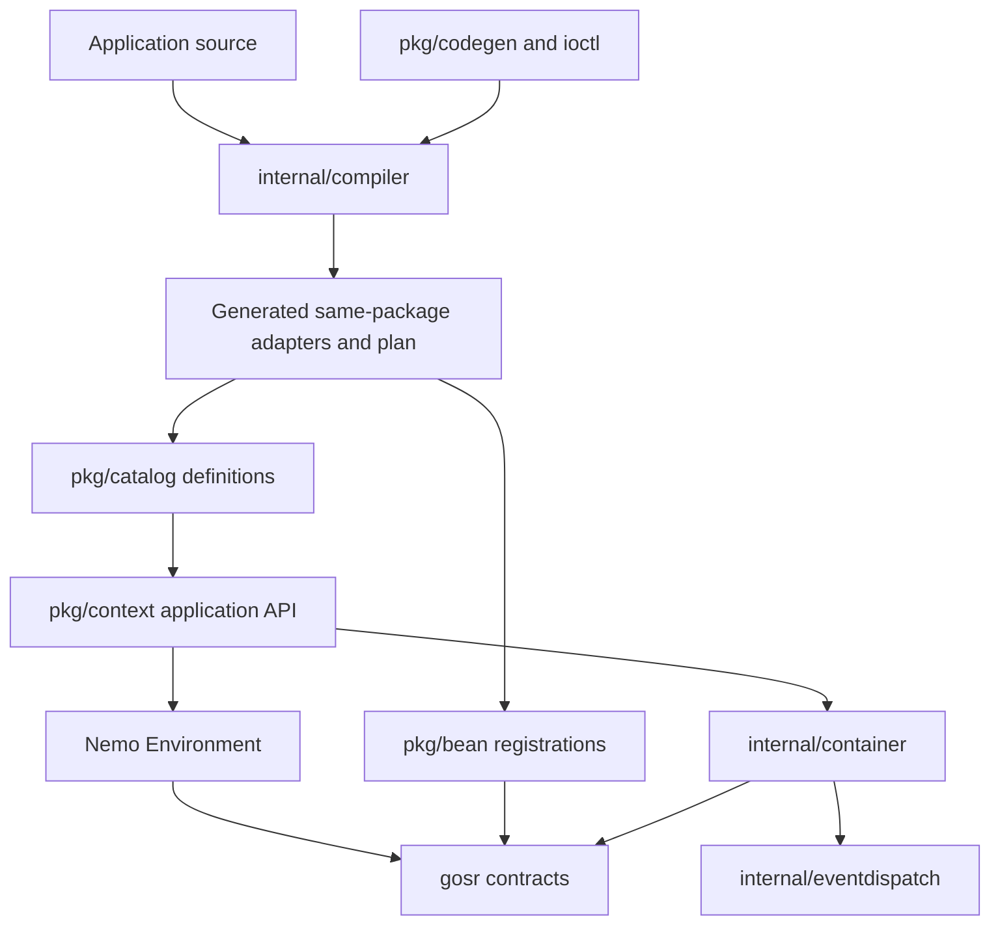
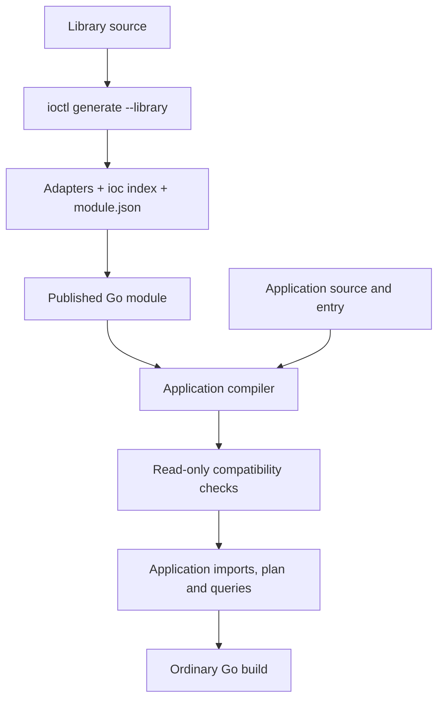
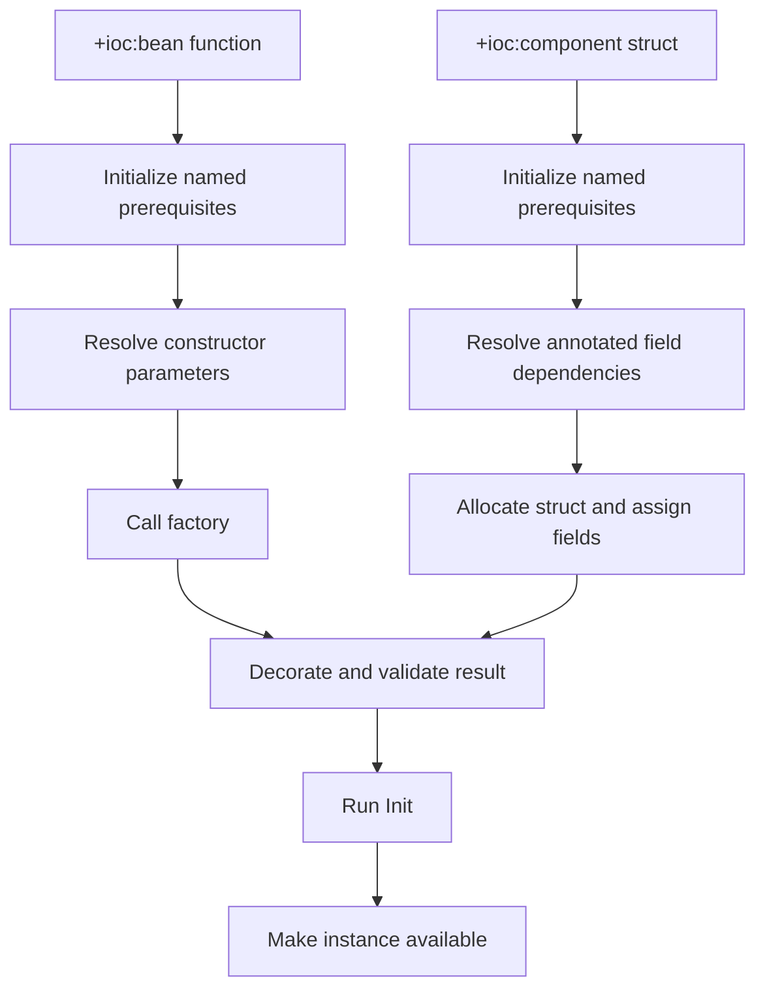
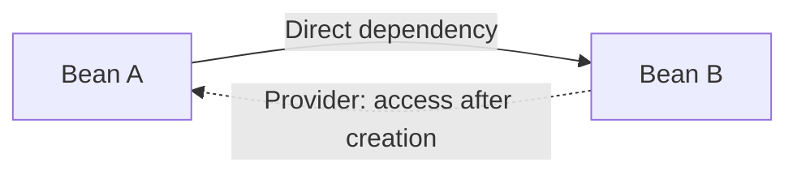
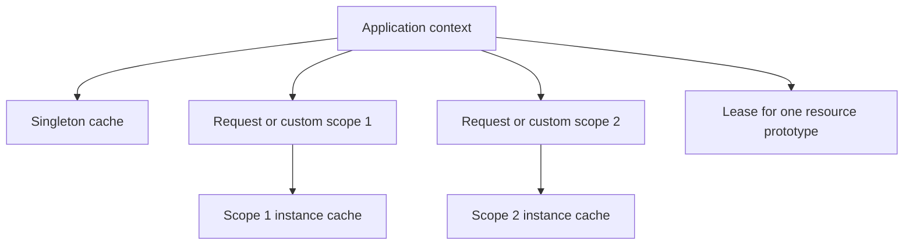
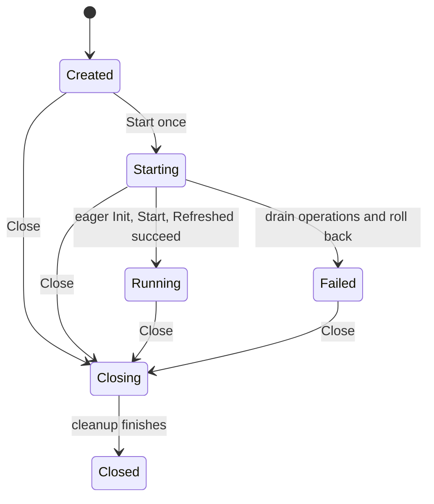
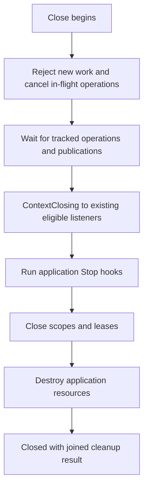

# Architecture

## Package responsibilities

`pkg/bean.Registration` combines a Bean definition with generated construction,
injection and lifecycle callbacks. This executable description is called a
**recipe** in the generation protocol. `pkg/catalog` stores definitions and
application plans; it contains no Bean instances.

`pkg/context` exposes lookup, scopes and application lifecycle operations.
`internal/container` binds dependency graphs, coordinates creation and cleanup,
and checks lifecycle state. `internal/eventdispatch` prepares and delivers
synchronous events. `pkg/codegen` is the public compiler API; `internal/command`
and `cmd/ioctl` provide the core CLI through shared `pkg/cli`. Runtime packages do not import the compiler or
application packages.

Generated `init` functions register definitions and plans without constructing
instances, performing I/O or starting goroutines. `NewApplicationContext` takes a
snapshot of the selected plan and its registrations, prepares the Environment
with the supplied construction Context, and pins its startup snapshot. It does
not run ordinary Bean factories. See [Environment](environment.md). Only imported packages run
these registration functions. Generated imports and per-entry plans select each
application entry's packages and definitions, so applications need no handwritten
runtime module list.

## Generation and validation

The compiler loads source from the target module and metadata from dependencies,
parses annotations and Go types, and assembles the entry dependency closure: the
packages and definitions selected for one application entry. It checks dependency
relationships that can be determined statically. Embedded templates generate
same-package adapters, golayout formats them, and a Go overlay loads and
type-checks the result before any output files are written.

`check` compares expected bytes without rewriting files. `explain` and `graph`
inspect prospective output, including before first generation. Their reports
include potential conditional candidates; they do not represent the active graph
of a particular startup.

Shared artifact, diagnostic, template and output mechanisms come from gosr.
Package loading and annotation parsing use the separate `gosr/tools` module.
ioc defines annotation schemas, graph policy, module isolation and publication
compatibility. golayout provides formatting. A target module's optional
`codequality/HEADER` supplies its generated-source notice; the generator does not
copy ioc's copyright owner into consumer output.

## Library publication {#library-publication}

A library publishes same-package `zz_ioc.gen.go` adapters, `iocindex/index.gen.go`
and `ioc/module.json` with its module source. Library authors regenerate these
files; consumers do not rewrite library source, module caches, vendor or foreign
replacement modules. Missing or stale publications and schema/recipe ABI
mismatches produce diagnostics. Applications can satisfy a library's open
dependency ports, but each application entry must satisfy all its required
dependencies. Ordinary `go build` and application startup do not run generation.

Publication schema **5** records per-package static adapter semantics fingerprints
and named initialization prerequisites; recipe ABI is **4**. Generated batches
embed the generation-time numeric ABI, so upgrading the runtime does not relabel
old output. Libraries and applications must regenerate incompatible adapters.
The compiler reloads managed packages under the consumer's
type environment and re-emits adapters in memory, even when the target, tags and
GOFLAGS match the publication environment. It compares semantics fingerprints and
build constraints. Equivalent portable libraries are accepted; incompatible source
selections, contracts, hooks or conditions produce diagnostics.

Each publication is checked against the consumer's build environment. It is not
an archive from which the compiler selects arbitrary target variants. Regenerate
application output for its actual build environment. Library authors must
regenerate and republish incompatible variants. Support for a platform, tag or
CGO combination requires testing that combination.

## Injection model {#injection-model}

There are two automatic injection paths:

| Registration | Construction and injection |
| --- | --- |
| `+ioc:bean` | Resolve parameters and call a package-level function returning `T` or `(T, error)` |
| `+ioc:component` | Resolve annotated fields, allocate `&T{}` and assign those fields |

`+ioc:controller` specializes component registration and uses the same field
injection path. Its HTTP mappings are compiled by the selected native backend.

A factory result does not receive a separate field-injection pass. Annotating both
a struct and its factory registers two definitions, not two stages of one Bean.
Unqualified lookup may then be ambiguous. A factory can assign its injected
parameters to fields with ordinary Go code.

Same-package adapters can access private constructors and fields. Unannotated
component fields retain their zero values. Embedded-field injection, setter or
arbitrary method injection, receiver-method factories, variadic factories and
open generic registrations are not supported. Event callbacks and lifecycle hooks
have their own signatures and are not general method injection points.

## Selection and graph binding

Go types declare dependency contracts. A result's own type is always exposed;
additional interfaces require `+ioc:expose`. Implementing an interface does not
register it for lookup. A selector combines contract, name/alias and all requested
qualifiers. Parameter and field names do not implicitly select Bean names.

A single or optional dependency needs one match or a unique matching primary.
Optional permits absence, not ambiguity or constructor failure. Collections keep
every match in `BeanDefinition.Order`, then ID order. Provider is deferred access
and must be the outermost wrapper. Only T, Optional[T], []T and Provider wrapping
one of those three forms are accepted; nested cardinality operators fail during
generation. Exact named collections, maps and arrays retain their Bean identity.
See the [annotation reference](annotations.md)
for dependency shapes and selector syntax.

Conditions select definitions before instance creation. The
`conditional:on-property` predicate reads the startup Environment snapshot.
Its structured attributes distinguish presence checks, explicit scalar equality
and missing-key policy. Profile predicates use that same snapshot. Neither
condition reads process variables independently. See [property and profile
conditions](annotations.md#property-and-profile-conditions).
`conditional:on-bean` and `conditional:on-missing-bean` inspect accepted
definitions in deterministic candidate order. Their optional `type` and `name`
attributes are independent requirements; different definitions may satisfy them.
With neither attribute, the target is the declared factory result or component
pointer type. Type expressions resolve in the source file scope and use full
import-path identities internally; unresolved types are errors. Property-eligible
definitions form an observation graph: possible matches precede their observer,
excluding the observer itself. Conditions do not observe live instances.
Observation cycles fail; Primary, collection Order, source/module order and
initialization prerequisites cannot arbitrate them. Multiple active implementations
remain legal; a unique primary resolves a matching single dependency only.

`Application.ConditionReport()` and Start share a metadata-only selection
evaluator. Reports contain detached candidate outcomes and observed predicates,
including matching accepted Bean IDs. Property values are excluded. Ordering
failures return a partial report and leave eligible candidates not evaluated.
The report remains available after failed startup; acceptance does not imply
valid binding or successful lifecycle callbacks. The selection implementation
separates candidate ordering, predicate evaluation and dependency binding.

Start binds every dependency in the selected graph, including required Provider
targets. A missing or ambiguous required target fails startup even if its provider
is never called. Provider defers instance resolution, not candidate validation.
Use `Provider[Optional[T]]` when absence is allowed.

`+ioc:depends-on=name` binds active names or aliases separately from injection
ports. Prerequisites complete construction and Init before the dependent factory,
including lazy targets. Missing/excluded targets, self/duplicate resolved targets,
unsupported scopes and creation cycles fail. It does not wait for Start or
asynchronous readiness, create a scope, or activate a lazy dependent at startup.
See the [scope matrix and lifecycle guarantees](annotations.md#initialization-prerequisites).

## Dependency cycles {#dependency-cycles}

| Check | Behavior |
| --- | --- |
| Generation | Rejects statically determined direct injection and prerequisite cycles |
| Start binding | Validates the active graph after condition selection, before creating instances |
| Instance resolution | Detects recursive creation and cycles in tracked operation waits |

The container does not expose partially initialized objects. Component fields
resolve before allocation, so field injection does not bypass direct-cycle checks.
`lazy` skips eager singleton creation but retains direct dependency edges; marking
both Beans lazy does not make a direct cycle valid.

A Provider can remove a creation-time dependency when its caller stores it and
uses it after the required instances finish construction and Init. Calling it
from a constructor or Init can recreate the cycle and fails with
`DependencyCycle`. All eager singletons finish Init before Start hooks run, but
Provider access does not guarantee the target's Start hook has completed.

Pass the supplied callback or caller Context through nested operations; it carries
the container's task ancestry. The wait graph covers tracked container operations,
not arbitrary channel or mutex deadlocks. Go package import cycles are separate
compile errors and cannot be resolved by Provider.

## Scope ownership {#scope-ownership}

| Scope | Instance owner | Required release |
| --- | --- | --- |
| Singleton | One per application context, independent of other contexts | Application Close |
| Request/custom | One per Bean per explicitly opened scope | Scope Close; application shutdown also closes outstanding scopes |
| Prototype without Stop/Destroy | New per resolution; consumer may retain it | No container cleanup owner |
| Prototype with Stop/Destroy | Explicit Lease acquired for one instance | Lease Close; ordinary lookup/direct capture is rejected |

Aliases and exposed contracts refer to the same definition. Instance reuse follows
its scope; neither aliases nor additional contracts turn prototypes into cached
instances.

Custom scopes use `WithScope(id)` plus `OpenScope(ctx, id)` and share Request's
explicit cache/close model. They do not install alternate storage or scheduling.
Scope contexts belong to the application that issued them. Closed, foreign or
absent scope contexts fail lookup. Nested contexts preserve other scope kinds.

A singleton cannot directly retain a request/custom instance, including through
a prototype chain. A named scope cannot capture a different named scope. A
Provider resolves with each call's Context; invoking it during construction still
cannot capture a shorter lifetime. Pass the request caller's scoped Context when
resolving a request dependency.

Constructors, Init and Start receive an operation Context that is canceled when
the operation ends. Stop and Destroy receive a cleanup Context independent of
cancellation by a Close caller. Callback contexts must not be retained for
long-lived work; Context field injection is rejected.

## Application lifecycle {#application-lifecycle}

Start binds the complete active graph, creates eager singletons and runs Init,
then invokes Start hooks in dependency order. Start hooks require eager singleton
ownership. Lazy/scoped instances run Init when created. Refreshed delivery is the
last startup barrier. Start is single-attempt and nonreentrant; failed contexts
are not restarted.

Construction, decoration or Init failures clean up allocated objects. Startup
failure cancels and waits for owned operations before rollback. Cleanup runs Stop
in reverse allocation order, then Destroy in reverse order, and joins errors.
A Bean with a Start hook is stopped if activation was attempted, including a
failed attempt; objects without Start can still have Stop. A nonnil factory
result plus an error transfers cleanup ownership; a nil result leaves partial
resources with the factory.

Concurrent and repeated Close calls wait for the same cleanup. Canceling a Close
caller ends only that caller's wait; cleanup continues, and another Close call can
wait for its result. Shutdown prevents late creations from becoming available.
A callback cannot wait for its own application's Close; the application owner
must initiate shutdown. Scope close operations participate in the wait graph,
which reports cycles in tracked waits. Cleanup hooks must return: the container
cannot forcibly terminate a blocked callback.

## Concurrency and extension boundaries

Concurrent lookups share one cached creation result per singleton/scope slot;
waiting is cancelable. A failed cached creation is retained for that owner rather
than silently retried. Callbacks run outside the engine's locks. Bean methods,
listener callbacks and mutable user state still need their own synchronization;
concurrent publications may call the same listener concurrently. Background work
owned by a Bean must cooperate with cancellation and finish during its lifecycle
hooks.

`WithCatalog` and `WithPlan` select registrations and the application plan.
`WithProperties` contributes a copied, highest-priority Environment source.
Default configuration loading uses Nemo before engine construction. Custom
implementations satisfy Gosr Environment and SnapshotProvider through the named
`SnapshotEnvironment` boundary. The built-in property, profile and Bean-existence
predicates form the condition model. There is no public arbitrary condition or
annotation-processor registration API.

`WithDecorator` wraps matching contracts before Init and generated Accept checks.
The replacement must satisfy **every** exposed contract, including the factory's
result type. Prefer interface-returning factories for interface wrappers; adding
an exposed interface does not remove a concrete result contract. The decorator
must keep the same owned object or assume cleanup of the wrapped object. Failed
replacement validation cleans up the original allocation. Lifecycle adapters
remain statically tied to the declared result; decoration is not arbitrary method
interception. The reserved local event publisher and Environment cannot be decorated or replaced
as primary; named publisher alternatives are supported.

## HTTP generation boundary

The public `pkg/codegen/http` model connects common HTTP analysis to a native
backend selected through `codegen.Options.HTTP`. `ginctl` composes the Gin backend
statically; the core container and root `ioctl` do not import Gin. A backend
returns Go source for the common notice, formatting, overlay-validation and
output pipeline. Import composition resolves declared package names in the
selected module and reconciles aliases without rewriting local shadow variables.

Gin runtime routing and scope packages do not depend on the compiler. Registration
uses the started application's active Bean definitions; Controller lookup uses
the request context. See [HTTP and Gin](http.md) for the complete rules.
