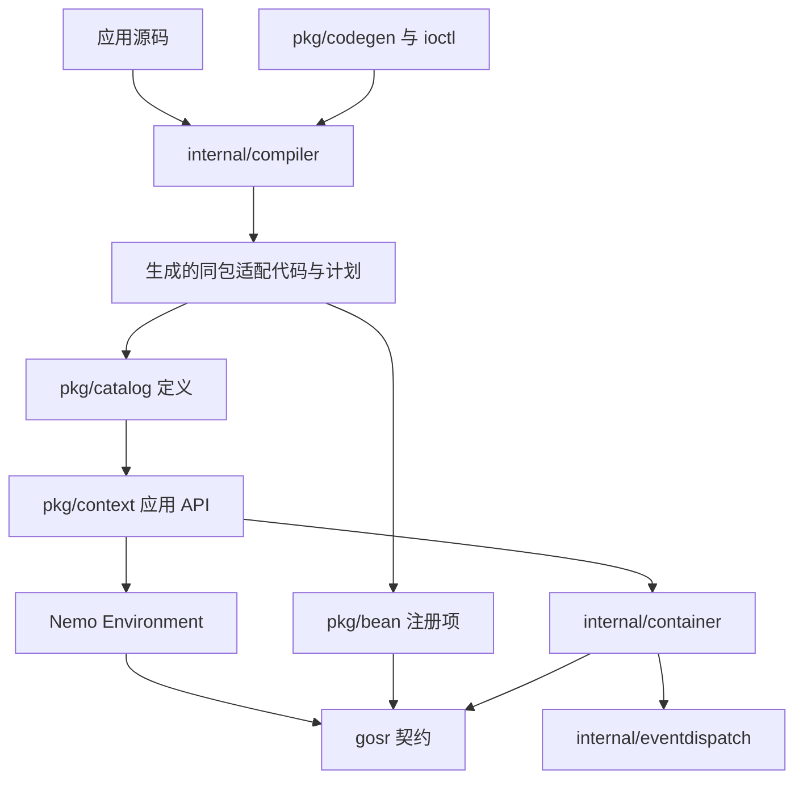
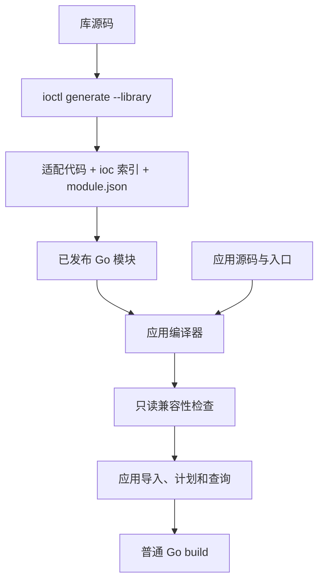
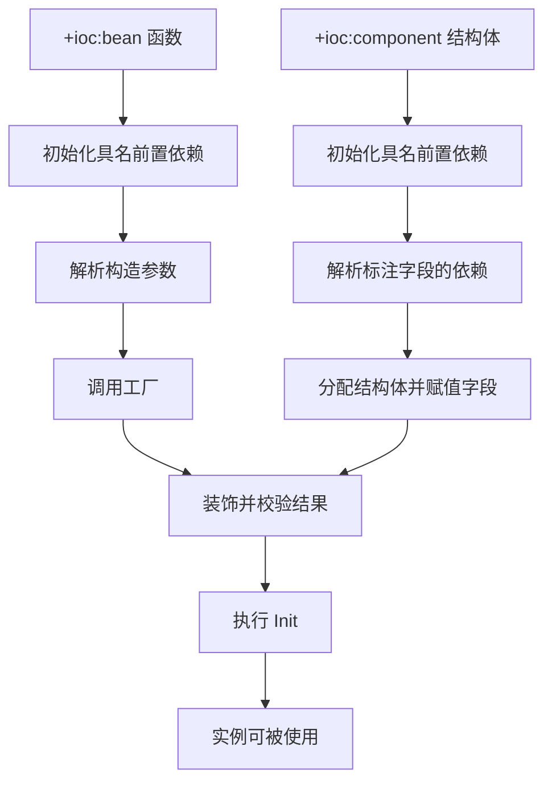
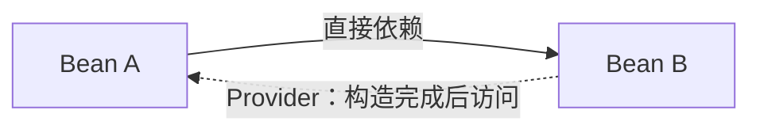
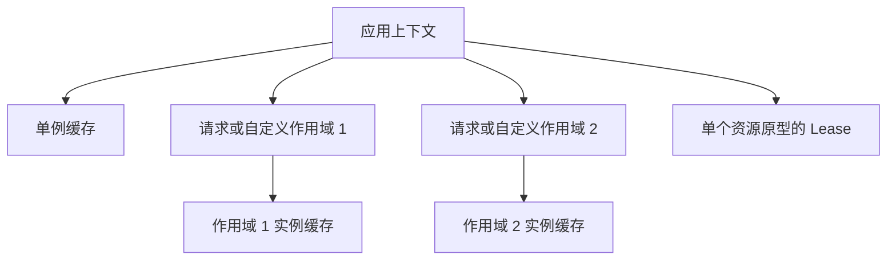
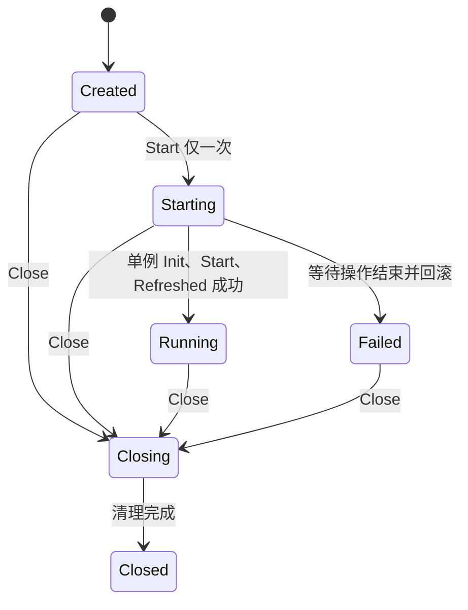
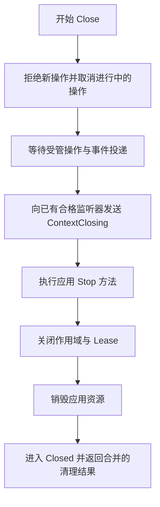

# 架构

## 包职责

`pkg/bean.Registration` 将 Bean 定义与生成的构造、注入及生命周期回调关联，生成
协议中称为 **Bean 装配描述（recipe）**。`pkg/catalog` 保存定义和应用计划，不包含
Bean 实例。

`pkg/context` 提供查询、作用域和应用生命周期操作。`internal/container` 绑定
依赖图，协调构造与清理，检查生命周期状态。`internal/eventdispatch` 准备并投递
同步事件。`pkg/codegen` 是公开编译器 API，`internal/command` 和 `cmd/ioctl`
通过共享 `pkg/cli` 提供核心 CLI。运行时包不导入编译器或应用包。

生成的 `init` 登记定义和计划，不创建实例、不执行 I/O、不启动 goroutine。
`NewApplicationContext(ctx, options...)` 为选定计划及其注册项创建快照，使用传入的
Context 准备 Environment 并固定启动快照，不调用普通 Bean 工厂。
配置准备与注入规则见 [Environment](environment.md)。只有被导入的包才会执行
这些注册函数。生成的导入和入口计划确定每个应用入口使用的包与定义，应用无需
手工维护运行时模块列表。

## 生成与校验

编译器加载目标模块源码和依赖元数据，解析注解与 Go 类型，并组合入口的依赖闭包，
即为该应用入口选定的包与定义集合。能够静态确定的依赖关系在生成阶段检查。
嵌入模板生成同包适配代码，经 golayout 格式化后，通过 Go overlay 加载并执行
类型检查，再写入输出文件。

`check` 比较预期字节，不重写文件。`explain` 和 `graph` 可以在首次生成前检查
预期结果。报告包含潜在的条件候选，不代表某次启动实际选中的依赖图。

共享产物、诊断、模板和输出机制来自 gosr。包加载和注解解析使用独立的
`gosr/tools` 模块。ioc 定义注解 schema、图策略、模块隔离和发布兼容规则；
golayout 提供格式化。目标模块可选的 `codequality/HEADER` 提供生成源码声明，
生成器不会将 ioc 的版权所有者复制到消费方产物。

## 库发布 {#library-publication}

库将同包 `zz_ioc.gen.go` 适配代码、`iocindex/index.gen.go` 和 `ioc/module.json`
随模块源码发布。库作者负责重新生成这些文件；消费方不会改写库源码、模块缓存、
vendor 或外部 replace 模块。发布物缺失、过期，或 schema/装配描述 ABI 不匹配时
产生诊断。库中未绑定的依赖可由应用装配满足，但每个应用入口都必须满足其全部
必需依赖。普通 `go build` 和应用启动都不执行生成。

发布 schema **5** 记录每个包的静态适配语义指纹，装配描述 ABI 为 **4**。生成的
注册批次固定其生成时的 ABI 数值；升级运行时不会改变旧适配代码的 ABI 声明。
版本不匹配时，库作者必须使用配套的生成器重新生成并发布。编译器在
消费方类型环境中重新加载托管包，在内存中生成适配代码，即使目标、tags 和 GOFLAGS
与发布环境一致也会验证，并比较语义指纹与构建约束。语义兼容的可移植库会被接受；
不兼容的源码选择、契约、生命周期方法或条件会产生诊断。

每个发布物都要在消费方构建环境中接受检查，并非从归档中选择任意目标变体。应用应
按实际构建环境重新生成。库作者负责重新生成并发布不兼容变体；支持某个平台、tag
或 CGO 组合，需要验证该组合。

## 注入模型 {#injection-model}

自动注入分为两条路径：

| 注册方式 | 构造与注入 |
| --- | --- |
| `+ioc:bean` | 解析参数，调用返回 `T` 或 `(T, error)` 的包级函数 |
| `+ioc:component` | 解析标注字段，分配 `&T{}` 并赋值这些字段 |

`+ioc:controller` 是组件注册的专用形式，使用相同的字段注入路径；HTTP 映射
由所选框架后端生成。

工厂返回值不会再经过独立的字段注入阶段。同时标注结构体与工厂会注册两个定义，
而不是同一 Bean 的两个阶段；未指定名称等条件的查询可能因此产生歧义。工厂可以
通过普通 Go 代码将注入参数赋给字段。

同包适配代码可以访问私有构造函数和字段。组件中未标注的字段保留零值。不支持
嵌入字段注入、setter 或任意方法注入、接收者方法工厂、变参工厂及开放泛型注册。
事件回调和生命周期方法具有独立的签名规则，不属于通用方法注入。

## 选择与图绑定

Go 类型声明依赖契约。结果自身类型始终暴露，额外接口需要 `+ioc:expose`；仅实现
接口不会将其注册为可查询类型。选择器同时约束契约、名称/别名和全部所需限定符。
参数名和字段名不会隐式选择 Bean 名称。

单值或可选依赖需要一个匹配项，或唯一的匹配主候选。可选依赖允许缺失，不允许
歧义或构造失败。集合保留全部匹配项，按 `BeanDefinition.Order`、ID 排序。
Provider 表示延迟访问，必须位于最外层。只接受 T、Optional[T]、[]T 及 Provider
包装这三种形态；嵌套基数操作在生成期报错。具名集合、map 和数组保留精确 Bean
类型标识。依赖类型和选择器语法见[注解参考](annotations.md)。

条件在创建实例前选择定义。`conditional:on-property` 从启动 Environment 快照
读取属性，其结构化属性区分存在性判断、精确标量比较和缺失键策略。Profile 条件
使用同一快照，两者均不独立读取进程变量。见[属性与 Profile 条件](annotations.md#property-and-profile-conditions)。
`conditional:on-bean` 与 `conditional:on-missing-bean` 按条件观察图的拓扑顺序检查
已接受定义。观察边来自其他符合条件的匹配定义，自身不参与匹配。可选的 `type`、
`name` 是独立要求，可以由不同定义满足。均省略时使用
工厂声明的结果类型或组件指针类型。类型表达式在源码文件作用域解析，内部使用包含
完整导入路径的类型标识；无法解析的类型产生错误。观察图成环时条件选择失败。
`Primary`、集合 `Order`、模块顺序和 `DependsOn` 均不用于裁决条件冲突。

`Application.ConditionReport()` 与 Start 共用只处理元数据的选择求值器。报告包含
独立的候选结果、已求值条件和匹配的已接受 Bean ID，不包含属性值。排序失败时返回
部分报告，合格但尚未求值的候选保留未求值状态。启动失败后仍可查询报告；通过条件
选择不代表绑定有效或生命周期回调成功。实现分别封装候选排序、条件判断与依赖绑定。

Start 为选中图中的全部依赖绑定目标，包括必需 Provider 的目标。即使 Provider
从未被调用，目标缺失或有歧义仍会使启动失败。Provider 延迟实例解析，不推迟候选
校验；允许缺失时使用 `Provider[Optional[T]]`。

`DependsOn` 在条件选择后按名称或别名绑定，参与创建图，不参与条件观察图。
目标的构造、装饰和 Init 必须在依赖方工厂执行前成功，即使目标为 lazy。
它不传递对象，也不等待 Start 或后台就绪。语法、所有权矩阵与失败规则见
[初始化依赖](annotations.md#initialization-prerequisites)。

## 循环依赖 {#dependency-cycles}

| 检查阶段 | 行为 |
| --- | --- |
| 生成 | 拒绝能够静态确定的直接注入与初始化依赖环 |
| Start 绑定 | 条件选择后、创建实例前校验有效图 |
| 实例解析 | 检测递归构造和受管操作之间的等待环 |

容器不会暴露尚未完成初始化的对象。组件在分配实例前解析字段依赖，因此字段注入
也不能绕过直接环检查。`lazy` 跳过单例的提前创建，但保留直接依赖边；将双方都
标为 lazy 不能使直接环合法。

如果调用方保存 Provider，在所需实例完成构造和 Init 后才使用它，就可以消除
创建阶段的依赖环。在构造函数或 Init 中立即调用仍可能重新形成环，并返回
`DependencyCycle`。所有立即创建的单例会先完成 Init，再执行 Start 方法；但
Provider 访问不保证目标 Bean 的 Start 已完成。

嵌套操作应传递回调接收的 Context 或调用方 Context，以保留容器的任务祖先关系。
等待图只覆盖受管容器操作，不检测任意 channel 或 mutex 死锁。Go 包导入环是
独立的编译错误，Provider 无法解决。

## 作用域所有权 {#scope-ownership}

| 作用域 | 实例所有者 | 释放要求 |
| --- | --- | --- |
| 单例 | 每个应用上下文一个，独立于其他上下文 | 应用 Close |
| 请求/自定义 | 每个显式打开的作用域中，每个 Bean 一个 | Scope Close；应用关闭也会关闭尚未结束的作用域 |
| 无 Stop/Destroy 的原型 | 每次解析新建，可由消费方保留 | 无容器清理所有者 |
| 带 Stop/Destroy 的原型 | 显式 Lease 管理一个实例 | Lease Close；拒绝普通查询/直接捕获 |

别名和暴露类型指向同一定义。实例是否复用由作用域决定；别名或额外契约不会使
原型实例被缓存。

自定义作用域通过 `WithScope(id)` 与 `OpenScope(ctx, id)` 启用，采用与请求作用域
相同的显式缓存/关闭模型，不会安装其他存储或调度实现。作用域上下文属于创建它的
应用；使用已关闭、其他应用的或缺失的作用域上下文查询会失败。嵌套上下文保留其他
种类的作用域。

单例不能直接保留请求/自定义实例，包括经过原型链间接保留。命名作用域不能捕获
其他命名作用域。Provider 每次使用调用方 Context 解析，构造中调用 Provider 仍
不能捕获更短生命周期的实例。解析请求依赖时，应传入请求调用方的作用域 Context。

构造函数、Init 和 Start 接收操作 Context，在操作结束时取消。Stop 和 Destroy
使用独立于 Close 调用方取消信号的清理 Context。回调 Context 不得保存供长期任务
使用，Context 字段注入会被拒绝。

## 应用生命周期 {#application-lifecycle}

Start 绑定完整有效图，创建非延迟单例并执行 Init，再按依赖顺序调用 Start。
Start 方法要求非延迟单例。延迟/作用域实例在创建时执行 Init，Refreshed 投递是
最后的启动屏障。Start 仅允许尝试一次且不可重入，失败上下文不能重启。

构造、装饰或 Init 失败时清理已分配对象。启动失败先取消并等待受管操作，再回滚。
清理按分配逆序执行 Stop，再按逆序执行 Destroy，并合并错误。带 Start 的 Bean
只要尝试过激活就会执行 Stop，包括激活失败的尝试；没有 Start 的对象仍可具有
Stop。工厂同时返回非 nil 值和错误时转移清理责任；返回 nil 时，部分资源仍由
工厂负责。

并发或重复 Close 等待同一次清理。取消 Close 调用方只结束本次等待；容器继续
清理，再次调用 Close 可以等待同一次清理的结果。关闭过程中，晚完成的构造不会
再交付实例。回调不能等待自己所属应用的 Close，应由应用所有者发起关闭。
作用域关闭参与等待图，以报告受管等待中的循环。清理方法必须返回，容器无法强行
终止阻塞的回调。

## 并发与扩展边界

并发查询在每个单例/作用域缓存项中共享一次构造结果，等待可取消。构造失败结果
保留在对应缓存项中，不会隐式重试。回调在引擎锁外执行。Bean 方法、监听器回调及
可变用户状态仍需自行同步；并发投递可能并发调用同一监听器。Bean 管理的后台任务
应配合取消，并在生命周期方法中等待其结束。

`WithCatalog` 与 `WithPlan` 选择注册项和应用计划。`WithProperties` 提供复制的
最高优先级 Environment 来源。默认配置通过 Nemo 在引擎构造前加载，自定义实现
通过具名接口 `SnapshotEnvironment` 提供 Gosr Environment 与 SnapshotProvider。
条件模型包含内置属性、Profile 与 Bean 存在性判断，没有公开的任意条件或注解处理器注册 API。

`WithDecorator` 在 Init 和生成的 Accept 检查之前包装匹配契约。替换结果必须
满足**全部**暴露契约，包括工厂结果类型。接口包装应优先使用返回接口的工厂；
添加暴露接口不会移除具体结果契约。装饰器必须保留原对象，或承担被包装对象的清理
责任。替换校验失败会清理原分配对象。生命周期适配仍静态绑定到声明结果，装饰不是
任意方法拦截。保留的本地事件发布器与 Environment 不能被装饰或替换为其他主候选，支持通过名称
选择其他发布器。

## HTTP 生成边界

公共 `pkg/codegen/http` 模型连接公共 HTTP 分析与框架后端，`codegen.Options.HTTP`
显式选择后端。`ginctl` 静态装配 Gin 后端；核心容器及根 `ioctl` 不导入 Gin。
后端返回 Go 源码，由公共流水线应用文件头、格式化并验证覆盖层后写入。
导入合并依据选定模块中的实际包名解析默认导入，并协调别名，不改写局部同名变量。

Gin 模块的运行时路由与作用域包不依赖编译器；注册使用启动后的有效 Bean 定义，
Controller 查找使用请求 Context。完整规则见 [HTTP 与 Gin](http.md)。
