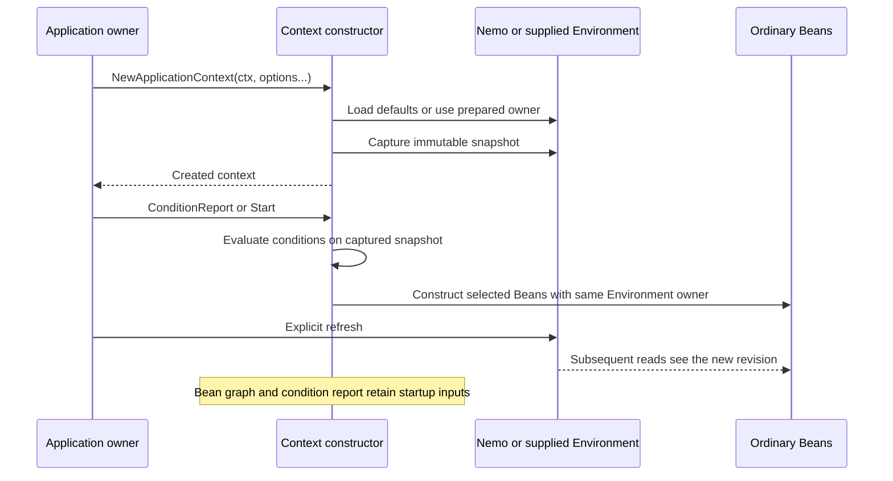

# Application Environment



`NewApplicationContext(ctx, options...)` prepares configuration before creating
ordinary Beans. Loading is cancelable through `ctx`. Invalid configuration,
provider failures and cancellation return an error before any ordinary factory
runs. Generated `init` functions register metadata only.

The default implementation is Nemo. It snapshots the process environment and
loads optional `application.yml` and `application-<profile>.yml` files in the
current working directory. Process names become lowercase property keys with
underscores replaced by dots. This is Nemo's exact mapping, not Spring's relaxed
binding. Invalid or colliding keys fail loading. Default process values remain
literal, including `${...}` text. Placeholders in files and `WithProperties`
continue to follow Gosr/Nemo expansion rules.

| Precedence, highest first | Source |
| --- | --- |
| 1 | Copied strings from `WithProperties` |
| 2 | Explicit providers supplied through `WithEnvironmentOptions` |
| 3 | Process environment |
| 4 | Discovered files, with profile files before base files |

Nemo construction options configure providers, profiles, defaults, discovery and
validation. Discovery options are additive to the optional default discovery.
Use a prepared custom Environment when all source selection must be explicit.
No watcher starts automatically.

```go
application, err := app.NewApplicationContext(ctx,
    app.WithEnvironmentOptions(
        nemoenv.WithProfiles("dev"),
    ),
    app.WithProperties(map[string]string{
        "storage.mode": "memory",
    }),
)
```

Here `app` imports `github.com/longxi-go/ioc/pkg/context` and `nemoenv` imports
`github.com/longxi-go/nemo/pkg/environment`. See the complete
[environment example](https://github.com/longxi-go/ioc/tree/main/examples/environment).

## Injection and ownership

```go
// +ioc:component
type Service struct {
    // +ioc:inject
    environment gosrenv.Environment
}
```

`gosrenv` imports `github.com/longxi-go/gosr/pkg/environment`. Constructors may
receive the same interface as a parameter. `application.Environment()` returns
that same initialized owner. The infrastructure name is `iocEnvironment`, and its
singleton definition is reserved. It cannot be contributed, decorated or replaced
by another primary. Named alternative Environment Beans may coexist.

`WithEnvironment(owner)` accepts the named `SnapshotEnvironment` interface,
which composes Gosr `Environment` and `SnapshotProvider`. The owner must already
be initialized and publish immutable, concurrent-reader-safe snapshots. This
option cannot be combined with `WithProperties` or `WithEnvironmentOptions`.
The application does not start external watchers or take over their shutdown.

## Conditions and refresh

Property and profile predicates use the immutable snapshot captured by context
construction. `ConditionReport()` and `Start` read the same inputs, even if the
live owner has refreshed between those calls. Bean-existence conditions then
inspect accepted definitions before dependency binding and construction.
[Annotation rules](annotations.md#property-and-profile-conditions) define matching,
placeholder expansion and diagnostics.

An injected Environment is the live owner. Its later reads may observe a newer
revision. With a `SnapshotProvider`, capture `Snapshot()` when several reads must be
coherent, or pass an
explicit snapshot to a typed binder. Refresh does not recreate Beans, rerun
conditions, rebind configuration structs or change the active dependency graph.
