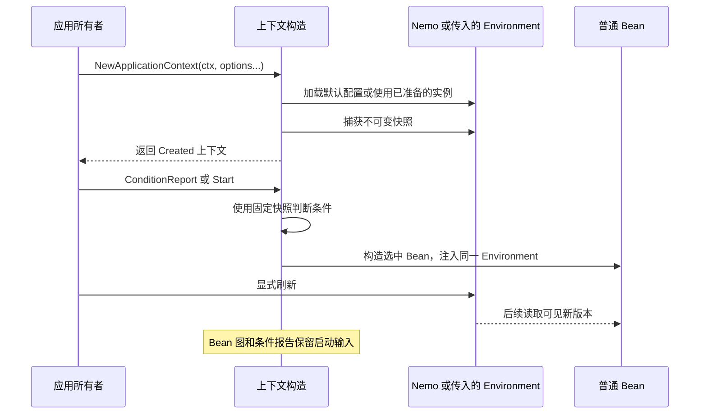

# 应用 Environment



`NewApplicationContext(ctx, options...)` 在普通 Bean 创建前准备配置，加载过程可通过
`ctx` 取消。配置无效、来源加载失败或操作取消时返回错误，不调用普通工厂。
生成的 `init` 只登记元数据。

默认实现为 Nemo，读取进程环境变量，并从当前工作目录加载可选的 `application.yml`
与 `application-<profile>.yml`。进程变量名转为小写，并将下划线替换为点。
这是 Nemo 的精确映射，不采用 Spring 的宽松绑定规则。无效键或键冲突使加载失败。
默认进程来源的值按原始文本保留，其中的 `${...}` 不作为配置语法执行。
配置文件与 `WithProperties` 中的占位符仍按 Gosr/Nemo 规则展开。

| 优先级，从高到低 | 来源 |
| --- | --- |
| 1 | `WithProperties` 复制的字符串 |
| 2 | `WithEnvironmentOptions` 显式提供的 Provider |
| 3 | 进程环境变量 |
| 4 | 发现的配置文件，Profile 文件优先于基础文件 |

Nemo 构造选项可配置 Provider、Profile、默认 Profile、文件发现和校验。
文件发现选项与可选的默认发现配置共同生效。若需完全显式地选择来源，可传入
已经准备好的自定义 Environment。容器不会自动启动 Watch。

```go
application, err := app.NewApplicationContext(ctx,
    app.WithEnvironmentOptions(
        nemoenv.WithProfiles("dev"),
    ),
    app.WithProperties(map[string]string{
        "storage.mode": "memory",
    }),
)
```

`app` 导入 `github.com/longxi-go/ioc/pkg/context`，`nemoenv` 导入
`github.com/longxi-go/nemo/pkg/environment`。完整代码见
[environment 示例](https://github.com/longxi-go/ioc/tree/main/examples/environment)。

## 注入与所有权

```go
// +ioc:component
type Service struct {
    // +ioc:inject
    environment gosrenv.Environment
}
```

`gosrenv` 导入 `github.com/longxi-go/gosr/pkg/environment`，构造函数也可将该接口
声明为参数。`application.Environment()` 返回同一已初始化实例。该基础设施的名称
为 `iocEnvironment`，属于保留的单例定义，不能由用户注册、装饰或替换为其他主候选。
按名称选择的其他 Environment Bean 可以共存。

`WithEnvironment(owner)` 接受具名接口 `SnapshotEnvironment`，由 Gosr 的
`Environment` 与 `SnapshotProvider` 组合而成。owner 必须已经初始化，发布不可变且
可并发读取的快照。此选项不能与 `WithProperties` 或 `WithEnvironmentOptions` 同用。
应用不会启动外部 Watch，也不接管其关闭责任。

## 条件与刷新

属性与 Profile 条件使用上下文构造时捕获的不可变快照。即使实时 Environment 在
`ConditionReport()` 与 `Start` 之间刷新，两者仍读取相同输入。Bean 存在性条件
随后检查已接受定义，再进行依赖绑定与构造。
[注解规则](annotations.md#property-and-profile-conditions) 定义匹配、占位符展开和诊断。

注入的 Environment 是实时 owner，后续读取可以看到新版本。多次相关读取需要一致时，
应通过 `SnapshotProvider` 捕获 `Snapshot()`，或向类型化绑定器传入明确快照。刷新不会重新创建 Bean、
重新判断条件、重绑定配置结构体或改变已激活的依赖图。
