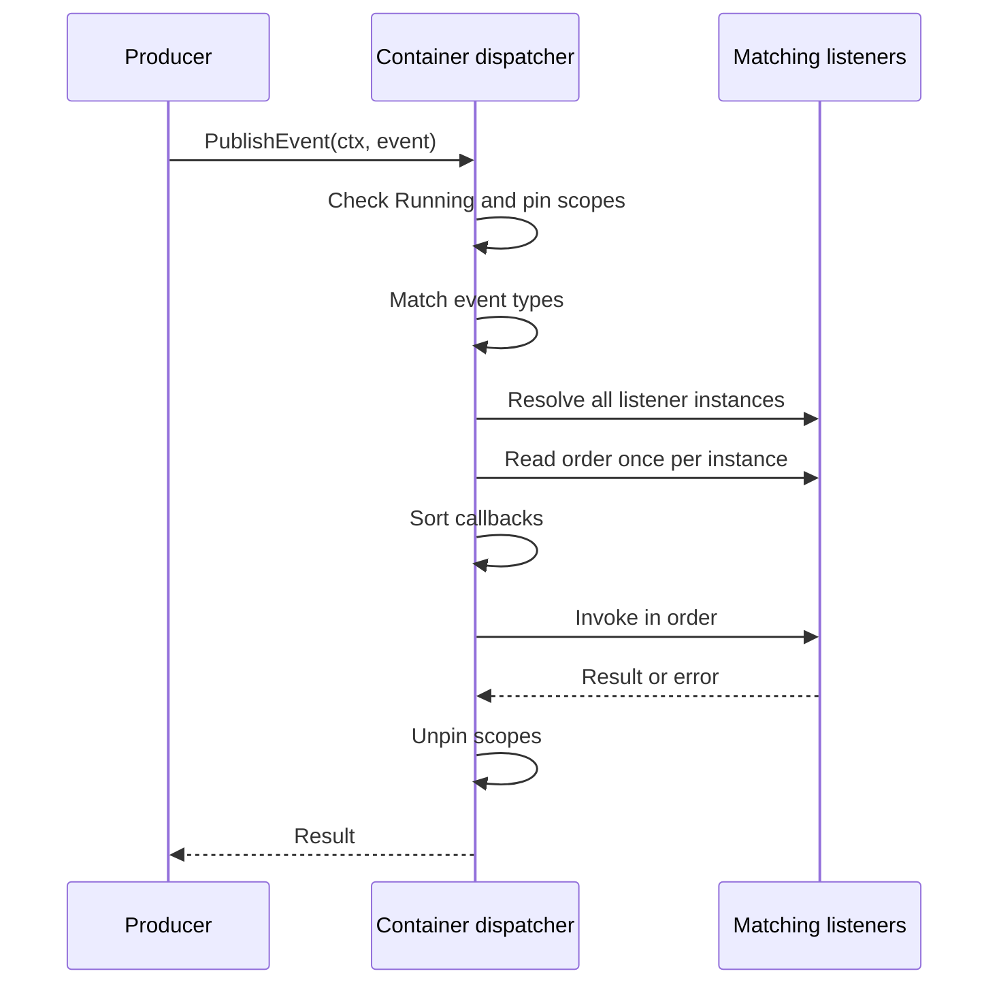

# Typed application events

Events use the independent gosr `pkg/event` and `pkg/ordered` contracts. An event
implements `event.Event`, commonly by embedding `event.BaseEvent`. Inject
`event.Publisher` or call `app.PublishEvent(ctx, value)` for the same local path.
The default publisher is a reserved per-application primary; alternatives must be
selected by name and cannot replace it as primary.

```go
// +ioc:component:name=orderAudit
// +ioc:listener
type Audit struct{}

func (*Audit) OnEvent(ctx context.Context, placed OrderPlaced) error {
    return nil
}

// +ioc:component
type Notifications struct{}

// +ioc:listen
// +ioc:order=200
func (*Notifications) onPlaced(ctx context.Context, placed OrderPlaced) error {
    return nil
}
```

This declaration fragment assumes `OrderPlaced` implements `event.Event`.
The [executable example](https://github.com/longxi-go/ioc/tree/main/examples/events)
contains a complete producer, listeners, startup and cleanup. `listener` subscribes typed OnEvent on an explicitly registered Bean or component. `listen` subscribes an
explicit method on a managed concrete owner; ordinary OnEvent methods do not
implicitly subscribe. Both require `(context.Context, E) error`, validated at
generation time, and generate direct same-package calls. A twice-annotated OnEvent
has one listener identity and is delivered once.

## Preparation and delivery



All matching instances and ordering keys prepare before any listener callback.
Preparation failure invokes no callbacks. Unrelated lazy listeners are not
constructed. Business delivery is synchronous and stops at the first callback
failure; prior callbacks are not rolled back. Panics become errors with listener
identity/provenance. Cancellation/phase checks occur before preparation, each
invocation and successful return; user callbacks must cooperate with cancellation.

A publication pins effective request/custom scopes until it returns, so concurrent
scope Close waits for callbacks before resource destruction. Application shutdown
cancels and drains publications. Nested publication may proceed, but re-entering
the same active listener along the propagated Context chain produces a publication
cycle error. Unrelated concurrent publications can invoke the same listener
concurrently; mutable listeners need synchronization. Pass the callback Context to nested operations; do not retain it after the callback
returns.

## Event ordering {#event-ordering}

The dispatcher samples `ordered.Ordered.Order()` once per owner per publication.
It sorts `PriorityOrdered` instances first, then ascending numeric order, then
stable listener declaration ID. Unordered instances use `ordered.LowestPrecedence`.
A listen method's `+ioc:order` overrides that method's numeric event order while
preserving its instance's priority group. Ordering does not construct unrelated
listener instances.

`BeanDefinition.Order` (a declaration-level `+ioc:order`) controls
injected-collection order, not condition or construction order. It does not supply event order. Event instance order
and method overrides do not change Bean selection or collection order.

## Lifecycle barriers

Here, `gs` is the import alias for `github.com/longxi-go/gosr/pkg/ioc`.
All application listeners are singleton. Business-only listeners can be lazy;
event-wide and container-notification listeners must be eager.

| Notification | Phase and behavior |
| --- | --- |
| `gs.ContextRefreshed` | After eager Init/Start, before Running; failure fails startup and triggers rollback |
| `gs.ContextClosing` | Only after an application reached Running; existing eligible owners only, before Stop/Destroy; attempts other listeners and joins preparation/order/callback errors |

Business publication is admitted only while Running; startup hooks and Refreshed
listeners cannot publish business events before that barrier completes. Public
publication rejects reserved ContextRefreshed/ContextClosing values and pointers.
Closing notification never constructs a lazy object or permits fresh lookup from
cleanup callbacks. Application Close cannot be joined from its own callback.

This is an in-process synchronous facility, with no async queue, transaction,
durable delivery or distributed bus guarantee. See
[application lifecycle](architecture.md#application-lifecycle) for shutdown order.
