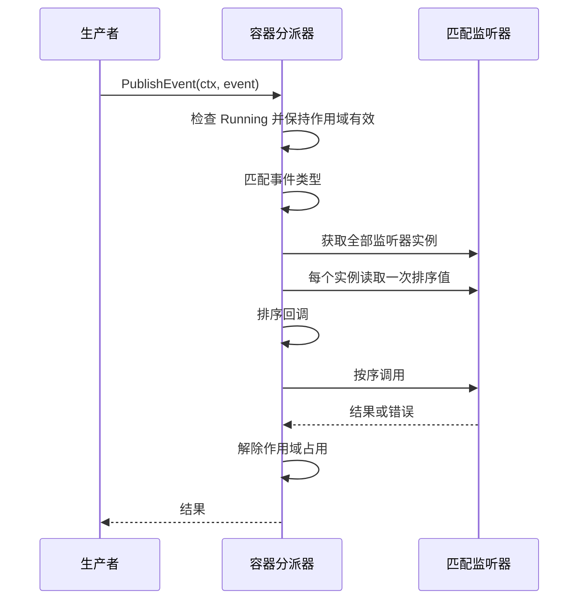

# 类型化应用事件

事件使用 gosr 的 `pkg/event` 和 `pkg/ordered` 契约。事件需实现 `event.Event`，
通常嵌入 `event.BaseEvent`。注入 `event.Publisher` 或调用
`app.PublishEvent(ctx, value)` 均通过应用内的分派器投递。默认发布器是每个应用
保留的主候选；其他发布器必须按名称选择，不能替换默认主候选。

```go
// +ioc:component:name=orderAudit
// +ioc:listener
type Audit struct{}

func (*Audit) OnEvent(ctx context.Context, placed OrderPlaced) error {
    return nil
}

// +ioc:component
type Notifications struct{}

// +ioc:listen
// +ioc:order=200
func (*Notifications) onPlaced(ctx context.Context, placed OrderPlaced) error {
    return nil
}
```

此声明片段假定 `OrderPlaced` 实现 `event.Event`。
[可执行示例](https://github.com/longxi-go/ioc/tree/main/examples/events) 包含完整生产者、
监听器、启动和清理。`listener` 为显式注册的 Bean 订阅类型化 OnEvent；
`listen` 订阅
受管具体类型上标注的方法，普通 OnEvent 不会隐式订阅。二者都要求
`(context.Context, E) error`，生成时校验并产生同包直接调用。同一 OnEvent 使用
两种注解仍只有一个监听器 ID，只投递一次。

## 准备与投递



全部匹配实例和排序键准备完成后才开始监听器回调。准备失败不会调用任何回调。
不构造无关的延迟监听器。业务投递同步执行，首个回调失败即停止；先前回调不会
回滚。panic 转为带监听器身份/来源的错误。准备前、每次调用前及成功返回前检查
取消/阶段状态；用户回调必须配合取消。

一次投递在返回前保持所用请求/自定义作用域有效，因此并发 Scope Close 会等待
回调结束后再销毁资源。应用关闭取消并等待投递。允许嵌套发布，但沿传递 Context 链重新
进入同一活跃监听器会产生投递循环错误。无关并发投递可能并发调用同一监听器，
可变监听器需自行同步。嵌套操作应传递回调接收的 Context，不得在回调返回后保存
该 Context。

## 事件排序 {#event-ordering}

分派器在每次投递时，对每个监听器实例读取一次 `ordered.Ordered.Order()`。
先排列实现 `PriorityOrdered` 的实例，再按排序值升序，最后按稳定的监听器声明
ID 排序。未实现排序接口的实例使用 `ordered.LowestPrecedence`。listen 方法的
`+ioc:order` 覆盖该方法的排序值，不改变实例所属的优先组。排序不需要创建无关
监听器实例。

`BeanDefinition.Order`，即声明级 `+ioc:order`，控制注入集合顺序，不控制条件或构造顺序，不提供
事件顺序。事件实例顺序和方法覆盖不会改变 Bean 选择或集合顺序。

## 生命周期屏障

本节中 `gs` 是 `github.com/longxi-go/gosr/pkg/ioc` 的导入别名。
应用监听器全部属于单例。仅处理业务事件的监听器可延迟构造；接收全部事件或处理
容器通知的监听器必须立即构造。

| 通知 | 阶段与行为 |
| --- | --- |
| `gs.ContextRefreshed` | 非延迟单例 Init/Start 之后、Running 之前；失败使启动失败并回滚 |
| `gs.ContextClosing` | 仅在应用曾到达 Running 后发送；只使用已有且匹配的实例，在 Stop/Destroy 前投递；继续尝试其他监听器，合并准备/排序/回调错误 |

业务发布只在 Running 接受；启动方法和 Refreshed 监听器不能在屏障完成前发布业务
事件。公开发布拒绝保留的 ContextRefreshed/ContextClosing 值及指针。关闭通知不会
构造延迟对象，清理回调中也不允许发起新查询。应用 Close 不能在自己的回调中等待。

这是进程内同步机制，不提供异步队列、事务、持久投递或分布式总线保证。
关闭顺序见[应用生命周期](architecture.md#application-lifecycle)。
