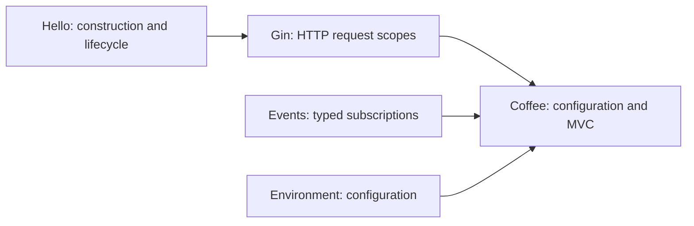

# Application examples

Examples cover container composition, HTTP request scopes and MVC application
assembly. Each directory contains executable source and generation commands.

| Example | Capabilities | Module / execution |
| --- | --- | --- |
| [Hello](https://github.com/longxi-go/ioc/tree/main/examples/hello) | Constructor/field injection, request Provider, startup and cleanup | Root module: `go run ./examples/hello` |
| [Events](https://github.com/longxi-go/ioc/tree/main/examples/events) | Typed subscriptions and listener ordering | Root module: `go run ./examples/events` |
| [Environment](https://github.com/longxi-go/ioc/tree/main/examples/environment) | Prepared Environment and typed configuration access | Root module: `go run ./examples/environment` |
| [Prerequisites](https://github.com/longxi-go/ioc/tree/main/examples/prerequisites) | Named initialization prerequisites | Root module: `go run ./examples/prerequisites` |
| [Gin integration](gin.md) | Generated HTTP routing, singleton Provider, per-request identity and cleanup | Independent module: `cd examples/gin && make run` |
| [Coffee MVC](coffee.md) | Nemo binding, SQLite, HTML/REST, conditional Beans and typed events | Independent module: `cd examples/coffee && make run` |

[Gin](gin.md) manages Request scopes around handler execution. [Coffee](coffee.md)
combines Nemo configuration, repositories, services, views, conditional listeners
and HTTP server shutdown.

Gin and Coffee declare their own dependencies in `go.mod`. Run generation and
checks from their respective directories; root `go test ./...` does not enter
nested modules. Their Makefiles select the compilers matching their module
requirements. No sibling checkout or local `replace` directive is required.

The [quick start](../quick-start.md) introduces the generation workflow; the
[annotation reference](../annotations.md) defines marker attributes and constraints.
