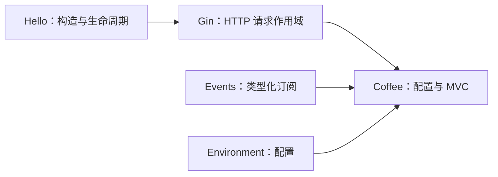

# 应用示例

示例涵盖容器装配、HTTP 请求作用域和 MVC 应用装配。各目录包含可执行源码
及相应的代码生成命令。

| 示例 | 能力 | 模块与运行方式 |
| --- | --- | --- |
| [Hello](https://github.com/longxi-go/ioc/tree/main/examples/hello) | 构造/字段注入、请求 Provider、启动与清理 | 根模块：`go run ./examples/hello` |
| [Events](https://github.com/longxi-go/ioc/tree/main/examples/events) | 类型化订阅和监听顺序 | 根模块：`go run ./examples/events` |
| [Environment](https://github.com/longxi-go/ioc/tree/main/examples/environment) | 预先准备的 Environment 和类型化配置访问 | 根模块：`go run ./examples/environment` |
| [Prerequisites](https://github.com/longxi-go/ioc/tree/main/examples/prerequisites) | 按名称声明初始化前置条件 | 根模块：`go run ./examples/prerequisites` |
| [Gin 集成](gin.md) | HTTP 注解路由、单例 Provider、请求实例隔离与清理 | 独立模块：`cd examples/gin && make run` |
| [Coffee MVC](coffee.md) | Nemo 绑定、SQLite、HTML/REST、条件 Bean 和类型化事件 | 独立模块：`cd examples/coffee && make run` |

[Gin](gin.md) 在处理器执行期间管理 Request 作用域；[Coffee](coffee.md) 集成
Nemo 配置、仓储、Service、视图、按条件启用的监听器及 HTTP 服务关闭流程。

Gin 和 Coffee 分别在自己的 `go.mod` 中声明依赖。生成与检查命令应在各自目录
执行，根目录的 `go test ./...` 不遍历嵌套模块。示例 Makefile 按模块依赖选择
编译器版本，不要求相邻仓库或本地 `replace` 指令。

生成流程见[快速开始](../quick-start.md)，注解属性及约束见
[注解参考](../annotations.md)。
