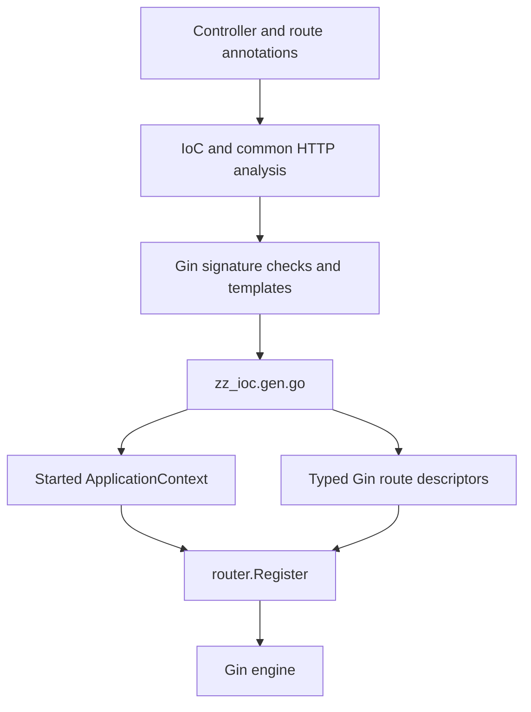
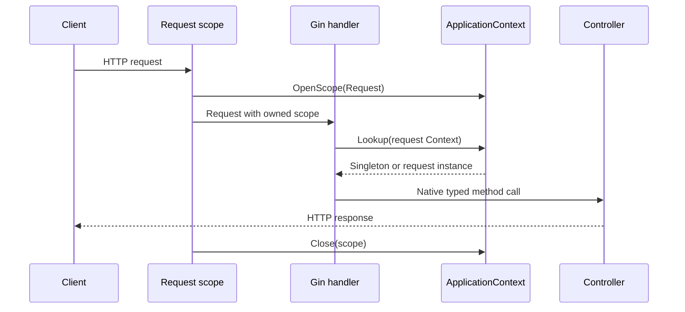

# HTTP annotations and the Gin adapter

HTTP mappings are declared beside Go types and functions. `ginctl` compiles the
mappings and IoC definitions together. Gin-specific dependencies belong to the
separate `github.com/longxi-go/ioc/adaptors/gin` module.



## Declare a Controller

```go
// HealthController exposes operational endpoints.
// +ioc:controller:name=healthController
// +ioc:http:route=/api/v1/
type HealthController struct {
    // +ioc:inject
    service *HealthService
}

// +ioc:http:get=/healthz
func (h *HealthController) health(ctx *gin.Context) {
    ctx.JSON(http.StatusOK, h.service.Status())
}
```

This declaration maps `GET /api/v1/healthz`. `+ioc:controller` registers a
component; it does not need an additional `+ioc:component`. Its `name` and
`aliases` attributes use the same selection rules as component registration.
Constructor registration and Controller specialization cannot appear on the same
declaration. Field injection, lifecycle hooks, qualifiers, conditions and profiles
retain their IoC semantics.

Only annotated methods become endpoints. Private methods are supported because
the generated adapter lives in the declaring package. Method signatures must be
`func(*gin.Context)` with no results or variadic parameters. A standalone function
with that signature can carry a route annotation without becoming a Bean factory.
There is no separate required Handler annotation.

## Annotation forms

| Annotation | Target | Meaning |
| --- | --- | --- |
| `+ioc:controller:name=healthController,aliases={health}` | Named, non-generic struct | Component registration with Controller semantics; attributes are optional |
| `+ioc:http:route=/api/v1/` | Controller | Common path prefix; creates no endpoint |
| `+ioc:http:route:path=/api/v1/` | Controller | Structured equivalent of the common prefix |
| `+ioc:http:route:method=GET,path=/healthz` | Controller method or standalone function | Explicit HTTP method and path |
| `+ioc:http:get=/healthz` | Controller method or standalone function | Shorthand for a GET mapping |
| `+ioc:http:post=/orders` | Controller method or standalone function | Shorthand for a POST mapping |
| `+ioc:http:put=/orders/:id` | Controller method or standalone function | Shorthand for a PUT mapping |
| `+ioc:http:patch=/orders/:id` | Controller method or standalone function | Shorthand for a PATCH mapping |
| `+ioc:http:delete=/orders/:id` | Controller method or standalone function | Shorthand for a DELETE mapping |
| `+ioc:http:head=/healthz` | Controller method or standalone function | Shorthand for a HEAD mapping |
| `+ioc:http:options=/orders` | Controller method or standalone function | Shorthand for an OPTIONS mapping |

Each handler accepts one mapping declaration. The canonical form requires both
`method` and `path` on a handler. Shorthand and
canonical declarations produce the same route model. An unannotated method is
not an implicit mapping, and a Controller prefix does not imply GET or Any.

Paths are static, absolute route declarations. A method's leading `/` joins the
Controller prefix rather than replacing it. Boundary slashes are joined; an
endpoint's trailing slash remains significant. Ambiguous separators, dot
segments, query strings, fragments and placeholder expressions are rejected.
Gin parameters such as `:id` and `*path` follow Gin's native matching rules.

## Generate and register

```sh
go get github.com/longxi-go/ioc/adaptors/gin@v0.2.0
go install github.com/longxi-go/ioc/adaptors/gin/cmd/ginctl@v0.2.0

ginctl generate --entry ./cmd/server --roots ./internal/...
ginctl check --entry ./cmd/server --roots ./internal/...
```

The root `ioctl` has no Gin backend. Use `ginctl` for HTTP applications; it
executes the same IoC pipeline with the Gin backend selected explicitly.
Notices, structural formatting, overlay type checking and output ownership remain
under the common compiler. Generation never creates Controllers or starts an
application. `check` verifies generated bytes without changing source.

The Gin backend supplies temporary typed declarations during initial source
analysis, so application code can call `IOCGinRoutes` before its first generation.
These declarations exist only in memory. The compiler removes them before
validating the final generated output.

```go
if err := app.Start(ctx); err != nil {
    return err
}
middleware, err := scope.Middleware(scope.Options{
    Manager: app,
    OnError: report,
})
if err != nil {
    return err
}
engine := gin.New()
engine.Use(gin.Recovery(), middleware)
if err := router.Register(ctx, engine, app, IOCGinRoutes()...); err != nil {
    return err
}
```

`router` and `scope` refer to `adaptors/gin/pkg/router` and
`adaptors/gin/pkg/scope`. The `report` callback receives admission and cleanup
errors; it must be concurrency-safe, return promptly and avoid panic. A zero
`CleanupTimeout` selects five seconds; negative values are invalid. Middleware
construction rejects a missing manager or error callback.

`IOCGinRoutes` is generated in the selected application entry package. It
aggregates route descriptors from the owned source packages. Route methods use
their declaring package's generated bridge, so private receiver types and methods
do not need exported forwarding methods.

`router.Register` requires a running application. It selects Controller routes
from the active definitions after condition evaluation. An excluded Controller
publishes no routes. Conflicting active mappings fail assembly; native routes
already installed in the engine also participate in conflict checks. Registration
must complete before HTTP admission. Discard an engine after failed registration;
Gin does not provide transactional route rollback.

## Scope and cleanup



Controllers support singleton and request scopes. Generated handlers resolve the
Controller with the request context; they never capture a request instance during
startup. Request Controllers require the adapter's scope middleware. Prototype
and custom Controller lifetimes are rejected because route lookup alone does not
define their acquisition and cleanup ownership.

Install Recovery before request-scope middleware. Scope cleanup runs during stack
unwinding, including aborted and panicking requests, and uses a bounded context
independent of request cancellation. HTTP admission and draining remain owned by
the application; drain requests before closing the ApplicationContext.

A Controller lookup failure records a Gin error and returns HTTP 503. Business
status codes, JSON/HTML rendering, request decoding and error responses remain
native handler responsibilities.

## Boundaries

Common HTTP annotation parsing and the public `pkg/codegen/http` model do not
import Gin. Gin runtime routing and scope packages do not import the compiler.
An additional framework adapter can consume the common model and provide its own
signature checks, templates and runtime integration. Native Gin handler source
is not portable to frameworks with different context or return-value contracts.

HTTP generation covers the selected module's owned source packages. Publishing
HTTP route metadata with `--library` and discovering HTTP routes from dependency
modules are not supported; `--library` rejects HTTP endpoints explicitly. IoC
library publication remains available for ordinary Beans.

The [Gin example](examples/gin.md) contains a small request-scope integration.
The [Coffee application](examples/coffee.md) applies the same mechanism to MVC,
SQLite, configuration binding, conditions, lifecycle hooks and events.
