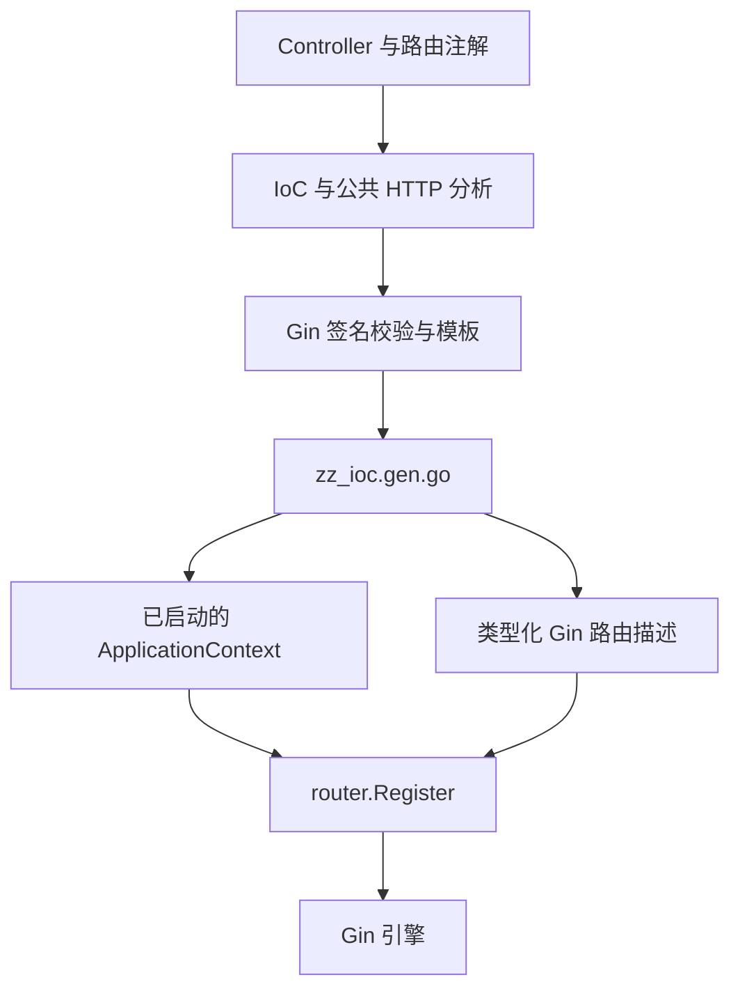
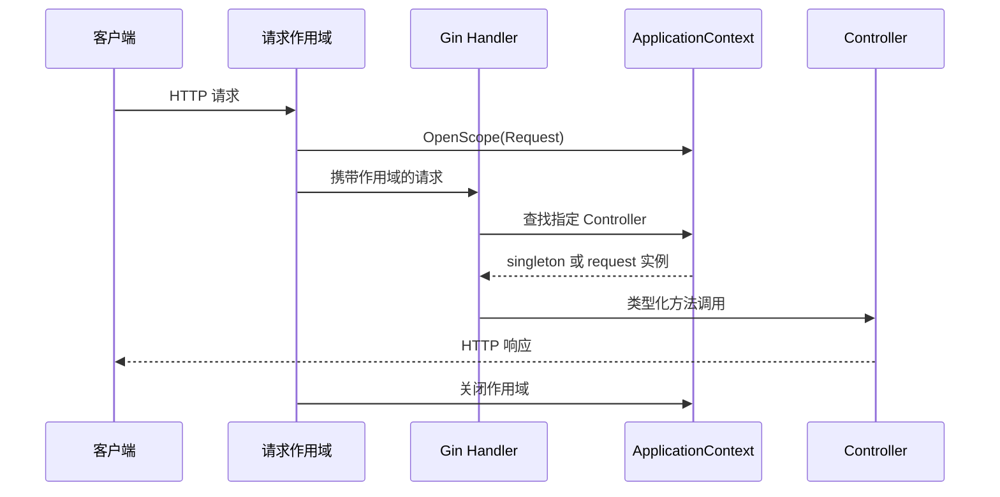

# HTTP 注解与 Gin 适配器

HTTP 映射声明在 Go 类型和函数的注释中，由 `ginctl` 与 IoC 定义一起编译。
Gin 依赖位于独立模块 `github.com/longxi-go/ioc/adaptors/gin`。



## 声明 Controller

```go
// HealthController exposes operational endpoints.
// +ioc:controller:name=healthController
// +ioc:http:route=/api/v1/
type HealthController struct {
    // +ioc:inject
    service *HealthService
}

// +ioc:http:get=/healthz
func (h *HealthController) health(ctx *gin.Context) {
    ctx.JSON(http.StatusOK, h.service.Status())
}
```

该声明映射 `GET /api/v1/healthz`。`+ioc:controller` 已包含组件注册，不需要
叠加 `+ioc:component`；`name`、`aliases` 与组件注册采用相同的选择规则。
同一声明不能同时使用构造函数注册与 Controller 注解。字段注入、生命周期钩子、
限定符、条件及 Profile 沿用既有 IoC 语义。

只有带路由注解的方法会成为端点。生成代码位于声明所在包，支持私有方法。
Gin Handler 的签名必须为 `func(*gin.Context)`，不接受返回值或可变参数。
同签名的包级函数可直接声明路由，不会因此注册为 Bean；无需额外的 Handler 注解。

## 注解形式

| 注解 | 目标 | 语义 |
| --- | --- | --- |
| `+ioc:controller:name=healthController,aliases={health}` | 具名、非泛型结构体 | 注册 Controller 组件；属性均可省略 |
| `+ioc:http:route=/api/v1/` | Controller | 公共路径前缀，不创建端点 |
| `+ioc:http:route:path=/api/v1/` | Controller | 公共前缀的结构化写法 |
| `+ioc:http:route:method=GET,path=/healthz` | Controller 方法或包级函数 | 指定 HTTP 方法和路径 |
| `+ioc:http:get=/healthz` | Controller 方法或包级函数 | GET 映射简写 |
| `+ioc:http:post=/orders` | Controller 方法或包级函数 | POST 映射简写 |
| `+ioc:http:put=/orders/:id` | Controller 方法或包级函数 | PUT 映射简写 |
| `+ioc:http:patch=/orders/:id` | Controller 方法或包级函数 | PATCH 映射简写 |
| `+ioc:http:delete=/orders/:id` | Controller 方法或包级函数 | DELETE 映射简写 |
| `+ioc:http:head=/healthz` | Controller 方法或包级函数 | HEAD 映射简写 |
| `+ioc:http:options=/orders` | Controller 方法或包级函数 | OPTIONS 映射简写 |

每个 Handler 只能声明一个映射。完整写法必须包含 `method` 和 `path`，与相应简写生成相同的路由模型。
未标注方法不会隐式暴露；Controller 前缀也不包含默认 GET 或 Any 映射。

路径必须为静态绝对路径。方法路径开头的 `/` 与 Controller 前缀拼接，不会覆盖
前缀；拼接处的斜杠会合并，端点末尾的斜杠保留。歧义分隔符、`.`/`..` 路径段、
查询字符串、片段和占位符表达式会被拒绝。`:id`、`*path` 等参数遵循 Gin 匹配规则。

## 生成与注册

```sh
go get github.com/longxi-go/ioc/adaptors/gin@v0.2.0
go install github.com/longxi-go/ioc/adaptors/gin/cmd/ginctl@v0.2.0

ginctl generate --entry ./cmd/server --roots ./internal/...
ginctl check --entry ./cmd/server --roots ./internal/...
```

根模块的 `ioctl` 未装配 Gin 后端；HTTP 应用使用 `ginctl`，通过显式选择 Gin
后端运行同一套 IoC 编译流水线。文件头、结构格式化、覆盖层类型检查和输出所有权
仍由公共编译器处理。生成过程不创建 Controller、不启动应用；`check` 只校验
生成结果，不修改源码。

Gin 后端在初次源码分析时提供临时类型声明，应用代码可以在首次生成前引用
`IOCGinRoutes`。这些声明仅存在于内存中，编译器会在校验最终生成结果前移除它们。

```go
if err := app.Start(ctx); err != nil {
    return err
}
middleware, err := scope.Middleware(scope.Options{
    Manager: app,
    OnError: report,
})
if err != nil {
    return err
}
engine := gin.New()
engine.Use(gin.Recovery(), middleware)
if err := router.Register(ctx, engine, app, IOCGinRoutes()...); err != nil {
    return err
}
```

`router` 与 `scope` 分别来自 `adaptors/gin/pkg/router` 和
`adaptors/gin/pkg/scope`。`report` 接收作用域打开和清理错误，必须并发安全、
及时返回且不发生 panic。`CleanupTimeout` 为零时使用五秒超时，负值非法。
缺少 manager 或错误回调时，中间件构造失败。

`IOCGinRoutes` 生成在选定的应用入口包，汇总所属模块中各源包的路由描述。
方法调用通过声明所在包的生成代码完成，私有接收者类型和方法不需要增加公开转发方法。

`router.Register` 要求应用处于 Running 状态，并根据条件求值后的有效定义选择
Controller 路由。未启用的 Controller 不注册路由；有效映射冲突时，组装返回错误。
引擎上已有的原生路由也参与冲突校验。注册必须在接收 HTTP 请求前完成。
注册失败后应丢弃该引擎，Gin 不提供事务式路由回滚。

## 作用域与清理



Controller 支持 singleton 和 request 作用域。生成的 Handler 使用请求 Context
解析 Controller，不在启动阶段捕获请求实例。request Controller 必须安装适配器
提供的请求作用域中间件。prototype 和自定义 Controller 作用域会被拒绝，因为
单次路由查找不能定义它们的获取和清理所有权。

Recovery 应安装在请求作用域中间件之前。清理在栈展开时执行，覆盖正常完成、
中止及 panic，并使用不受请求取消影响、具有时限的 Context。HTTP 接入和排空
仍由应用管理；关闭 ApplicationContext 前必须先排空请求。

Controller 查找失败时，Handler 记录 Gin 错误并返回 HTTP 503。业务状态码、
JSON/HTML 输出、请求解码及业务错误响应仍由原生 Handler 处理。

## 能力边界

公共 HTTP 注解解析与 `pkg/codegen/http` 模型不依赖 Gin；Gin 的运行时路由和
作用域包不依赖编译器。其他框架适配器可以使用公共模型，提供各自的签名校验、
模板和运行时集成。不同框架的 Context 或返回值契约不同，Gin Handler 源码不能
据此直接跨框架复用。

HTTP 生成仅处理选定模块拥有的源包，尚不支持通过 `--library` 发布 HTTP 路由
元数据，也不扫描依赖模块中的 HTTP 路由。包含 HTTP 端点时使用 `--library`
会明确报错；普通 Bean 的 IoC 库发布不受影响。

[Gin 示例](examples/gin.md) 展示请求作用域集成；
[Coffee 应用](examples/coffee.md) 将同一机制用于 MVC、SQLite、配置绑定、条件、
生命周期钩子与事件。
