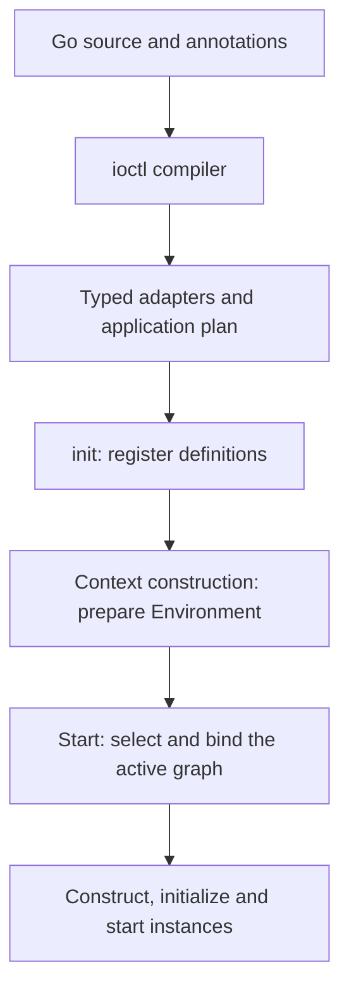

# Managed IoC through generated Go

**ioc** generates construction, private field injection, lifecycle calls and
typed lookup code from annotations in Go comments. The command is **ioctl**.
Runtime construction, injection and discovery use no reflection or unsafe.

[Build an application](quick-start.md){ .md-button .md-button--primary }
[Annotation reference](annotations.md){ .md-button }

| Concern | Behavior |
| --- | --- |
| Registration | Generated init registers definitions and plans without constructing instances |
| Startup | Each application context binds its graph and owns lifecycle execution |
| Lookup | Typed `app.GetBean[T](ctx)` uses a generated query plan |
| Dependencies | Constructor parameter types and injected field types; explicit selectors |
| Scope | Singletons, explicit request/custom scopes, prototype leases |
| Lifecycle | Init/Start/Stop/Destroy, startup rollback and repeatable close |
| Events | Typed synchronous listeners, instance ordering and lifecycle barriers |
| Libraries | Library-owned adapters/index/metadata; application-owned composition |

Shared contracts are defined by [gosr](https://github.com/longxi-go/gosr).
The [architecture](architecture.md) explains package boundaries, selection,
ownership, concurrent creation and publication. The [event guide](events.md)
separates event ordering from Bean ordering.

## Application examples

The [example index](examples/index.md) covers container fundamentals, HTTP
integration and a complete application. [Gin request scopes](examples/gin.md)
connect router execution to managed Beans. [Coffee MVC](examples/coffee.md)
combines Nemo binding, repository/Service injection, HTML/REST controllers,
conditional listeners and resource shutdown.

## Supported boundaries and compatibility

The container supports a statically known graph with configuration-dependent
candidate selection at startup. It does not provide runtime source discovery,
dynamic graph refresh, automatic configuration rebinding, built-in Web framework adapters,
early-exposed circular objects or arbitrary method interception.

Public APIs follow the module version. Version 0.x may change APIs between minor
versions; pin dependencies and review changes before upgrading. Generated Bean
registrations have their own schema/ABI, checked separately from the module version.
Use matching CLI/runtime versions and regenerate library and application output
when that ABI changes. See [publication rules](architecture.md#library-publication)
for schema and ABI versions.

Consumer analysis accepts compatible portable library publications across build
environments and diagnoses incompatible source/type variants. Each publication is
checked against the consumer's build environment; incompatible variants require
regeneration.
