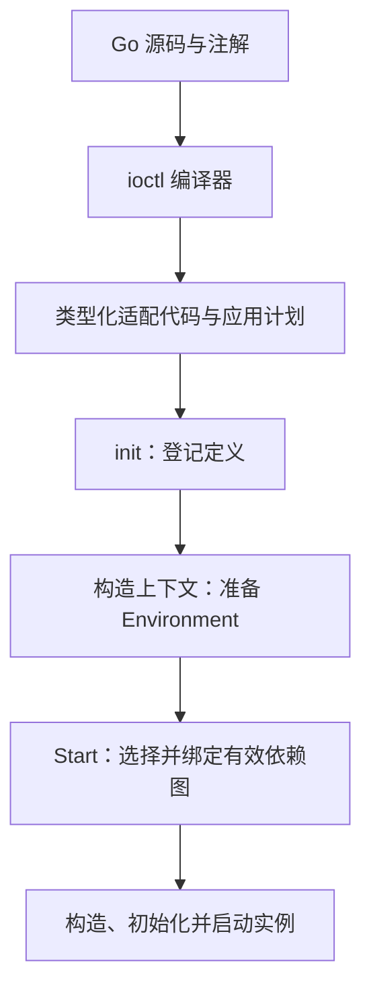

# 通过生成 Go 代码实现托管 IoC

**ioc** 根据 Go 注释中的注解生成构造、私有字段注入、生命周期调用和类型化查询
代码。命令名为 **ioctl**。运行时构造、注入和发现不依赖反射或 unsafe。

[构建应用](quick-start.md){ .md-button .md-button--primary }
[注解参考](annotations.md){ .md-button }

| 关注点 | 行为 |
| --- | --- |
| 注册 | 生成的 init 登记定义和计划，不构造实例 |
| 启动 | 每个应用上下文绑定自己的图并执行生命周期 |
| 查询 | 类型化 `app.GetBean[T](ctx)` 使用生成的查询计划 |
| 依赖 | 构造参数和注入字段的类型声明依赖，通过显式选择器消歧 |
| 作用域 | 单例、显式请求/自定义作用域、原型 Lease |
| 生命周期 | Init/Start/Stop/Destroy、启动回滚和可重复关闭 |
| 事件 | 类型化同步监听器、实例排序和生命周期屏障 |
| 库 | 库发布适配代码、索引和元数据，应用生成装配计划 |

共享契约属于 [gosr](https://github.com/longxi-go/gosr)。
[架构](architecture.md) 说明包边界、候选选择、所有权、并发构造和发布。
[事件指南](events.md) 区分事件排序和 Bean 排序。

## 支持边界与兼容性

容器支持静态已知的图，并在启动时依据配置选择候选。不提供运行时源码发现、
动态图刷新、自动配置重绑定、Web 集成、提前暴露循环对象或任意方法拦截。

公开 API 使用模块版本。0.x 版本可能在次版本升级时调整 API；请固定依赖，升级前
审阅变化。生成的 Bean 注册项具有独立的 schema/ABI，与模块版本分别检查。应配套
使用 CLI 和运行时版本；ABI 变化时重新生成库和应用产物。schema 与 ABI 版本见
[库发布规则](architecture.md#library-publication)。

消费方分析允许在不同构建环境间复用语义兼容的可移植库发布物，并诊断不兼容的
源码/类型变体。每个发布物都要通过消费方构建环境下的检查；不兼容变体需要重新生成。
