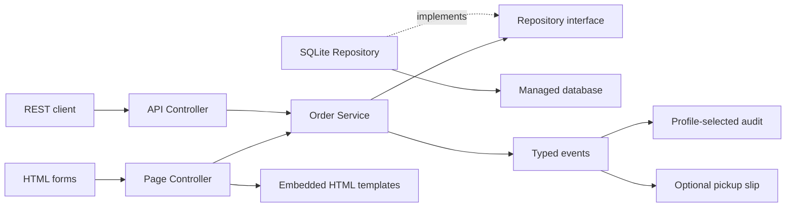
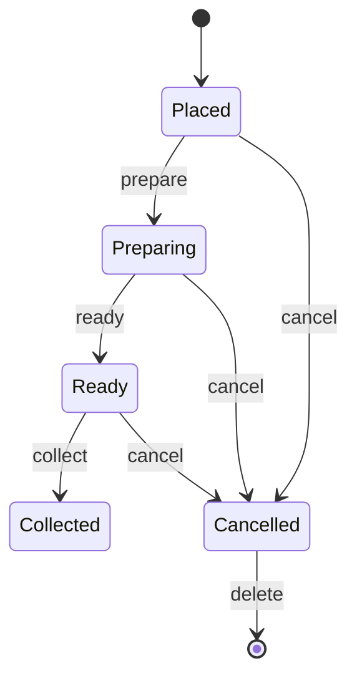
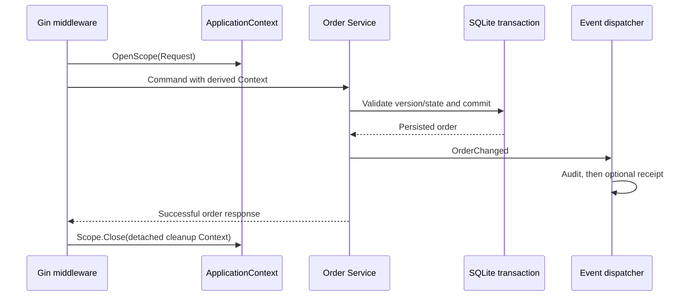

# Coffee shop MVC

[English](README.md) | [简体中文](README.zh_CN.md)

A Gin application for placing, preparing and collecting coffee orders. SQLite
persists orders; HTML forms and a JSON API share the same Service. IoC generates
cross-package construction, injection, lifecycle callbacks and event subscriptions.



## Application integration

IoC manages instances and lifecycle; Nemo provides the startup Environment and
typed binding. HTTP annotations generate typed Gin route registration. Configuration declarations,
Bean registration, generation order, Gin assembly, request scope and listener
activation are described in the [integration guide](docs/integration.md).

## Run

Use the Go version declared in [go.mod](go.mod). No C compiler or external database
server is required. From this directory:

```sh
make run
# Open http://127.0.0.1:8082/
```

The default database is `coffee.db` in the working directory. No orders are seeded;
data survives a restart. The fixed menu contains Espresso ($2.50), Americano ($3.00)
and Latte ($3.50). Prices use integer cents. One order contains one coffee and a
quantity from 1 to 100.

[application.yml](application.yml) supplies `cafe.server.address`,
`cafe.database.path` and `cafe.features.receipt.enabled`. Nemo binds these nested
properties to [Settings](internal/configuration/settings.go) before opening the
DB. Command flags override the address/database; `-profile dev` activates the
verbose audit implementation:

```sh
make run ARGS='-profile dev -db /tmp/coffee.db -address 127.0.0.1:8082'
```

To enable pickup slips, set `cafe.features.receipt.enabled: true` in the YAML
hierarchy, or set `CAFE_FEATURES_RECEIPT_ENABLED=true` in the process environment.
Slips are written to the application log after successful creation; no physical
printer or payment integration is involved. Conditions use the startup snapshot.
Changing an Environment value does not reselect Beans or reopen the database.

## Orders



Coffee, quantity and customer name can change only while Placed. All mutations
after creation require the current version. SQLite transactions check both version
and source state; stale edits and duplicate pickups return HTTP 409. Only cancelled
orders can be physically deleted. Collected orders remain available for lookup.
The list supports `status`, `limit` (1–100, default 20) and nonnegative `offset`.

| Method | Endpoint | Input/result |
| --- | --- | --- |
| GET | `/api/menu` | Fixed menu with server-owned prices |
| POST | `/api/orders` | `customer`, `coffee`, `quantity`; returns 201 and Location |
| GET | `/api/orders` | Paginated orders; optional status/limit/offset |
| GET | `/api/orders/:id` | Order snapshot and version |
| PUT | `/api/orders/:id` | Editable fields and `version` |
| POST | `/api/orders/:id/prepare` | `version` |
| POST | `/api/orders/:id/ready` | `version` |
| POST | `/api/orders/:id/collect` | `version` |
| POST | `/api/orders/:id/cancel` | `version` |
| DELETE | `/api/orders/:id?version=N` | Delete a cancelled order; returns 204 |

Mutation bodies use `application/json`, except DELETE's version query parameter.
Unknown JSON fields, trailing values, invalid bounds and bodies over 16 KiB are
rejected. Invalid input returns 400, unknown orders 404, state/version conflicts
409 and unsupported content types 415. Operational errors do not expose SQL or
filesystem details. Non-safe cross-origin browser requests are rejected by Go's
`http.CrossOriginProtection`; no mutation uses GET. This local example has no
customer authentication, payment, stock management or durable event delivery.

```sh
curl -i http://127.0.0.1:8082/api/orders \
  -H 'Content-Type: application/json' \
  -d '{"customer":"Ada","coffee":"latte","quantity":2}'
curl http://127.0.0.1:8082/api/orders/1
curl -X PUT http://127.0.0.1:8082/api/orders/1 \
  -H 'Content-Type: application/json' \
  -d '{"customer":"Ada","coffee":"espresso","quantity":2,"version":1}'
curl http://127.0.0.1:8082/api/orders/1/prepare \
  -H 'Content-Type: application/json' -d '{"version":2}'
curl http://127.0.0.1:8082/api/orders/1/ready \
  -H 'Content-Type: application/json' -d '{"version":3}'
curl http://127.0.0.1:8082/api/orders/1/collect \
  -H 'Content-Type: application/json' -d '{"version":4}'
```

Obtain order IDs and versions from API responses. HTML provides the same operations
at `/`, `/orders/new` and `/orders/:id`, with POST/redirect/GET after
successful form actions. Templates and CSS are embedded in the executable.

## Bean composition and annotations

| Annotation/mechanism | Declaration | Purpose |
| --- | --- | --- |
| `+ioc:bean` | [configuration](internal/configuration/settings.go), [Service](internal/service/service.go), [database](internal/infrastructure/database.go) | Typed constructors and infrastructure ownership |
| `+ioc:controller`, `+ioc:inject` | [API](internal/controller/api.go), [Pages](internal/controller/pages.go) | Same-package injection into private fields |
| `+ioc:http:route`, `+ioc:http:get`, `+ioc:http:post`, `+ioc:http:put`, `+ioc:http:delete` | Controller methods | Generated native Gin mappings |
| `+ioc:expose=model.Repository` | [NewSQLite](internal/repository/sqlite.go) | Publish the implemented repository contract explicitly |
| `name`, `aliases` | Service `orderService` / `orders`; logger `applicationLogger` / `defaultLogger` | Multiple names for one definition |
| `+ioc:primary`, `+ioc:qualifier=audit` | [loggers](internal/observation/logging.go) | Default application logger and separately selected audit channel |
| `+ioc:param` | [audit factories](internal/observation/audit.go) | Select constructor parameters by qualifier or name |
| `+ioc:scope=request`, `Provider[*model.Operation]` | [request metadata](internal/infrastructure/request.go), Service | Resolve metadata in the current caller's scope |
| `+ioc:depends-on=databaseMigration` | NewSQLite | Require completed migration Init without retaining its instance |
| `Init`, `Destroy` | Database and [migration](internal/infrastructure/migration.go) | Open/prepare before use, close after request drain or startup failure |
| `+ioc:listener`, `Ordered` | AuditListener | Typed audit callback, event order 100 |
| `+ioc:listen`, `+ioc:order=200` | [ReceiptListener.onOrder](internal/observation/receipt.go) | Typed method callback after audit |
| `+ioc:profile={dev}` | NewVerboseSink | Development audit implementation |
| `+ioc:conditional:on-missing-bean:type=AuditSink` | NewConciseSink | Default audit only when no eligible alternative exists |
| `+ioc:conditional:on-property:prefix=cafe.features.receipt,name=enabled,havingValue=true` | NewConsolePrinter | Explicit feature flag |
| `+ioc:conditional:on-bean:type=ReceiptPrinter` | ReceiptListener | Exclude the listener when the optional integration is absent |
| `+nemo:config:prefix=cafe` | Settings | Generated nested property binding |

With no dev profile, the concise audit sink is selected. In dev, the verbose sink
replaces it. Receipt-disabled startup excludes both printer and listener.
`ConditionReport` records the candidate selection outcomes.
Audit and receipt factories declare interface return types; decorators must satisfy
those interfaces. Both default factories return non-nil instances.

Bean selection happens before construction. `primary` resolves single dependency
ambiguity; it does not choose which condition wins. Instance `Ordered` and method
`+ioc:order` control event delivery; declaration-level Bean order controls collections.
The [annotation reference](../../docs/design/docs/annotations.md) describes the full
catalog, including mechanisms not needed by this application.



Events are synchronous and published after commit. Listener failures are logged
with order/correlation IDs; they do not convert an already committed mutation into
an HTTP failure. Failed writes publish no success event. There is no transaction
link between SQLite and the event dispatcher. Request-scoped metadata never stores
a Gin Context. Shutdown drains HTTP before closing the application and database.

## Layout and verification

`cmd/coffee` contains the thin entry and generated application plan. `internal/model`
owns domain data/contracts, `repository` SQL, `service` use cases, `controller` HTTP,
`view` templates, `configuration` binding, `infrastructure` resources and request
metadata, and `observation` event integrations. Business methods do not query the
container.

```sh
make generate
make check
make build
```

Generation uses the public compiler versions selected by this module. Generated
files are retained with their source. `make check` validates SQLite/HTTP behavior,
conditional selection, concurrency, source layout/notices, dependency consistency,
vet, coverage, race detection, lint and generated-output freshness. The repository
root's `go test ./...` does not traverse this nested module.

[examples/gin](../gin/README.md) retains the smaller Gin/request-scope integration.
