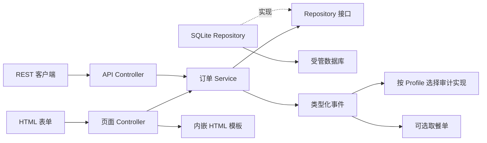
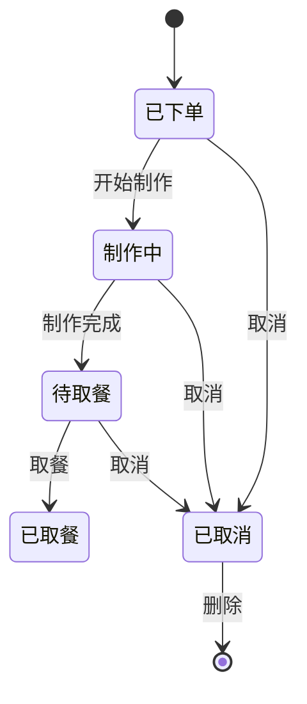
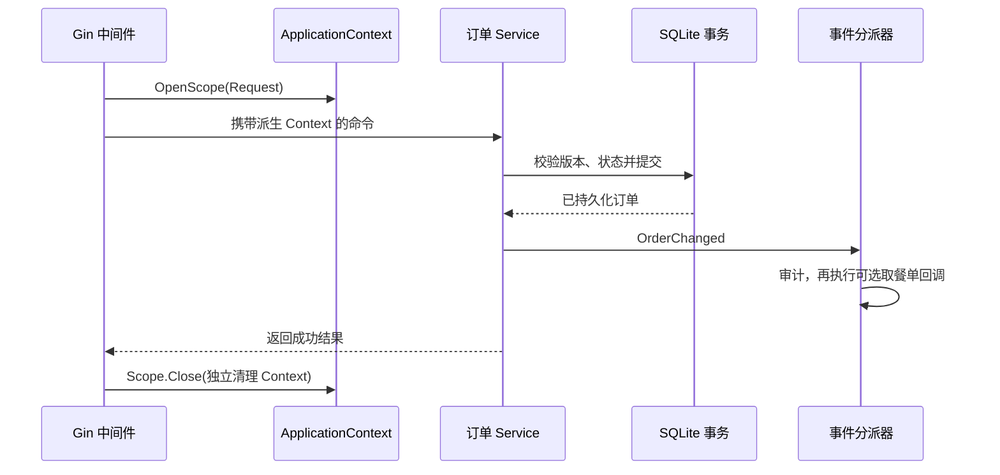

# 咖啡厅 MVC 示例

[English](README.md) | [简体中文](README.zh_CN.md)

使用 Gin 和 SQLite 实现咖啡订单的下单、制作和取餐。HTML 页面与 JSON API 共用
订单 Service；IoC 生成跨包构造、依赖注入、生命周期回调和事件订阅代码。



## 应用集成

IoC 管理实例与生命周期，Nemo 提供启动 Environment 和类型化绑定。HTTP 注解
生成类型化 Gin 路由注册代码。配置声明、Bean 注册、生成顺序、Gin 装配、请求作用域和监听器
激活见[集成指南](docs/integration.zh_CN.md)。

## 启动

Go 版本以 [go.mod](go.mod) 为准。SQLite 驱动使用纯 Go 实现，无需 C 编译器或
独立数据库服务。在当前目录执行：

```sh
make run
# 浏览器访问 http://127.0.0.1:8082/
```

默认数据文件为工作目录下的 `coffee.db`。启动时不插入演示订单，重启后保留数据。
固定菜单包含 Espresso（$2.50）、Americano（$3.00）和 Latte（$3.50）；金额使用
整数美分存储。每单选择一种咖啡，数量为 1–100 杯。

[application.yml](application.yml) 配置 `cafe.server.address`、
`cafe.database.path` 和 `cafe.features.receipt.enabled`。数据库打开前，Nemo 将
这些多级属性绑定到 [Settings](internal/configuration/settings.go)。命令行参数可
覆盖监听地址和数据库路径，`-profile dev` 启用开发环境的详细审计实现：

```sh
make run ARGS='-profile dev -db /tmp/coffee.db -address 127.0.0.1:8082'
```

在 YAML 对应层级中将 `cafe.features.receipt.enabled` 设为 `true`，或设置进程变量
`CAFE_FEATURES_RECEIPT_ENABLED=true`，即可启用取餐单。下单成功后，取餐单写入
应用日志；它不接入实体打印机，也不代表支付凭证。条件判断使用启动时的配置快照，
运行期间修改 Environment 不会重新选择 Bean 或重建数据库连接池。

## 订单规则与接口



只有已下单、尚未开始制作的订单可以修改姓名、咖啡和数量。创建后的每次变更都需
提交当前版本号。SQLite 在同一事务中校验版本与原状态；过期修改、重复取餐返回
HTTP 409。只有已取消订单允许物理删除，已取餐订单保留查询。
列表支持 `status`、`limit`（1–100，默认 20）和非负 `offset`。

| 方法 | 路径 | 输入或结果 |
| --- | --- | --- |
| GET | `/api/menu` | 固定菜单，价格由服务端确定 |
| POST | `/api/orders` | `customer`、`coffee`、`quantity`；返回 201 和 Location |
| GET | `/api/orders` | 分页订单，可传 status/limit/offset |
| GET | `/api/orders/:id` | 订单及其版本 |
| PUT | `/api/orders/:id` | 可修改字段和 `version` |
| POST | `/api/orders/:id/prepare` | `version` |
| POST | `/api/orders/:id/ready` | `version` |
| POST | `/api/orders/:id/collect` | `version` |
| POST | `/api/orders/:id/cancel` | `version` |
| DELETE | `/api/orders/:id?version=N` | 删除已取消订单，返回 204 |

除 DELETE 的查询参数外，API 变更请求使用 `application/json`。未知 JSON 字段、
尾随数据、越界值及超过 16 KiB 的请求体均被拒绝。非法输入返回 400，订单不存在
返回 404，状态或版本冲突返回 409，内容类型不受支持返回 415。响应不暴露 SQL 和
文件系统错误详情。Go 的 `http.CrossOriginProtection` 拒绝浏览器发起的不安全跨源
请求；GET 不修改数据。此本地示例不包含客户鉴权、支付、库存或可靠事件投递。

```sh
curl -i http://127.0.0.1:8082/api/orders \
  -H 'Content-Type: application/json' \
  -d '{"customer":"Ada","coffee":"latte","quantity":2}'
curl http://127.0.0.1:8082/api/orders/1
curl -X PUT http://127.0.0.1:8082/api/orders/1 \
  -H 'Content-Type: application/json' \
  -d '{"customer":"Ada","coffee":"espresso","quantity":2,"version":1}'
curl http://127.0.0.1:8082/api/orders/1/prepare \
  -H 'Content-Type: application/json' -d '{"version":2}'
curl http://127.0.0.1:8082/api/orders/1/ready \
  -H 'Content-Type: application/json' -d '{"version":3}'
curl http://127.0.0.1:8082/api/orders/1/collect \
  -H 'Content-Type: application/json' -d '{"version":4}'
```

请求中的 ID 和版本号应取自实际响应。HTML 页面位于 `/`、`/orders/new` 和
`/orders/:id`，提供相同的订单操作。表单成功后通过 303 重定向到查询页面。
模板与 CSS 均嵌入可执行文件。

## Bean 装配与注解

| 注解或机制 | 声明位置 | 用途 |
| --- | --- | --- |
| `+ioc:bean` | [配置](internal/configuration/settings.go)、[Service](internal/service/service.go)、[数据库](internal/infrastructure/database.go) | 类型化构造及基础设施所有权 |
| `+ioc:controller`、`+ioc:inject` | [API](internal/controller/api.go)、[Pages](internal/controller/pages.go) | 向私有字段生成同包注入代码 |
| `+ioc:http:route`、`+ioc:http:get`、`+ioc:http:post`、`+ioc:http:put`、`+ioc:http:delete` | Controller 方法 | 生成原生 Gin 映射 |
| `+ioc:expose=model.Repository` | [NewSQLite](internal/repository/sqlite.go) | 显式暴露 Repository 契约 |
| `name`、`aliases` | Service 的 orderService/orders，Logger 的 applicationLogger/defaultLogger | 同一定义的名称与别名 |
| `+ioc:primary`、`+ioc:qualifier=audit` | [Logger](internal/observation/logging.go) | 默认应用日志与单独选择的审计日志 |
| `+ioc:param` | [审计工厂](internal/observation/audit.go) | 按名称或限定符选择构造参数 |
| `+ioc:scope=request`、`Provider[*model.Operation]` | [请求元数据](internal/infrastructure/request.go)、Service | 根据调用方 Context 解析当前请求实例 |
| `+ioc:depends-on=databaseMigration` | NewSQLite | 工厂执行前完成数据库迁移的 Init，无需持有迁移对象 |
| `Init`、`Destroy` | 数据库与[迁移](internal/infrastructure/migration.go) | 使用前打开和准备，退出或启动回滚时关闭 |
| `+ioc:listener`、`Ordered` | AuditListener | 类型化审计回调，事件顺序值为 100 |
| `+ioc:listen`、`+ioc:order=200` | [ReceiptListener.onOrder](internal/observation/receipt.go) | 审计之后执行的类型化方法回调 |
| `+ioc:profile={dev}` | NewVerboseSink | 开发环境的详细审计实现 |
| `+ioc:conditional:on-missing-bean:type=AuditSink` | NewConciseSink | 没有其他合格实现时注册默认审计 |
| `+ioc:conditional:on-property:prefix=cafe.features.receipt,name=enabled,havingValue=true` | NewConsolePrinter | 按配置启用取餐单 |
| `+ioc:conditional:on-bean:type=ReceiptPrinter` | ReceiptListener | 打印实现不存在时排除相应监听器 |
| `+nemo:config:prefix=cafe` | Settings | 生成多级配置绑定代码 |

不启用 dev Profile 时使用简明审计，启用后由详细审计替代。关闭取餐单功能时，打印
实现和监听器均被排除。`ConditionReport` 记录各定义的候选选择结果。
审计与打印工厂声明接口返回类型，装饰器必须满足相应接口；默认工厂均返回非 nil 实例。

Bean 条件先于实例构造求值。`primary` 解决单值依赖的候选歧义，不决定条件是否
成立。监听器实例的 `Ordered` 和 listen 方法上的 `+ioc:order` 决定事件顺序；
声明级 Bean order 用于集合排序。完整语法及其他机制见
[注解参考](../../docs/design/docs/annotations.zh.md)。



事件在提交成功后同步发布。监听失败记录订单和关联 ID，不把已提交的订单转换为
HTTP 失败；持久化失败不发布成功事件。SQLite 与事件分派器之间没有事务联动。
请求 Bean 只保存元数据，不保存 Gin Context。关闭应用时先排空 HTTP 请求，再关闭
容器和数据库。

## 目录与验证

`cmd/coffee` 是启动入口和生成的应用计划。`internal/model` 定义领域模型与契约，
`repository` 实现 SQL，`service` 实现用例，`controller` 适配 HTTP，`view` 管理
模板，`configuration` 负责绑定，`infrastructure` 管理资源与请求元数据，
`observation` 提供事件集成。业务方法不通过容器查找依赖。

```sh
make generate
make check
make build
```

生成命令使用本模块选定的公开编译器版本，生成文件与源码一同保留。
`make check` 在本模块中验证 SQLite、HTTP、条件装配和并发行为，以及格式、文件头、
依赖一致性、校验和、vet、覆盖率、随机顺序竞态测试、lint 和生成代码一致性。
仓库根目录的 `go test ./...` 不遍历此嵌套模块。

[examples/gin](../gin/README.zh_CN.md) 保留为较小的 Gin 与请求作用域集成示例。
