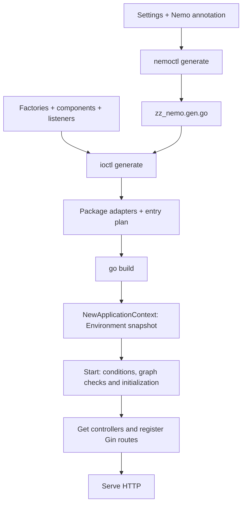
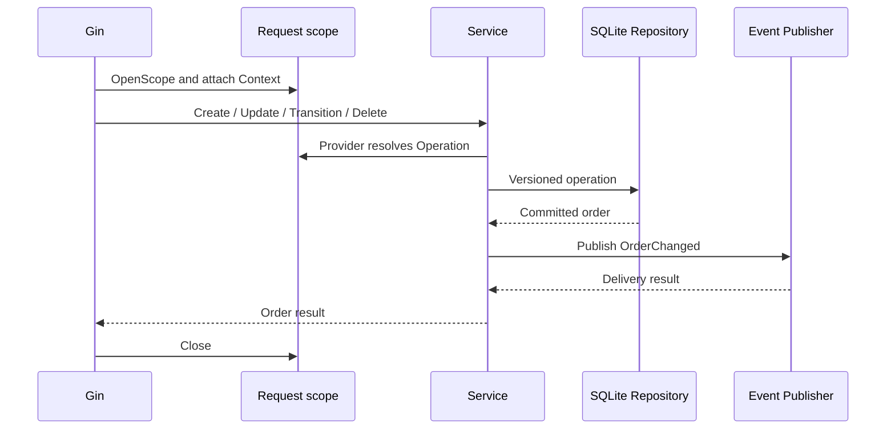

# Building a Gin application with IoC and Nemo

[English](integration.md) | [简体中文](integration.zh_CN.md) · [Coffee MVC](../README.md)

<!-- --8<-- [start:coffee-manual] -->

The Coffee application keeps HTTP, business operations and persistence in separate
packages. IoC constructs the application graph from generated definitions. Nemo
loads properties and generates typed binding. Gin owns HTTP routing and middleware.



## Package boundaries

| Package | Responsibility | Dependencies supplied by IoC |
| --- | --- | --- |
| `configuration` | Bind and validate startup settings | Gosr Environment |
| `infrastructure` | Database pool, schema prerequisite, request metadata | Settings; operation Context |
| `repository` | SQL and atomic order version/state checks | Managed Database |
| `service` | Order operations and post-commit publication | Repository, event Publisher, request Provider, Logger |
| `controller` | JSON/form parsing, status codes and route registration | Service; Renderer for HTML |
| `view` | Embedded HTML templates and CSS | No business service |
| `observation` | Audit and optional receipt subscriptions | Selected sink/printer and Logger |
| `application` | Start the graph, connect controllers to Gin, own shutdown | ApplicationContext |
| `cmd/coffee` | Flags, process signals and generated entry plan | Application bootstrap |

The Repository interface belongs to the domain model. Service code depends on that
interface; SQLite code implements it. Controllers depend on the shared Service.
Container access is confined to application assembly. A business method receives
its dependencies through construction or injection.

## 1. Declare and bind configuration

[Settings][coffee-examples-coffee-internal-configuration-settings-go] groups properties under `cafe`:

```go
// +nemo:config:prefix=cafe
type Settings struct {
	Server   Server
	Database Database
	Features Features
}

type Server struct {
	Address string `default:"127.0.0.1:8082"`
}

type Database struct {
	Path string `default:"coffee.db"`
}

type Features struct {
	Receipt Receipt
}

type Receipt struct {
	Enabled bool `default:"false"`
}
```

The field hierarchy maps `Settings.Server.Address` to `cafe.server.address` and
`Settings.Features.Receipt.Enabled` to `cafe.features.receipt.enabled`.
The annotation selects a property prefix; `default` tags supply values when a
property is absent during binding. They do not insert properties into Environment
or participate in Bean condition evaluation.

[application.yml][coffee-examples-coffee-application-yml] supplies the file-based values:

```yaml
cafe:
  server:
    address: 127.0.0.1:8082
  database:
    path: coffee.db
  features:
    receipt:
      enabled: false
```

[NewSettings][coffee-examples-coffee-internal-configuration-settings-go] receives the prepared Gosr
Environment and calls the generated binding contract:

```go
// NewSettings uses the same prepared Environment that selects conditional Beans.
// +ioc:bean
func NewSettings(env gosrenv.Environment) (*Settings, error) {
	settings, err := binding.Bind[Settings](env, "")
	if err != nil {
		return nil, err
	}
	if err = settings.Validate(); err != nil {
		return nil, err
	}
	return &settings, nil
}
```

An empty prefix argument to `binding.Bind[Settings](env, "")` uses the generated
`PropertyPrefix()` (`cafe`). Nemo generates `PropertyPrefix` and `BindProperties`
in [zz_nemo.gen.go][coffee-examples-coffee-internal-configuration-zz-nemo-gen-go]. Binding completes
before `Validate` checks the address and database path; either error fails startup.
The returned Settings instance is constructed once and treated as read-only.

IoC prepares its built-in Nemo Environment before evaluating Bean conditions or
constructing application Beans. The default discovers optional `application.yml`
relative to the process working directory. In this application, explicit `-db` and
`-address` values enter the highest-priority source through `WithProperties`;
process variables precede discovered file values. For example,
`CAFE_FEATURES_RECEIPT_ENABLED=true` overrides the file's receipt flag.
The CLI passes `-profile dev` through `WithEnvironmentOptions` and Nemo's
`WithProfiles` before Environment preparation. See [main.go][coffee-examples-coffee-cmd-coffee-main-go].

Conditions use the Environment snapshot captured during ApplicationContext
creation. Refreshing Environment does not rerun selection, rebind this Settings
Bean or reopen the database. Configuration refresh needs an explicit application
policy; it is not implied by a configuration annotation.

## 2. Register dependencies at their owning declarations

[NewSQLite][coffee-examples-coffee-internal-repository-sqlite-go] registers a concrete implementation
and exposes its domain contract:

```go
// NewSQLite requires schema readiness without storing the prerequisite object.
// +ioc:bean
// +ioc:expose=model.Repository
// +ioc:depends-on=databaseMigration
func NewSQLite(database *infrastructure.Database) *SQLite {
	return &SQLite{
		database: database,
	}
}
```

`+ioc:expose=model.Repository` lets the graph resolve `model.Repository` to this
Bean. The generated code checks Go assignability and performs typed construction.
`+ioc:depends-on=databaseMigration` requires the migration Bean's initialization
to finish before this factory runs. It adds a lifecycle prerequisite without adding
an unused migration argument to the repository constructor.

The Database factory only creates its resource owner. `Database.Init` opens the
pool; `Migration.Init` creates the schema. `Database.Destroy` closes the pool on
shutdown or failed startup. These hooks are recognized by their method signatures,
without additional lifecycle annotations. See [database.go][coffee-examples-coffee-internal-infrastructure-database-go]
and [migration.go][coffee-examples-coffee-internal-infrastructure-migration-go].

The [Service factory][coffee-examples-coffee-internal-service-service-go] declares its required inputs:

```go
// New uses ordinary constructor injection; business methods never locate Beans.
// +ioc:bean:name=orderService,aliases={orders}
func New(
	repository model.Repository,
	publisher event.Publisher,
	operation gs.Provider[*model.Operation],
	logger *slog.Logger,
) *Service {
	return &Service{
		repository: repository,
		publisher:  publisher,
		operation:  operation,
		logger:     logger,
	}
}
```

IoC resolves constructor parameters by type unless a parameter annotation specifies
a name or qualifier. `name=orderService,aliases={orders}` gives one Bean two lookup
names; it does not create a second instance. The `*slog.Logger` dependency selects
the primary application Logger. Audit factories instead select `auditLogger` by
name or its `audit` qualifier; see [logging.go][coffee-examples-coffee-internal-observation-logging-go]
and [audit.go][coffee-examples-coffee-internal-observation-audit-go].

[API][coffee-examples-coffee-internal-controller-api-go] uses field injection:

```go
// API adapts JSON requests to the same use cases used by HTML forms.
// +ioc:component
type API struct {
	// +ioc:inject:name=orders
	orders *service.Service
}
```

The generated adapter is in the component's package, so the field can remain
private. `name=orders` resolves the Service alias. [Pages][coffee-examples-coffee-internal-controller-pages-go]
injects the same Service by type and a Renderer; both controllers use identical
business operations. Declare a component or a factory for an object, according to
its construction needs; do not register the same object through both approaches.

## 3. Generate configuration binding, then application wiring

From `examples/coffee`:

```sh
make format
make generate
make check
make build
```

The [Makefile][coffee-examples-coffee-makefile] obtains compiler versions from this module's selected
dependencies and executes generation in dependency order:

```text
nemoctl generate --roots ./internal/configuration
ioctl generate --entry ./cmd/coffee --roots ./internal/...
```

Nemo's generated methods must exist before IoC type analysis. IoC writes package
adapters next to their declarations and the application composition plan to
[cmd/coffee/zz_ioc.gen.go][coffee-examples-coffee-cmd-coffee-zz-ioc-gen-go]. The entry imports participating
packages; generated `init` functions contribute definitions without opening the DB
or constructing application instances. The executable does not maintain a manual
runtime module list. New application packages must lie within the configured roots;
regenerate after changing declarations, dependency types or annotations.

Retain generated `.go` files with their source. `make check-generated` compares
output without rewriting it. Generated files are compiler-owned; change annotations
or declarations and regenerate rather than editing adapters.

## 4. Connect managed controllers to Gin

[application.Start][coffee-examples-coffee-internal-application-application-go] performs assembly:

1. Create ApplicationContext with the CLI options. This loads Environment and
   captures its snapshot alongside the generated definitions.
2. Call `Start(ctx)` to evaluate conditions, bind and validate the active graph,
   then initialize eager Beans, including Settings, Database, migration, Service
   and controllers.
3. Obtain API, Pages, Settings and Logger through typed `GetBean[T]` calls.
4. Create `gin.New()`, install Recovery before RequestScope, register controller
   routes and wrap the router with `http.CrossOriginProtection`.

IoC supplies controllers and dependencies; route registration remains explicit
application code. `API.Register` and `Pages.Register` connect their methods to Gin.

> **TODO: generate Handler and route registration code from HTTP method and path
> annotations, following Spring's `GetMapping` and related mapping annotations.**

`application.Run` creates the HTTP server only after assembly succeeds. It stops
accepting requests and waits for active HTTP requests before closing the graph.
The drain wait is bounded to five seconds; on timeout it closes HTTP connections
and returns the shutdown error. Container cleanup has a separate bounded wait.
Cleanup Contexts are detached from process cancellation. Closing a listener after
a permanent accept error follows the same drain path. The startup failure path
also closes resources already owned by the graph.

## 5. Resolve request dependencies within the HTTP operation

The singleton Service retains a `gs.Provider[*model.Operation]`, not an Operation
instance. [NewOperation][coffee-examples-coffee-internal-infrastructure-request-go] defines request scope:

```go
// NewOperation is cached once per explicitly opened HTTP request scope.
// +ioc:bean
// +ioc:scope=request
func NewOperation(ctx context.Context) (*model.Operation, error) {
	if err := ctx.Err(); err != nil {
		return nil, err
	}
	id, _ := ctx.Value(operationKey{}).(string)
	if id == "" {
		return nil, errors.New(missingOperationMessage)
	}
	return &model.Operation{
		ID: id,
	}, nil
}
```

[RequestScope][coffee-examples-coffee-internal-application-scope-go] creates an ID, stores it in a derived
standard Context and calls `OpenScope(parent, gs.Request)`. It replaces
`ctx.Request` with `ctx.Request.WithContext(operation)` before invoking downstream
handlers. Controllers pass `ctx.Request.Context()` to Service methods. The Provider
uses that Context to resolve the current request's Operation; passing a background
Context would lose the scope capability.

Scope Close runs in a defer on normal completion, abort and panic unwinding. The
cleanup Context uses `context.WithoutCancel` plus a timeout, so client cancellation
does not cancel cleanup waiting. Install Recovery outside RequestScope to let
stack unwinding execute cleanup before recovery writes the error response.
No Bean stores `*gin.Context` or an operation Context. Request-scope resources
belong to the scope; controllers and Service remain singletons.

## 6. Select optional integrations and subscribe to events

The receipt factory has a property condition:

```go
// NewConsolePrinter is eligible only when the receipt feature is enabled.
// +ioc:bean
// +ioc:conditional:on-property:prefix=cafe.features.receipt,name=enabled,havingValue=true
func NewConsolePrinter(logger *slog.Logger) ReceiptPrinter {
	return &ConsolePrinter{
		logger: logger,
	}
}
```

The listener's Bean condition and method subscription are distinct:

```go
// ReceiptListener is eligible only when a ReceiptPrinter can satisfy its dependency.
// +ioc:component
// +ioc:conditional:on-bean:type=ReceiptPrinter
type ReceiptListener struct {
	// +ioc:inject
	printer ReceiptPrinter
}

// onOrder prints creation events after the audit listener (order 100).
// +ioc:listen
// +ioc:order=200
func (l *ReceiptListener) onOrder(ctx context.Context, fact model.OrderChanged) error {
	if fact.Action != model.Created {
		return nil
	}
	return l.printer.Print(ctx, fact.Order)
}
```

`on-property` decides whether the printer definition is eligible. `on-bean` excludes
the listener when no ReceiptPrinter is eligible. `+ioc:listen` subscribes only
`onOrder`, with method order 200. The [AuditListener][coffee-examples-coffee-internal-observation-audit-go]
uses `+ioc:listener` on its Bean and implements `OnEvent` plus `Order() int` (100).
Both subscription forms generate typed calls; the method form permits custom names
and several event methods on one Bean. The Bean-level form uses `OnEvent`.

| Startup settings | AuditSink | ReceiptPrinter / ReceiptListener |
| --- | --- | --- |
| Default profile, receipt false | ConciseSink fallback | Excluded |
| dev profile, receipt false | VerboseSink | Excluded |
| Default profile, receipt true | ConciseSink fallback | Included |
| dev profile, receipt true | VerboseSink | Included |

`+ioc:profile={dev}` enables the verbose audit factory. The concise factory's
`on-missing-bean:type=AuditSink` condition supplies a fallback. `primary` resolves a
single dependency among eligible candidates; it does not make a condition true.
Audit and receipt factories expose interface return types, so typed decorators can
replace their implementations without changing consumers.

## Order execution and extension boundaries



Repository transactions check version and source status before changing an order.
Service publishes OrderChanged only after commit. Listener errors are logged with
order and correlation IDs; an already committed order remains a successful result.
Publication is synchronous and uses the operation Context, so cancellation may
prevent delivery after a successful commit. SQLite and the event dispatcher do
not share a transaction, retry queue or durable delivery guarantee. The dev audit
sink logs the full order snapshot, including the customer name; the fallback logs
only action, order ID and correlation ID.

To add a use case, extend the domain contract and its implementation, add a Service
operation, then bind it to an API or page route. Add an annotated factory/component
only when the new object needs container ownership. To change persistence, supply
another Repository implementation and make candidate selection unambiguous. To
add optional behavior, declare its dependency and activation condition separately
from the business operation. See the [annotation reference][coffee-docs-design-docs-annotations-md]
for supported attributes and invalid combinations.

The application keeps a fixed menu, one coffee type per order and a local SQLite
file. Authentication, payments, inventory and durable messaging require separate
application capabilities.

<!-- --8<-- [end:coffee-manual] -->

[coffee-examples-coffee-internal-configuration-settings-go]: ../internal/configuration/settings.go
[coffee-examples-coffee-application-yml]: ../application.yml
[coffee-examples-coffee-internal-configuration-zz-nemo-gen-go]: ../internal/configuration/zz_nemo.gen.go
[coffee-examples-coffee-cmd-coffee-main-go]: ../cmd/coffee/main.go
[coffee-examples-coffee-internal-repository-sqlite-go]: ../internal/repository/sqlite.go
[coffee-examples-coffee-internal-infrastructure-database-go]: ../internal/infrastructure/database.go
[coffee-examples-coffee-internal-infrastructure-migration-go]: ../internal/infrastructure/migration.go
[coffee-examples-coffee-internal-service-service-go]: ../internal/service/service.go
[coffee-examples-coffee-internal-observation-logging-go]: ../internal/observation/logging.go
[coffee-examples-coffee-internal-observation-audit-go]: ../internal/observation/audit.go
[coffee-examples-coffee-internal-controller-api-go]: ../internal/controller/api.go
[coffee-examples-coffee-internal-controller-pages-go]: ../internal/controller/pages.go
[coffee-examples-coffee-makefile]: ../Makefile
[coffee-examples-coffee-cmd-coffee-zz-ioc-gen-go]: ../cmd/coffee/zz_ioc.gen.go
[coffee-examples-coffee-internal-application-application-go]: ../internal/application/application.go
[coffee-examples-coffee-internal-infrastructure-request-go]: ../internal/infrastructure/request.go
[coffee-examples-coffee-internal-application-scope-go]: ../internal/application/scope.go
[coffee-docs-design-docs-annotations-md]: ../../../docs/design/docs/annotations.md
