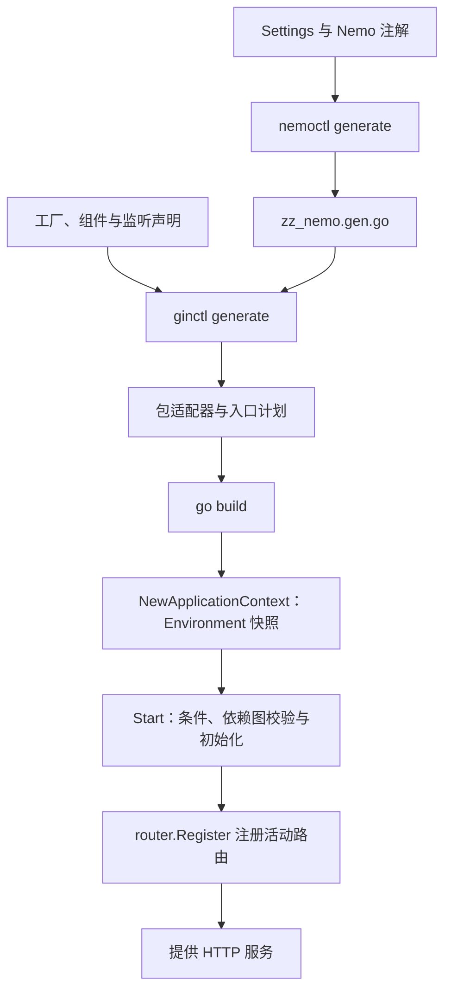
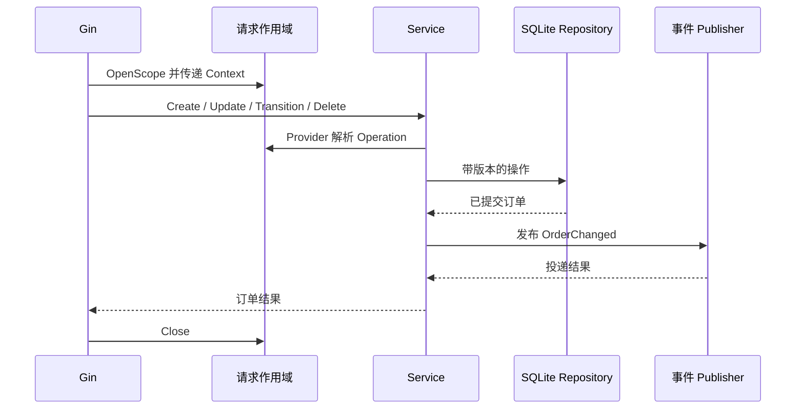

# 使用 IoC 和 Nemo 开发 Gin 应用

[English](integration.md) | [简体中文](integration.zh_CN.md) · [咖啡厅 MVC](../README.zh_CN.md)

<!-- --8<-- [start:coffee-manual] -->

Coffee 将 HTTP、业务操作和持久化分为独立包。IoC 根据生成的定义构建应用依赖图，
Nemo 加载属性并生成类型化绑定代码，Gin 负责路由和中间件执行。



## 包职责

| 包 | 职责 | 由 IoC 提供的依赖 |
| --- | --- | --- |
| `configuration` | 绑定和校验启动配置 | Gosr Environment |
| `infrastructure` | 数据库连接池、迁移前置条件、请求元数据 | Settings、操作 Context |
| `repository` | SQL 及原子版本、状态校验 | 受管 Database |
| `service` | 订单操作与提交后事件发布 | Repository、事件 Publisher、请求 Provider、Logger |
| `controller` | JSON/表单解析、状态码与路由注解 | Service；HTML 使用的 Renderer |
| `view` | 内嵌 HTML 模板和 CSS | 无业务 Service 依赖 |
| `observation` | 审计和可选取餐单订阅 | 按条件选择的 sink/printer、Logger |
| `application` | 启动依赖图、将 Controller 接入 Gin、管理关闭流程 | ApplicationContext |
| `cmd/coffee` | 命令行参数、进程信号、生成的入口计划 | 应用启动逻辑 |

Repository 接口由领域模型包定义，Service 依赖该接口，SQLite 实现接口。
Controller 共用订单 Service。容器查找集中在应用装配处，业务方法通过构造或注入
获得依赖。

## 1. 声明并绑定配置

[Settings][coffee-examples-coffee-internal-configuration-settings-go] 使用 `cafe` 作为属性前缀：

```go
// +nemo:config:prefix=cafe
type Settings struct {
	Server   Server
	Database Database
	Features Features
}

type Server struct {
	Address string `default:"127.0.0.1:8082"`
}

type Database struct {
	Path string `default:"coffee.db"`
}

type Features struct {
	Receipt Receipt
}

type Receipt struct {
	Enabled bool `default:"false"`
}
```

字段层级将 `Settings.Server.Address` 映射为 `cafe.server.address`，将
`Settings.Features.Receipt.Enabled` 映射为 `cafe.features.receipt.enabled`。
注解指定绑定前缀，`default` 标签在属性缺失时提供绑定默认值；标签不会向
Environment 写入属性，也不参与 Bean 条件求值。

[application.yml][coffee-examples-coffee-application-yml] 提供文件属性：

```yaml
cafe:
  server:
    address: 127.0.0.1:8082
  database:
    path: coffee.db
  features:
    receipt:
      enabled: false
```

[NewSettings][coffee-examples-coffee-internal-configuration-settings-go] 接收已准备的 Gosr Environment，
调用生成的绑定契约：

```go
// NewSettings uses the same prepared Environment that selects conditional Beans.
// +ioc:bean
func NewSettings(env gosrenv.Environment) (*Settings, error) {
	settings, err := binding.Bind[Settings](env, "")
	if err != nil {
		return nil, err
	}
	if err = settings.Validate(); err != nil {
		return nil, err
	}
	return &settings, nil
}
```

`binding.Bind[Settings](env, "")` 的空前缀使用生成的 `PropertyPrefix()`，即
`cafe`。Nemo 在 [zz_nemo.gen.go][coffee-examples-coffee-internal-configuration-zz-nemo-gen-go] 中生成
`PropertyPrefix` 和 `BindProperties`。绑定完成后，`Validate` 检查监听地址和
数据库路径；任一步失败均中止启动。Settings 只构造一次，作为只读配置使用。

IoC 在 Bean 条件求值和实例构造之前准备内置 Nemo Environment。默认相对于进程
工作目录查找可选的 `application.yml`。本应用将显式传入的 `-db`、`-address`
通过 `WithProperties` 写入最高优先级属性源；进程变量优先于发现的配置文件。
例如 `CAFE_FEATURES_RECEIPT_ENABLED=true` 可覆盖文件中的取餐单开关。
CLI 将 `-profile dev` 经 `WithEnvironmentOptions` 和 Nemo 的 `WithProfiles`
传入 Environment 准备过程。实现见 [main.go][coffee-examples-coffee-cmd-coffee-main-go]。

条件使用创建 ApplicationContext 时捕获的 Environment 快照。刷新 Environment
不会重新选择 Bean、重新绑定当前 Settings 实例或重建数据库连接池。配置刷新需要
应用明确规定更新策略，配置注解本身不提供此行为。

## 2. 在依赖所属声明处注册 Bean

[NewSQLite][coffee-examples-coffee-internal-repository-sqlite-go] 注册具体实现并暴露领域契约：

```go
// NewSQLite requires schema readiness without storing the prerequisite object.
// +ioc:bean
// +ioc:expose=model.Repository
// +ioc:depends-on=databaseMigration
func NewSQLite(database *infrastructure.Database) *SQLite {
	return &SQLite{
		database: database,
	}
}
```

`+ioc:expose=model.Repository` 使依赖图可以通过 `model.Repository` 解析此 Bean。
生成代码校验 Go 类型可赋值关系并执行类型化构造。`+ioc:depends-on=databaseMigration`
要求迁移 Bean 初始化完成后再调用仓储工厂，为初始化增加前置条件，无需在构造函数
中传入不使用的迁移实例。

数据库工厂只创建资源所有者。`Database.Init` 打开连接池，`Migration.Init` 创建
表结构，`Database.Destroy` 在关闭或启动失败时释放连接池。这些钩子按方法签名
识别，无需额外生命周期注解。实现见 [database.go][coffee-examples-coffee-internal-infrastructure-database-go]
和 [migration.go][coffee-examples-coffee-internal-infrastructure-migration-go]。

[Service 工厂][coffee-examples-coffee-internal-service-service-go] 声明业务操作所需的依赖：

```go
// New uses ordinary constructor injection; business methods never locate Beans.
// +ioc:bean:name=orderService,aliases={orders}
func New(
	repository model.Repository,
	publisher event.Publisher,
	operation gs.Provider[*model.Operation],
	logger *slog.Logger,
) *Service {
	return &Service{
		repository: repository,
		publisher:  publisher,
		operation:  operation,
		logger:     logger,
	}
}
```

构造参数默认按类型解析；需要名称或限定符选择时使用参数注解。
`name=orderService,aliases={orders}` 为同一个 Bean 定义两个查找名称，不增加实例。
`*slog.Logger` 使用主候选应用 Logger。审计工厂通过名称 `auditLogger` 或限定符
`audit` 选择审计日志，见 [logging.go][coffee-examples-coffee-internal-observation-logging-go] 和
[audit.go][coffee-examples-coffee-internal-observation-audit-go]。

[API][coffee-examples-coffee-internal-controller-api-go] 采用字段注入：

```go
// API adapts JSON requests to the same use cases used by HTML forms.
// +ioc:controller
// +ioc:http:route=/api
type API struct {
	// +ioc:inject:name=orders
	orders *service.Service
}
```

生成适配器与组件位于同一个包，因此可以注入私有字段。`name=orders` 按 Service
别名选择依赖。[Pages][coffee-examples-coffee-internal-controller-pages-go] 按类型注入同一个 Service，
并注入 Renderer；两种 Controller 调用相同的业务操作。根据对象的构造需求选择
组件声明或工厂声明，避免同时用两种方式重复注册同一对象。

## 3. 先生成配置绑定，再生成应用装配代码

在 `examples/coffee` 下执行：

```sh
make format
make generate
make check
make build
```

[Makefile][coffee-examples-coffee-makefile] 从当前模块选定的依赖读取编译器版本，并按依赖顺序生成：

```text
nemoctl generate --roots ./internal/configuration
ginctl generate --entry ./cmd/coffee --roots ./internal/...
```

IoC 进行类型分析前，需要已有 Nemo 生成的方法。IoC 将包适配器写入声明所在包，
将应用组合计划写入 [cmd/coffee/zz_ioc.gen.go][coffee-examples-coffee-cmd-coffee-zz-ioc-gen-go]。入口
导入参与装配的包，生成的 `init` 只提交定义，不打开数据库或构造应用实例。
运行期无需手写模块列表。新增应用包必须包含在生成根路径中；修改声明、依赖类型
或注解后重新生成。

生成的 `.go` 文件与源码一同保留。`make check-generated` 比较生成结果，不写入
文件。生成文件由编译器管理，修改应落在注解或声明处，再重新生成适配器。

## 4. 将受管 Controller 接入 Gin

[application.Start][coffee-examples-coffee-internal-application-application-go] 完成应用装配：

1. 使用 CLI 选项创建 ApplicationContext，加载 Environment 并捕获其快照，同时保存
   生成的定义。
2. 调用 `Start(ctx)` 求值条件、绑定并校验活动依赖图，再初始化 Settings、Database、
   迁移、Service 和 Controller 等非延迟 Bean。
3. 通过类型化 `GetBean[T]` 获取 Settings 和 Logger。
4. 创建 `gin.New()`，依次安装 Recovery 和 RequestScope，再调用适配器的
   `router.Register`，最后以 `http.CrossOriginProtection` 包装路由。

Controller 上的 `+ioc:http:route=/api` 定义公共前缀，方法注解声明相对路径：

```go
// +ioc:http:get=/orders/:id
func (a *API) get(ctx *gin.Context) {
	id, err := positive(ctx.Param(idParameter))
	if err != nil {
		apiError(ctx, err)
		return
	}
	order, err := a.orders.Get(ctx.Request.Context(), id)
	if err != nil {
		apiError(ctx, err)
		return
	}
	ctx.JSON(http.StatusOK, order)
}
```

该声明注册 `GET /api/orders/:id`。生成器在 Controller 包内写入类型化桥接代码，
私有方法无需导出。`Pages` 使用相同机制声明 HTML 端点。两种 Controller 均由
`+ioc:controller` 注册，无需另加 `+ioc:component`。

`cmd/coffee` 将生成的 `IOCGinRoutes()` 传给 `application.Run`，装配层在容器
启动后注册活动路由。条件排除的 Controller 不发布路由；活动映射冲突时启动失败。
作用域和 HTTP 服务的所有权仍由应用管理，不在 `init` 中打开资源或启动监听。

`application.Run` 在装配成功后创建 HTTP 服务。关闭时先停止接收请求，等待活动
HTTP 请求完成，再关闭依赖图。排空等待上限为五秒；超时后关闭 HTTP 连接并返回
关闭错误，容器清理另有等待期限。清理 Context 不继承进程取消状态。监听器遇到
不可恢复的 Accept 错误时也执行相同排空流程；启动失败路径关闭已归容器管理的资源。

## 5. 在 HTTP 操作内解析请求依赖

单例 Service 持有 `gs.Provider[*model.Operation]`，不持有 Operation 实例。
[NewOperation][coffee-examples-coffee-internal-infrastructure-request-go] 声明请求作用域：

```go
// NewOperation is cached once per explicitly opened HTTP request scope.
// +ioc:bean
// +ioc:scope=request
func NewOperation(ctx context.Context) (*model.Operation, error) {
	if err := ctx.Err(); err != nil {
		return nil, err
	}
	id, _ := ctx.Value(operationKey{}).(string)
	if id == "" {
		return nil, errors.New(missingOperationMessage)
	}
	return &model.Operation{
		ID: id,
	}, nil
}
```

[RequestScope][coffee-examples-coffee-internal-application-scope-go] 生成关联 ID，放入派生的标准
Context，再由适配器的 `scope.Middleware` 调用
`OpenScope(parent, gs.Request)`，将派生 Context 写入请求后执行处理器。
Controller 将 `ctx.Request.Context()` 传给 Service，Provider 据此解析当前请求的
Operation；改用后台 Context 会丢失作用域能力。

正常返回、中止和 panic 栈展开均通过 defer 关闭作用域。清理 Context 使用
`context.WithoutCancel` 并附加超时，避免客户端取消同时中断清理等待。
Recovery 需位于 RequestScope 外层，使栈展开先清理作用域，再写入恢复响应。
Bean 不保存 `*gin.Context` 或操作 Context。请求资源归作用域所有，Controller
和 Service 仍为单例。

## 6. 选择可选集成并订阅事件

取餐单工厂使用属性条件：

```go
// NewConsolePrinter is eligible only when the receipt feature is enabled.
// +ioc:bean
// +ioc:conditional:on-property:prefix=cafe.features.receipt,name=enabled,havingValue=true
func NewConsolePrinter(logger *slog.Logger) ReceiptPrinter {
	return &ConsolePrinter{
		logger: logger,
	}
}
```

监听器的 Bean 条件与方法订阅分别声明：

```go
// ReceiptListener is eligible only when a ReceiptPrinter can satisfy its dependency.
// +ioc:component
// +ioc:conditional:on-bean:type=ReceiptPrinter
type ReceiptListener struct {
	// +ioc:inject
	printer ReceiptPrinter
}

// onOrder prints creation events after the audit listener (order 100).
// +ioc:listen
// +ioc:order=200
func (l *ReceiptListener) onOrder(ctx context.Context, fact model.OrderChanged) error {
	if fact.Action != model.Created {
		return nil
	}
	return l.printer.Print(ctx, fact.Order)
}
```

`on-property` 决定打印定义是否合格，`on-bean` 在没有合格 ReceiptPrinter 时排除
监听器。`+ioc:listen` 只订阅 `onOrder`，方法顺序值为 200。
[AuditListener][coffee-examples-coffee-internal-observation-audit-go] 在 Bean 上使用 `+ioc:listener`，
实现 `OnEvent` 和返回 100 的 `Order() int`。两种订阅形式都生成类型化调用；
方法形式允许自定义方法名，并可在同一个 Bean 上处理多种事件，Bean 级形式约定
使用 `OnEvent`。

| 启动设置 | AuditSink | ReceiptPrinter / ReceiptListener |
| --- | --- | --- |
| 默认 Profile、取餐单关闭 | ConciseSink 默认实现 | 排除 |
| dev Profile、取餐单关闭 | VerboseSink | 排除 |
| 默认 Profile、取餐单开启 | ConciseSink 默认实现 | 包含 |
| dev Profile、取餐单开启 | VerboseSink | 包含 |

`+ioc:profile={dev}` 启用详细审计工厂，简明审计工厂通过
`on-missing-bean:type=AuditSink` 提供默认实现。`primary` 在合格候选中解决单值
依赖歧义，不决定条件是否成立。审计和打印工厂返回接口类型，使类型化装饰器可以
替换实现而不影响消费者。

## 订单执行与扩展边界



Repository 在事务中校验版本和原状态，Service 在提交成功后发布 OrderChanged。
监听失败记录订单及关联 ID，已提交的订单仍返回成功。事件同步发布并使用操作
Context，因此提交成功后发生的取消可能阻止事件投递。SQLite 与事件分派器之间
没有共享事务、重试队列或持久化投递保证。dev 审计记录包含客户姓名的完整订单
快照，默认审计只记录动作、订单 ID 和关联 ID。

新增用例时，扩展领域契约及其实现、增加 Service 操作，再接入 API 或页面路由。
只有新增对象需要容器管理时才声明工厂或组件。替换持久化实现时提供另一个
Repository，并使候选选择无歧义。增加可选行为时，单独声明依赖与激活条件，
保持业务操作不依赖具体集成。支持的属性和非法组合见
[注解参考][coffee-docs-design-docs-annotations-zh-md]。

当前应用使用固定菜单，每单一种咖啡，数据保存在本地 SQLite 文件。
客户鉴权、支付、库存和可靠消息需要独立的应用能力。

<!-- --8<-- [end:coffee-manual] -->

[coffee-examples-coffee-internal-configuration-settings-go]: ../internal/configuration/settings.go
[coffee-examples-coffee-application-yml]: ../application.yml
[coffee-examples-coffee-internal-configuration-zz-nemo-gen-go]: ../internal/configuration/zz_nemo.gen.go
[coffee-examples-coffee-cmd-coffee-main-go]: ../cmd/coffee/main.go
[coffee-examples-coffee-internal-repository-sqlite-go]: ../internal/repository/sqlite.go
[coffee-examples-coffee-internal-infrastructure-database-go]: ../internal/infrastructure/database.go
[coffee-examples-coffee-internal-infrastructure-migration-go]: ../internal/infrastructure/migration.go
[coffee-examples-coffee-internal-service-service-go]: ../internal/service/service.go
[coffee-examples-coffee-internal-observation-logging-go]: ../internal/observation/logging.go
[coffee-examples-coffee-internal-observation-audit-go]: ../internal/observation/audit.go
[coffee-examples-coffee-internal-controller-api-go]: ../internal/controller/api.go
[coffee-examples-coffee-internal-controller-pages-go]: ../internal/controller/pages.go
[coffee-examples-coffee-makefile]: ../Makefile
[coffee-examples-coffee-cmd-coffee-zz-ioc-gen-go]: ../cmd/coffee/zz_ioc.gen.go
[coffee-examples-coffee-internal-application-application-go]: ../internal/application/application.go
[coffee-examples-coffee-internal-infrastructure-request-go]: ../internal/infrastructure/request.go
[coffee-examples-coffee-internal-application-scope-go]: ../internal/application/scope.go
[coffee-docs-design-docs-annotations-zh-md]: ../../../docs/design/docs/annotations.zh.md
