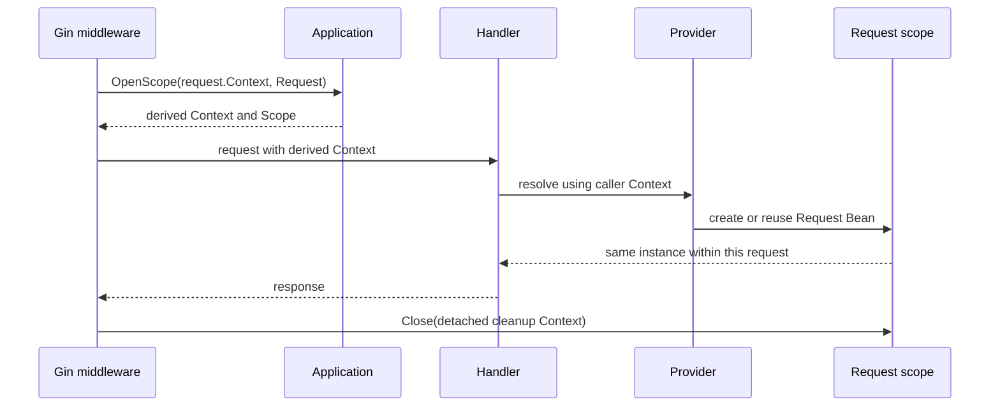

# IoC with Gin

[English](README.md) | [简体中文](README.zh_CN.md)

This standalone example composes a Gin handler through generated IoC wiring and
opens an explicit IoC lifetime for each HTTP request. It defines no production
Gin adapter API. Gin is a dependency of this nested module only.



## Composition and ownership

- `Statistics` and `Service` use `+ioc:component`. `Service` receives a
  `gs.Provider[*Request]` from `github.com/longxi-go/gosr/pkg/ioc` through
  `+ioc:inject`; the singleton retains no
  request instance or Context.
- `NewRequest` uses `+ioc:bean` and `+ioc:scope=request`. It validates the
  `X-Tenant` header from the operation Context before allocating an instance.
  Its `Destroy` hook records resource release.
- `NewHandler` uses `+ioc:bean` for constructor injection. Generated `init`
  contributes definitions; `New` starts the application and obtains the handler
  through `GetBean[*Handler]` before exposing the router.

`GET /request` resolves the Provider twice. Both IDs match within a request;
different requests get different IDs. A missing tenant returns HTTP 503 and
reports the constructor error without corrupting later requests. Responses omit
internal error details.

`RequestScope` propagates `c.Request.Context()`, not `*gin.Context`. Its deferred
Close uses `context.WithoutCancel` and a bounded timeout so request cancellation
does not cancel cleanup. Cleanup errors go to a required concurrency-safe error
sink; they do not rewrite an already-sent response. A timeout bounds the wait,
not the container's cleanup work.

When using Gin Recovery, install it **before** `RequestScope`. A panic then
unwinds through scope cleanup before Recovery handles the response. Drain HTTP
requests with `http.Server.Shutdown` before `Application.Close` in a serving
application. Neither the example's singletons nor its request objects retain
an operation Context.

## Run and regenerate

Requires the Go version declared in `go.mod`. From this directory:

```sh
make run
make check
```

`make run` sends one request through the real Gin router with `httptest`, without
opening a TCP listener. The JSON response has tenant `alpha` and matching IDs.
Gin may print its debug-mode startup log.

After changing annotated declarations:

```sh
make format
make generate
make check
```

Generation uses the published compiler matching this module's IoC requirement.
Generated adapters are retained with source; there is no manual module list.
`make check` checks this nested module's standalone dependencies, adapter
freshness, source layout/notices, vet, coverage tests, shuffled race tests and
lint. Root `go test ./...` does not traverse nested modules.

Tests exercise generated construction, scope identity and concurrent isolation,
cancellation, constructor failure recovery, normal/abort/panic cleanup, cleanup
error reporting, admission after shutdown and repeatable application Close.
