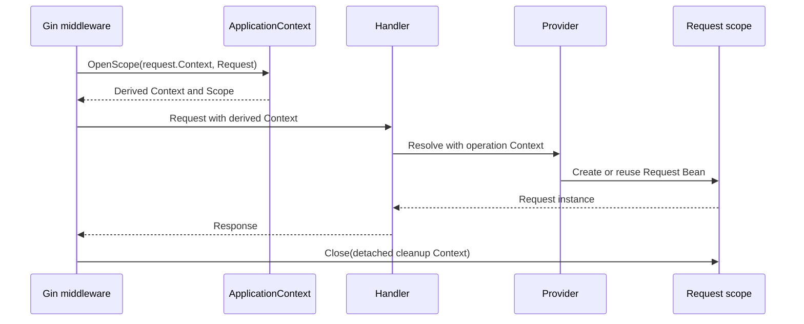

# IoC with Gin

[English](README.md) | [简体中文](README.zh_CN.md)

<!-- --8<-- [start:gin-manual] -->

This independent module assembles a Gin handler with generated IoC code and gives
each HTTP request an explicit Request scope. Its executable dispatches one request
with `httptest`; [Coffee MVC][gin-examples-coffee-readme-md] provides a listening server,
SQLite persistence, Nemo configuration binding and HTML/REST controllers.



## Declare and generate Beans

[Service][gin-examples-gin-service-go] is a singleton component with a request Provider:

```go
// Service is a singleton; its Provider resolves against each caller's scope.
// +ioc:component
type Service struct {
	// +ioc:inject
	request gs.Provider[*Request]
}
```

`gs` refers to `github.com/longxi-go/gosr/pkg/ioc`. `+ioc:inject` supplies a Provider
that resolves against its caller's Context. It keeps the singleton independent of
any individual request instance. [NewRequest][gin-examples-gin-request-go] declares the target's
lifetime and validates metadata before allocation:

```go
// NewRequest validates caller metadata before allocating the scoped resource.
// +ioc:bean
// +ioc:scope=request
func NewRequest(ctx context.Context, statistics *Statistics) (*Request, error) {
	if err := ctx.Err(); err != nil {
		return nil, err
	}
	tenant, _ := ctx.Value(tenantKey{}).(string)
	if strings.TrimSpace(tenant) == "" {
		return nil, errMissingTenant
	}
	return &Request{
		ID:         statistics.created.Add(1),
		Tenant:     tenant,
		statistics: statistics,
	}, nil
}
```

The middleware copies `X-Tenant` into a derived standard Context. It is example
metadata, not authenticated tenant identity. `Destroy(context.Context) error`
records release when the request scope closes. [Statistics][gin-examples-gin-request-go] uses
atomic counters so concurrent requests can record creation and destruction.

[Handler][gin-examples-gin-handler-go] declares field injection and its HTTP endpoint:

```go
// Handler uses an injected Service without retaining request instances.
// +ioc:controller:name=requestHandler
type Handler struct {
	// +ioc:inject
	service *Service
}

// +ioc:http:get=/request
func (h *Handler) serve(ctx *gin.Context) {
	view, err := h.Describe(ctx.Request.Context())
	if err != nil {
		_ = ctx.Error(err)
		unavailable(ctx)
		return
	}
	ctx.JSON(http.StatusOK, view)
}
```

From this directory, generate and check the application:

```sh
make format
make generate
make check
```

The [Makefile][gin-examples-gin-makefile] runs the `ginctl` selected by the Gin adapter requirement
in [go.mod][gin-examples-gin-go-mod], with `generate --entry . --roots .`. The generated
[zz_ioc.gen.go][gin-examples-gin-zz-ioc-gen-go] contains package definitions and the query/composition
plan. Its `init` registers definitions; `ApplicationContext.Start` constructs eager
Beans. Retain generated files with source and regenerate after changing declarations
or annotations. No runtime module list is required.

## Assemble the Gin router

[New][gin-examples-gin-application-go] starts ApplicationContext before registering
`IOCGinRoutes()` with the adapter's `router.Register`. The generated function
aggregates the annotated mappings; its package bridges call private methods
directly. `+ioc:controller` supplies component registration and does not require
an additional `+ioc:component`.

```go
middleware, err := RequestScope(owner, report)
if err != nil {
    return nil, err
}
engine := gin.New()
engine.Use(middleware)
if err := ginrouter.Register(ctx, engine, owner, IOCGinRoutes()...); err != nil {
    return nil, err
}
```

[RequestScope][gin-examples-gin-scope-middleware-go] adds tenant metadata, then delegates
scope ownership to `adaptors/gin/pkg/scope.Middleware`. The adapter opens the
Request scope, replaces the HTTP request context and closes the scope after
handler execution. The wrapper reports errors recorded by the handler through
`ErrorHandlerFunc`. Handlers pass `ctx.Request.Context()` to business methods;
a background Context cannot resolve the HTTP request's scoped dependencies.

`GET /request` resolves Provider twice. Both IDs match within a request; different
requests receive distinct instances. A missing tenant or a cancelled operation
returns 503 and reports the error through `ErrorHandlerFunc`. This status belongs
to this example's error policy; applications map domain/input errors independently.
Responses omit internal error details.

## Cleanup and error reporting

Close uses `context.WithoutCancel` with a five-second timeout so request cancellation
does not cancel cleanup waiting. The timeout bounds the caller's wait; it does not
terminate container cleanup. The required error callback must be concurrency-safe,
return promptly and avoid panic. Cleanup errors are reported without rewriting a
response already sent to the client.

For a serving application, install Gin Recovery **before** RequestScope: stack
unwinding then closes the scope before Recovery writes a response. The router
returned by this module's `New` installs RequestScope only; the executable's
in-process request has no Recovery middleware. The [panic-path test][gin-examples-gin-scope-middleware-test-go]
assembles Recovery explicitly. Drain HTTP with `http.Server.Shutdown` before
closing ApplicationContext. [Coffee's application package][gin-examples-coffee-internal-application-server-go]
owns that server lifecycle.

Singleton and request Beans retain neither `*gin.Context` nor the operation Context.
Only immutable tenant data crosses from HTTP into the scoped Request.

## Run and check

Use the Go version in [go.mod][gin-examples-gin-go-mod]:

```sh
make run
# {"firstId":1,"secondId":1,"tenant":"alpha"}
make check
```

`make run` dispatches one request through the Gin router without binding a TCP port.
Gin may also print debug startup messages. `make check` runs standalone dependency,
format/notice, vet, coverage, shuffled race, lint and generated-output checks.
Root `go test ./...` does not traverse this nested module.

Configuration, persistence, MVC and conditional listener registration are covered
in the [Coffee integration guide][gin-examples-coffee-docs-integration-md].

<!-- --8<-- [end:gin-manual] -->

[gin-examples-coffee-readme-md]: ../coffee/README.md
[gin-examples-gin-service-go]: service.go
[gin-examples-gin-request-go]: request.go
[gin-examples-gin-handler-go]: handler.go
[gin-examples-gin-makefile]: Makefile
[gin-examples-gin-go-mod]: go.mod
[gin-examples-gin-zz-ioc-gen-go]: zz_ioc.gen.go
[gin-examples-gin-application-go]: application.go
[gin-examples-gin-scope-middleware-go]: scope_middleware.go
[gin-examples-gin-scope-middleware-test-go]: scope_middleware_test.go
[gin-examples-coffee-internal-application-server-go]: ../coffee/internal/application/server.go
[gin-examples-coffee-docs-integration-md]: ../coffee/docs/integration.md
