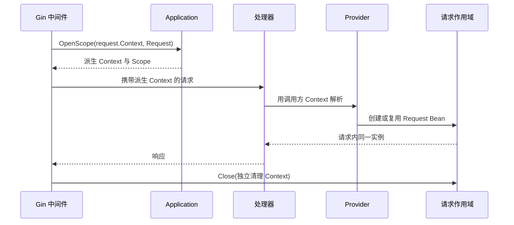

# IoC 与 Gin 集成

[English](README.md) | [简体中文](README.zh_CN.md)

本示例通过生成的 IoC 装配代码构造 Gin 处理器，为每次 HTTP 请求显式创建作用域。
示例不定义正式的 Gin 适配器 API；Gin 依赖仅属于当前嵌套模块。



## 装配与所有权

- `Statistics` 和 `Service` 使用 `+ioc:component`。`Service` 通过
  `+ioc:inject` 注入 `github.com/longxi-go/gosr/pkg/ioc` 的
  `gs.Provider[*Request]`，单例不持有请求实例或 Context。
- `NewRequest` 使用 `+ioc:bean` 和 `+ioc:scope=request`，从操作 Context
  获取并校验 `X-Tenant` 请求头后分配实例。其 `Destroy` 钩子记录资源释放。
- `NewHandler` 使用 `+ioc:bean` 实现构造注入。生成的 `init` 只注册定义；
  `New` 启动应用，通过 `GetBean[*Handler]` 获取处理器后才对外提供路由。

`GET /request` 调用 Provider 两次。同一次请求的两个 ID 相同，不同请求的 ID
不同。缺失租户时返回 HTTP 503，并报告构造错误，后续请求仍可正常处理。响应
不包含内部错误详情。

`RequestScope` 传递 `c.Request.Context()`，不保留 `*gin.Context`。defer 中的
Close 使用 `context.WithoutCancel` 和超时限制，避免请求取消同时中断清理等待。
清理错误交给必需的、并发安全的错误处理函数，不改写已经发送的响应。超时限制
调用方等待时间，不终止容器的清理工作。

使用 Gin Recovery 时，需在 `RequestScope` **之前**安装。Panic 展开调用栈时
先清理作用域，再由 Recovery 处理响应。实际提供 HTTP 服务的应用应先调用
`http.Server.Shutdown` 等待请求结束，再调用 `Application.Close`。示例中的
单例和请求对象均不保留操作 Context。

## 运行与生成

使用 `go.mod` 声明的 Go 版本，在当前目录执行：

```sh
make run
make check
```

`make run` 使用 `httptest` 通过真实 Gin 路由处理一次请求，不启动 TCP 监听。
JSON 响应中的租户为 `alpha`，两个 ID 相同。Gin 在调试模式下还可能输出启动日志。

修改带注解的声明后执行：

```sh
make format
make generate
make check
```

生成命令使用与当前模块 IoC 依赖匹配的公开编译器。生成的适配代码与源码一同
保留，无需手工维护模块列表。`make check` 单独检查当前嵌套模块的依赖、生成
代码、格式、文件头、vet、覆盖率测试、随机顺序竞态测试和 lint。根模块的
`go test ./...` 不遍历嵌套模块。

测试覆盖生成式构造、请求内复用、并发隔离、取消、构造失败后的恢复、正常返回及
Abort/Panic 的清理、清理错误报告、关闭后的请求拒绝和重复关闭应用。
