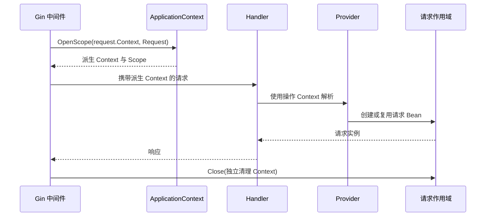

# IoC 与 Gin 集成

[English](README.md) | [简体中文](README.zh_CN.md)

<!-- --8<-- [start:gin-manual] -->

本独立模块使用生成的 IoC 代码装配 Gin 处理器，为每次 HTTP 请求创建显式的
Request 作用域。可执行程序通过 `httptest` 分派一次请求；
[Coffee MVC][gin-examples-coffee-readme-zh-cn-md] 提供监听服务、SQLite 持久化、Nemo
配置绑定和 HTML/REST Controller。



## 声明和生成 Bean

[Service][gin-examples-gin-service-go] 是持有请求 Provider 的单例组件：

```go
// Service is a singleton; its Provider resolves against each caller's scope.
// +ioc:component
type Service struct {
	// +ioc:inject
	request gs.Provider[*Request]
}
```

`gs` 是 `github.com/longxi-go/gosr/pkg/ioc` 的导入别名。`+ioc:inject` 注入的
Provider 按调用方 Context 解析，使单例不依赖某个请求实例。
[NewRequest][gin-examples-gin-request-go] 声明目标作用域，在分配实例前校验元数据：

```go
// NewRequest validates caller metadata before allocating the scoped resource.
// +ioc:bean
// +ioc:scope=request
func NewRequest(ctx context.Context, statistics *Statistics) (*Request, error) {
	if err := ctx.Err(); err != nil {
		return nil, err
	}
	tenant, _ := ctx.Value(tenantKey{}).(string)
	if strings.TrimSpace(tenant) == "" {
		return nil, errMissingTenant
	}
	return &Request{
		ID:         statistics.created.Add(1),
		Tenant:     tenant,
		statistics: statistics,
	}, nil
}
```

中间件将 `X-Tenant` 复制到派生的标准 Context。该值是示例元数据，不代表已经
认证的租户身份。`Destroy(context.Context) error` 在请求作用域关闭时记录释放，
[Statistics][gin-examples-gin-request-go] 使用原子计数器记录并发请求的创建与销毁。

[NewHandler][gin-examples-gin-handler-go] 使用构造注入：

```go
// NewHandler keeps singleton dependencies explicit without capturing a request.
// +ioc:bean
func NewHandler(service *Service) *Handler {
	return &Handler{
		service: service,
	}
}
```

在当前目录生成并检查应用：

```sh
make format
make generate
make check
```

[Makefile][gin-examples-gin-makefile] 按 [go.mod][gin-examples-gin-go-mod] 中声明的 IoC 版本选择公开编译器，执行
`generate --entry . --roots .`。生成的 [zz_ioc.gen.go][gin-examples-gin-zz-ioc-gen-go] 包含包定义、
查询计划与组合计划；其中 `init` 注册定义，`ApplicationContext.Start` 构造
非延迟 Bean。生成文件与源码一同保留，修改声明或注解后重新生成，无需维护运行期
模块列表。

## 装配 Gin 路由

[New][gin-examples-gin-application-go] 创建 ApplicationContext、启动依赖图，再通过类型化
`GetBean[T]` 获取 Handler 和 Statistics。随后调用 `gin.New()`，安装
[RequestScope][gin-examples-gin-scope-middleware-go]，将 `GET /request` 注册到受管 Handler。
路由构造和注册属于显式应用代码，注解处理提供对象及其依赖。

> **待办：参考 Spring 的 `GetMapping` 等映射注解，根据声明 HTTP 方法和路径的
> 注释注解，生成 Handler 与路由注册代码。**

RequestScope 调用 `OpenScope(parent, gs.Request)`，将返回的 Context 设置到
`ctx.Request`，执行后续处理器，并在 defer 中关闭作用域。处理器向业务方法传递
`ctx.Request.Context()`；使用后台 Context 调用 Provider 会丢失 HTTP 操作的
作用域能力。

`GET /request` 调用 Provider 两次：请求内 ID 相同，不同请求使用不同实例。
租户缺失或操作已取消时返回 503，并通过 `ErrorHandlerFunc` 报告错误。
该状态码是本示例的错误策略，应用应按自身领域和输入错误定义 HTTP 映射。
响应不包含内部错误详情。

## 清理与错误处理

Close 使用 `context.WithoutCancel` 和五秒超时，避免请求取消同时中断清理等待。
超时限制调用方等待，不终止容器清理。必需的错误回调应并发安全、及时返回且不发生
panic。清理错误经回调报告，不改写已发送的响应。

实际监听 HTTP 时，应先安装 Gin Recovery，再安装 RequestScope，使栈展开先
关闭作用域，再由 Recovery 写入响应。本模块 `New` 返回的路由只安装 RequestScope，
可执行程序的进程内请求未安装 Recovery；[panic 路径测试][gin-examples-gin-scope-middleware-test-go]
显式装配了 Recovery。关闭 ApplicationContext 前应调用 `http.Server.Shutdown`
排空请求。[Coffee 的 application 包][gin-examples-coffee-internal-application-server-go]
管理该服务生命周期。

单例和请求 Bean 均不保存 `*gin.Context` 或操作 Context；只有不可变租户数据从
HTTP 边界传入请求实例。

## 运行与检查

Go 版本以 [go.mod][gin-examples-gin-go-mod] 为准：

```sh
make run
# {"firstId":1,"secondId":1,"tenant":"alpha"}
make check
```

`make run` 通过 Gin 路由分派一次请求，不绑定 TCP 端口。Gin 也可能输出调试启动
日志。`make check` 检查独立模块依赖、格式与文件头、vet、覆盖率、随机顺序竞态、
lint 和生成结果。根目录的 `go test ./...` 不遍历此嵌套模块。

配置、持久化、MVC 与按条件注册的监听器见
[Coffee 集成指南][gin-examples-coffee-docs-integration-zh-cn-md]。

<!-- --8<-- [end:gin-manual] -->

[gin-examples-coffee-readme-zh-cn-md]: ../coffee/README.zh_CN.md
[gin-examples-gin-service-go]: service.go
[gin-examples-gin-request-go]: request.go
[gin-examples-gin-handler-go]: handler.go
[gin-examples-gin-makefile]: Makefile
[gin-examples-gin-go-mod]: go.mod
[gin-examples-gin-zz-ioc-gen-go]: zz_ioc.gen.go
[gin-examples-gin-application-go]: application.go
[gin-examples-gin-scope-middleware-go]: scope_middleware.go
[gin-examples-gin-scope-middleware-test-go]: scope_middleware_test.go
[gin-examples-coffee-internal-application-server-go]: ../coffee/internal/application/server.go
[gin-examples-coffee-docs-integration-zh-cn-md]: ../coffee/docs/integration.zh_CN.md
